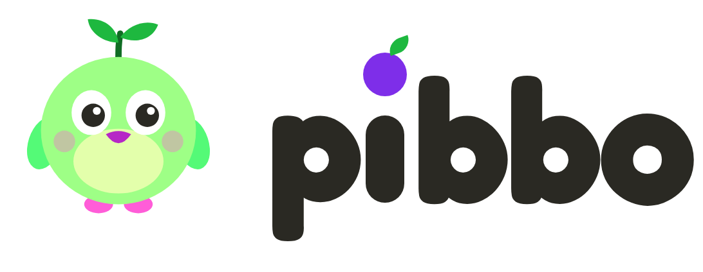

<p align="center">
  <picture>
    <source media="(prefers-color-scheme: dark)" srcset="docs/brand/pibbo-logo-dark.png">
    
  </picture>
</p>

# Pibbo

[](LICENSE)


Pibbo helps young children learn to count and to sound out words. A child opens it on whatever
screen is to hand, picks an activity, and plays: counting the things in front of them, and
saying each sound of a word and blending the sounds into the word.

It is a responsive web application with an Angular frontend and no backend. It collects nothing
about a child.

## Contents

- [Features](#features)
- [Non-goals](#non-goals)
- [Architecture](#architecture)
- [Getting started](#getting-started)
- [Build and test](#build-and-test)
- [Repository structure](#repository-structure)
- [Documentation](#documentation)
- [Project status](#project-status)
- [Contributing](#contributing)
- [Code of conduct](#code-of-conduct)
- [Security](#security)
- [Support](#support)
- [License](#license)

## Features

Pibbo answers one question: does this help a child count, or sound out a word? It has two
activities and a way to choose between them.

| Screen | What it does |
|---|---|
| **Home** | The child chooses an activity. Each choice is a picture, spoken when touched. Nothing needs reading. |
| **Count** | Things appear, the child touches each one, and Pibbo says the number as it is touched. Then the child says how many there are by choosing the numeral. |
| **Sound Out** | A short word appears with its picture. The child touches each letter to hear its sound, then blends the sounds to hear the word: "c", "a", "t", "cat". |

Key behaviours:

- **A child who cannot read can use all of it.** Every instruction is spoken and shown by a
  picture or by motion.
- **A letter makes its sound, not its name.** The letter m says "mmm", never "em", from a
  recording of that sound alone.
- **Counting is one touch, one number.** Each thing is counted once.
- **A wrong answer is a chance to try again.** There is no timer, no lives and no losing.
- **Made for small hands.** Few, large things to touch, a tap and nothing harder, and one thing
  asked at a time.
- **Every width.** Every screen works from a narrow phone to a large display, upright and on
  its side, by touch, mouse, keyboard and screen reader, with the sound on or off, and honours
  reduced motion.

## Non-goals

Pibbo has no adverts, no purchases, no links that leave the app, no chat, no accounts for
children, no leaderboards or comparison between children, no streaks, no timers or countdowns,
no notifications, and nothing that tracks a child. It asks a child for nothing about
themselves.

## Architecture

```
Child ──▶ pibbo (screens) ──▶ domain (counting, sounds, rounds, storage)
               │                    │
     components (presentation)     api (contracts, types, tokens)
               │
     pictures and recordings, bundled and served with the app
```

| Project | Responsibility |
|---|---|
| `frontend/projects/api` (`@pibbo/api`) | Contracts, types and injection tokens |
| `frontend/projects/domain` (`@pibbo/domain`) | The rules of the activities: `counting/`, `sounds/`, `rounds/`, `storage/` |
| `frontend/projects/components` (`@pibbo/components`) | Presentation components, named as in the design system |
| `frontend/projects/pibbo` | The app: pages, dialogs and the composition root |

Design principles:

- **Nothing about a child is collected.** No analytics, no tracking, no third-party code. The
  browser calls only Pibbo's own origin, and fonts, pictures and recordings are self-hosted.
  The microphone and the camera are never used.
- **Content is fixed and reviewed.** Every word, picture and recording is in the repository.
  Nothing a child sees or hears is generated at run time, and no sound comes from the
  browser's speech engine.
- **One-way dependencies.** `pibbo` depends on the libraries and `api` depends on nothing.
  ESLint enforces the boundaries.
- **Lazy loading and memory come first.** Every route is lazy-loaded, an activity's code,
  pictures and recordings load when the child chooses it, and everything a screen acquires is
  released when the child leaves it.
- **A touch answers at once.** What a round needs is ready before the round is shown.

The full rules are in [`AGENTS.md`](AGENTS.md), and each decision that shapes the code is
recorded in `docs/adr/` as it is made.

## Getting started

The repository starts with its instructions and skills and no code. Once the Angular workspace
exists in `frontend/`, you will need [Node.js](https://nodejs.org) 22 or later with npm, and:

```shell
git clone https://github.com/QuinntyneBrown/pibbo.git
cd pibbo/frontend
npm ci
npm start    # http://localhost:4200
```

## Build and test

These commands are added with the workspace; the first change that needs one adds it.

| Task | Command |
|---|---|
| Everything below except the sweeps | `node tools/verify/verify.mjs` |
| Format and lint | `cd frontend && npm run format:check && npm run lint` |
| Unit tests | `cd frontend && npm test` |
| Production build | `cd frontend && npm run build` |
| Behaviour specs | `cd frontend && npx playwright install chromium && npm run e2e` |
| Visual, responsive and accessibility sweeps | `cd frontend && npm run e2e:visual`, `e2e:responsive`, `e2e:accessibility` |

Run `node tools/verify/verify.mjs` before you push. It runs every CI check and the unit tests.

No automated test uses a real clock, real randomness, real sound or a network beyond localhost.
Playwright specs run on Chromium with a set time and a set order, and check which recordings
were asked for. CI runs lint, the build and one critical acceptance path per feature in under
5 minutes. The sweeps run only on request.

## Repository structure

Folders appear as the work reaches them. Today the repository holds the first three lines below
and the files at its root.

```
pibbo/
├── .claude/skills/          The skills coding agents follow
├── .agents/skills/          The same skills, for other agents
├── .github/                 Issue and pull request templates
├── frontend/                The Angular workspace
│   ├── projects/              The libraries (api, domain, components) and the app (pibbo)
│   └── e2e/                   Playwright specs, fixtures, page objects and sweeps
├── docs/
│   ├── specs/               Requirements: L1 (high level) and L2 (acceptance criteria)
│   ├── mocks/               HTML mocks of every screen in every state; the source of truth for the UI
│   ├── design-system/       Tokens and components extracted from the mocks
│   ├── detailed-designs/    One design per feature, grouped by subsystem
│   ├── adr/                 Architecture decision records
│   ├── journeys.md          The journeys that build Pibbo, with their progress
│   ├── prompts/             One prompt per journey
│   └── lessons-learned.md   What each journey taught
└── tools/                   verify
```

## Documentation

| Document | Description |
|---|---|
| [AGENTS.md](AGENTS.md) | Pibbo's purpose and scope, its design rules, children's privacy and safety, the architecture rules and the required workflow |
| [CONTRIBUTING.md](CONTRIBUTING.md) | How a change is proposed and made |
| `docs/specs/` | What Pibbo must do (`L1.md`) and each behaviour with its acceptance criteria (`L2.md`); not written yet |
| `docs/mocks/` | Every screen in every state; not drawn yet |

## Project status

Pibbo is at its start. The repository holds its instructions and skills; there are no
requirements, no design and no code yet. These are still to be decided, each by a requirement
and a design before any code:

- which numbers Count covers, and in what order;
- which sounds and words Sound Out covers, and in what order;
- whether Pibbo remembers what a child has practised, and where;
- whether a grown-up has a screen of their own;
- which languages and accents Pibbo speaks;
- the brand: its name's wordmark, colours and type.

## Contributing

Contributions are welcome. Before you open a pull request, read
[`CONTRIBUTING.md`](CONTRIBUTING.md) for the workflow and [`AGENTS.md`](AGENTS.md) for the
architecture rules. In summary:

- A change must help a child count or sound out a word.
- Nothing may collect anything about a child, or load anything from a third party.
- Every change to product code needs a requirement, a detailed design and a mock before any
  code is written.
- Work in small slices, and write the failing acceptance test first.
- Keep the requirements, designs, mocks, tests and code consistent with each other.
- A change that grows the initial bundle or leaks memory is not done.

## Code of conduct

This project has adopted the [Contributor Covenant](CODE_OF_CONDUCT.md). By participating, you
are expected to uphold this code.

## Security

Do not report security vulnerabilities through public GitHub issues. See
[`SECURITY.md`](SECURITY.md) for how to report one privately.

## Support

See [`SUPPORT.md`](SUPPORT.md) for how to ask a question, report a bug or request a feature.

## License

Copyright (c) 2026 Quinntyne Brown. Licensed under the [MIT License](LICENSE).
