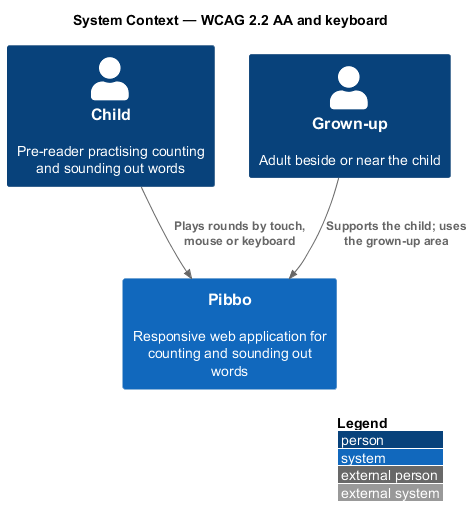
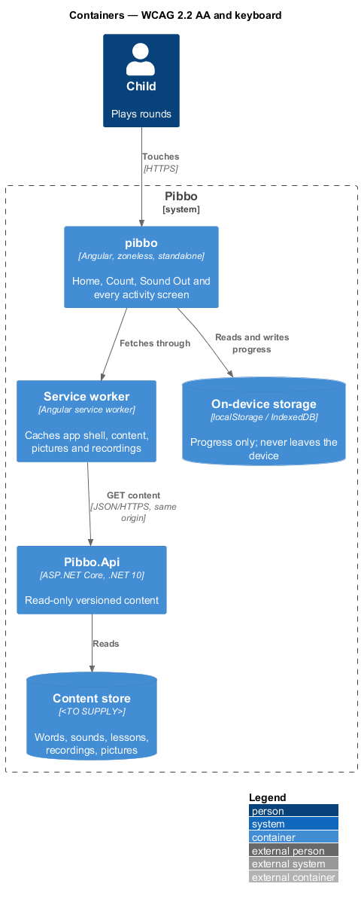
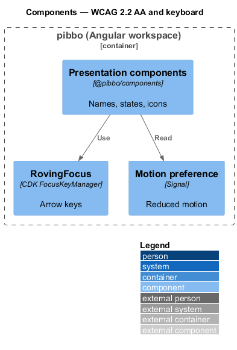
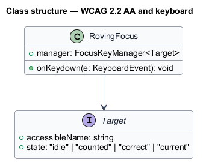
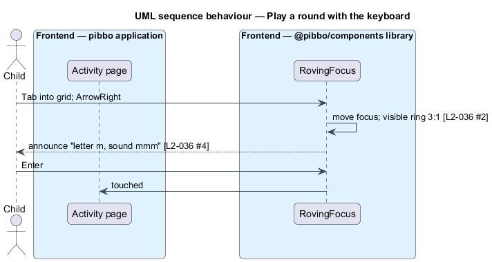

# WCAG 2.2 AA and keyboard

## Overview

Pibbo meets WCAG 2.2 AA. Every target is reachable by Tab or arrow keys in a logical order, focus is visible at 3:1 or more, and Enter or Space activates it. A screen reader announces each target's spoken name ("letter m, sound mmm"). Text contrast is at least 4.5:1, graphics 3:1, and every state shows a shape or icon as well as colour. Reduced motion removes every non-essential animation.

## Description

The feature is a vertical slice through the Angular workspace: the page in the `pibbo` application, presentation components in `@pibbo/components`, pure rules in `@pibbo/domain`, and the contracts and tokens in `@pibbo/api`.

- **`Tab order`** — every target is a native button in the order a child meets it (the way out and progress, the instruction, the game, the answer bar), so Tab, Enter and Space play every round; CDK roving focus is not used, since it would grow the initial bundle (ADRs 0029, 0030).
- **`Accessible names`** — each target is named by its own text or an `aria-label` built from content (for example "letter m, sound mmm").
- **`keyboard.spec.ts`** — every activity, the check game and the gate played from the keyboard on a desktop, each target reached in order with its focus outline and a name.
- **`State icons`** — counted, correct and current states carry an icon and an ARIA attribute (`aria-pressed`, `aria-current`).
- **`Reduced motion`** — a `prefers-reduced-motion` media query in each stylesheet that animates removes every animation that is not the answer itself.
- **`axe sweep`** — `accessibility.sweep.ts`, run on request (`npm run sweep:a11y`): every screen, light and dark, with and without reduced motion, with no serious or critical violation; `heap.sweep.ts` and `visual.sweep.ts` sit beside it.

## Requirements

The feature realises the following level-2 (L2) requirements. Each L2 requirement refines a level-1 (L1) requirement, cited by identifier.

| L2 ID | Refines (L1) | Requirement |
|-------|--------------|-------------|
| `L2-036` | `L1-029` | WCAG 2.2 AA and keyboard |

Acceptance criteria of `L2-036` (WCAG 2.2 AA and keyboard):

1. Given every screen in every state, when scanned with axe-core, then there are no serious or critical violations.
2. Given a desktop with keyboard only, when navigating, then every target is reachable in a logical order with Tab or arrow keys, focus is visible at 3:1 contrast or more, and Enter or Space activates it.
3. Given text and essential graphics, when measured, then text contrast is at least 4.5:1 and graphics at least 3:1.
4. Given a screen reader, when a target is focused, then it announces its spoken name (for example "letter m, sound mmm").
5. Given prefers-reduced-motion, when set, then every non-essential animation is removed and every activity can still be completed.
6. Given any state (counted, correct, current), when shown, then a shape or icon shows it as well as colour.

## Diagrams

### System context

The child uses Pibbo directly; a grown-up is beside or nearby and is not needed to make the feature work. No third-party system takes part.

### Containers

The feature runs in the `pibbo` single-page application. Content arrives from `Pibbo.Api` through the service worker cache; nothing a child does is sent back.

### Components

Accessibility lives in each presentation component; `RovingFocus` is shared.

### Class structure

One small contract per target makes names and states uniform.

### Play a round with the keyboard

Arrow keys move focus, Enter or Space touches, and the screen reader hears the spoken name.

