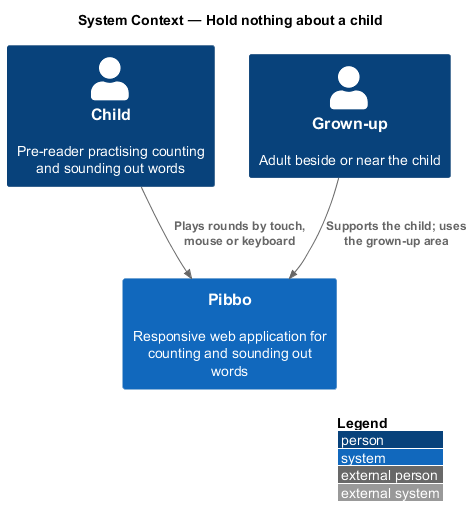
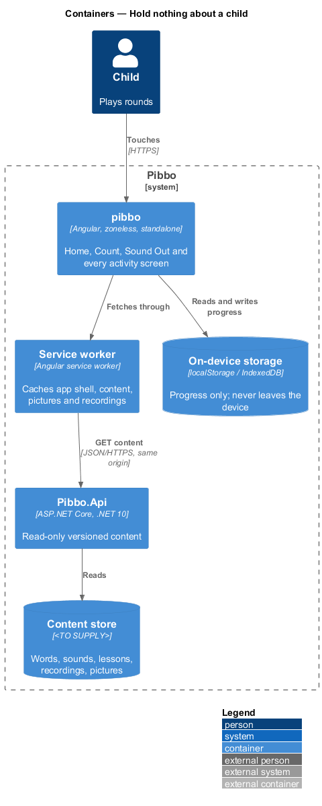
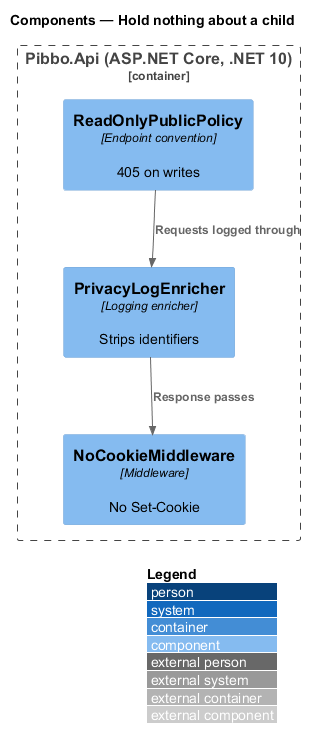
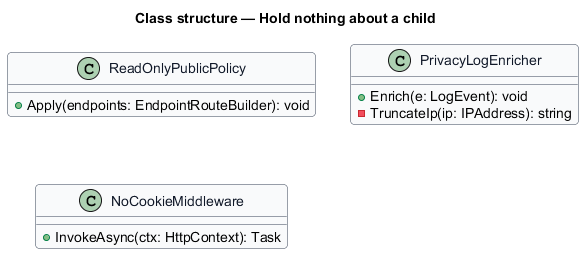
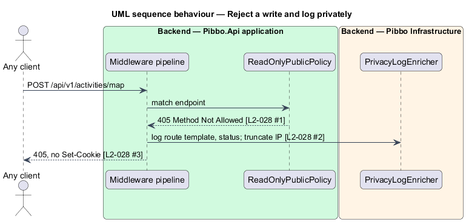

# Hold nothing about a child

## Overview

The backend serves content only. Public endpoints accept GET and HEAD and answer 405 to writes; only the authenticated admin endpoints accept writes. Logs omit or truncate the client IP and store no query string, cookie or device identifier. No public response sets a cookie. An ADR in `docs/adr/` records this scope.

## Description

The feature is a vertical slice through the backend: `Pibbo.Api` (controllers and middleware), `Pibbo.Application` (MediatR handlers), `Pibbo.Domain` and `Pibbo.Infrastructure`, with the Angular client generated from its OpenAPI document. The backend exists only once the ADR required by `L2-028` is accepted.

- **`ReadOnlyPublicPolicy`** — endpoint convention rejecting POST, PUT, PATCH and DELETE outside `/api/v1/admin` with 405.
- **`PrivacyLogEnricher`** — Serilog / OpenTelemetry enricher that drops query strings, cookies and device identifiers and truncates IPs.
- **`NoCookieMiddleware`** — removes any `Set-Cookie` header from public responses.
- **`ADR`** — `docs/adr/` decision record for the content-only backend (`<TO SUPPLY>`, not yet written).

## Requirements

The feature realises the following level-2 (L2) requirements. Each L2 requirement refines a level-1 (L1) requirement, cited by identifier.

| L2 ID | Refines (L1) | Requirement |
|-------|--------------|-------------|
| `L2-028` | `L1-024` | Backend holds nothing about a child |

Acceptance criteria of `L2-028` (Backend holds nothing about a child):

1. Given every public endpoint, when called with POST, PUT, PATCH or DELETE, then 405 is returned; only the authenticated admin endpoints (L2-031) accept writes.
2. Given any request, when logged, then the client IP is omitted or truncated, and no query string, cookie or device identifier is stored.
3. Given any public response, when inspected, then it has no Set-Cookie header.
4. Given the backend is added, when reviewed, then an ADR in `docs/adr/` records that it serves content only and holds nothing about a child.

## Diagrams

### System context

The child uses Pibbo directly; a grown-up is beside or nearby and is not needed to make the feature work. No third-party system takes part.

### Containers

`Pibbo.Api` serves read-only content to the `pibbo` application on the same origin; it receives nothing about a child.

### Components

Every request passes the policy, the enricher and the cookie filter.

### Class structure

Three small cross-cutting parts, each with one rule.

### Reject a write and log privately

A write to a public endpoint answers 405 and the log line holds only the route template and a truncated IP.

