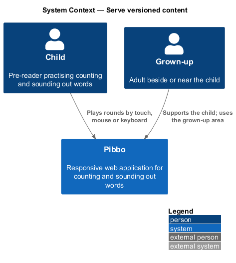
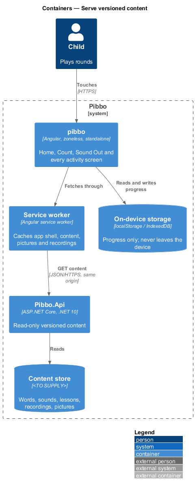
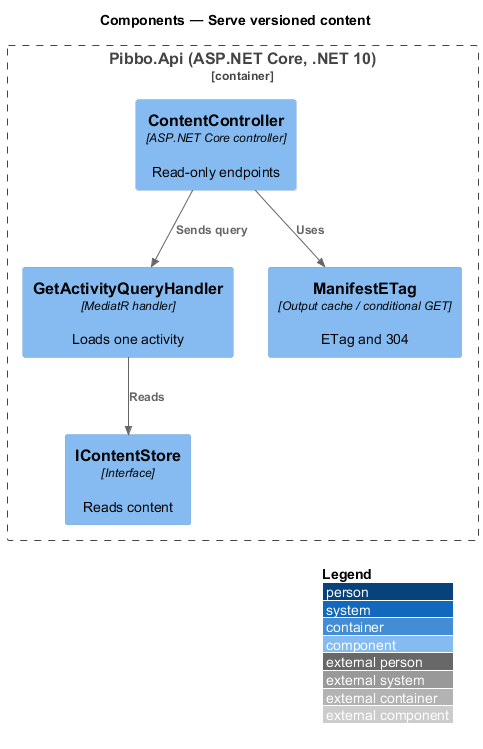
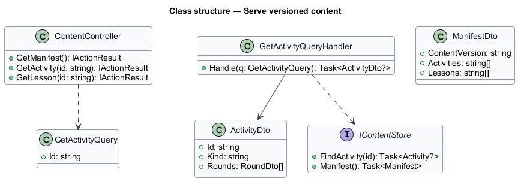
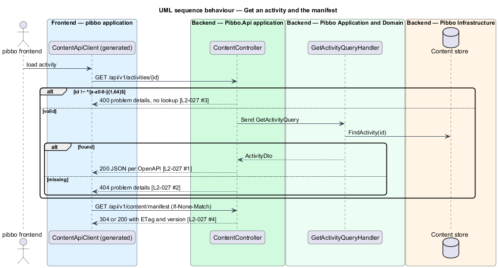

# Serve versioned content

## Overview

The content service is the read-only API that gives the frontend its activity content: words, letters, sounds, pictures, recordings and lessons. Content is versioned; the *manifest* lists what exists and carries a content version and an ETag so a client can skip unchanged downloads.

- **manifest** — index of all activities, lessons and asset paths for one content version

## Description

The feature is a vertical slice through the backend: `Pibbo.Api` (controllers and middleware), `Pibbo.Application` (MediatR handlers), `Pibbo.Domain` and `Pibbo.Infrastructure`, with the Angular client generated from its OpenAPI document. The backend exists only once the ADR required by `L2-028` is accepted.

- **`ContentController`** — ASP.NET Core controller exposing `GET /api/v1/content/manifest`, `GET /api/v1/activities/{id}`, `GET /api/v1/lessons/{id}`. It validates the id route constraint and sends one MediatR request.
- **`GetManifestQuery / GetActivityQuery / GetLessonQuery`** — MediatR requests with handlers in `Pibbo.Application`.
- **`IContentStore`** — abstraction over the content store; the store's technology is `<TO SUPPLY>`.
- **`OpenAPI document`** — published schema; the Angular client types in `@pibbo/api` are generated from it and the build fails on drift.

## Requirements

The feature realises the following level-2 (L2) requirements. Each L2 requirement refines a level-1 (L1) requirement, cited by identifier.

| L2 ID | Refines (L1) | Requirement |
|-------|--------------|-------------|
| `L2-027` | `L1-024` | Content API. An ASP.NET Core (.NET 10 LTS) API serves read-only, versioned content: `GET /api/v1/content/manifest`, `GET /api/v1/activities/{id}`, `GET /api/v1/lessons/{id}`, plus static recordings and pictures. |

Acceptance criteria of `L2-027` (Content API):

1. Given a valid activity id, when `GET /api/v1/activities/{id}` is called, then 200 is returned with JSON matching the published OpenAPI schema.
2. Given an unknown id, when called, then 404 with an RFC 9457 problem-details body is returned.
3. Given an id not matching `^[a-z0-9-]{1,64}$`, when called, then 400 problem details is returned and no lookup is made.
4. Given the manifest, when returned, then it carries a content version and an ETag; a request with a matching If-None-Match gets 304.
5. Given the OpenAPI document, when the build runs, then the Angular client types are generated from it and the build fails if they drift.

## Diagrams

### System context

The child uses Pibbo directly; a grown-up is beside or nearby and is not needed to make the feature work. No third-party system takes part.

### Containers

`Pibbo.Api` serves read-only content to the `pibbo` application on the same origin; it receives nothing about a child.

### Components

`ContentController` validates input and dispatches one query per endpoint; handlers read through `IContentStore`.

### Class structure

Ids are validated before any lookup; misses become RFC 9457 problem details.

### Get an activity and the manifest

Invalid ids return 400 without a lookup; unknown ids 404; the manifest answers 304 to a matching If-None-Match.

