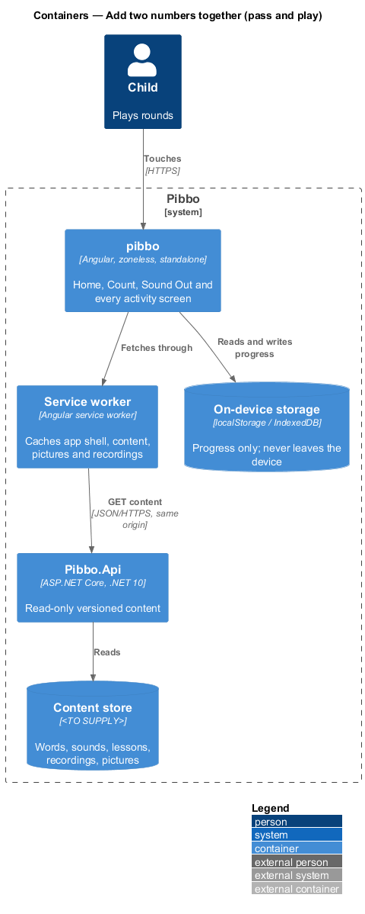
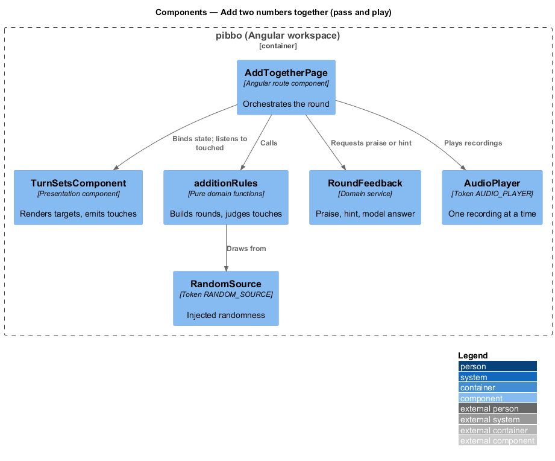
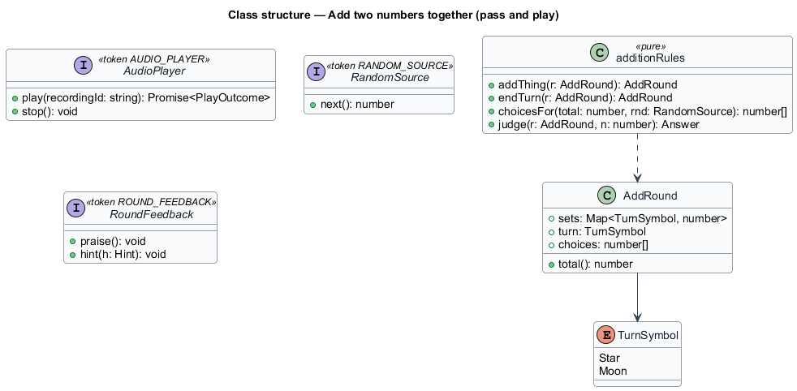

# Add two numbers together (pass and play)

## Overview

Two players share one device. In turn each adds a set of 1 to 5 things by touching, then Pibbo asks how many there are altogether (2 to 10). Each turn is shown by a symbol and colour — a star, a moon — never by a name. No names, avatars, scores, winners or losers exist.

- **turn symbol** — star or moon marking whose turn it is, shown by shape as well as colour

## Description

The feature is a vertical slice through the Angular workspace: the page in the `pibbo` application, presentation components in `@pibbo/components`, pure rules in `@pibbo/domain`, and the contracts and tokens in `@pibbo/api`.

- **`AddTogether`** — route component in `pibbo` (selector `pb-add-together`, route `/count/add`), loaded by `loadComponent` when the child chooses the activity. It holds the round in a signal, asks the rules for each touch, plays recordings through `AUDIO_PLAYER` and hands state to the presentation component.
- **`TurnSets`** — presentation component in `@pibbo/components` (selector `pb-turn-sets`): the two players with their turn symbol, + and − and their ducks, the sum, and the three numeral choices. It takes the round's sets, whose turn it is, the choices, the numeral picked and whether it is locked as signal inputs, emits `added`, `took` and `picked`, and injects no service.
- **`AddRound`** — immutable round state in `@pibbo/domain/counting` (`turn`, `choosing`, `retry`, `done`); every transition returns a new value.
- **Addition rules** — pure functions in `@pibbo/domain/counting` with unit tests: `startAddRound`, `addThing` and `takeThing` (only for the player whose turn it is, 0 to 5), `passTurn` (star to moon, then the choices from the injected `RandomSource`), `pickTotal`, `checkTotal` and `chooseAgain`.
- **`AudioPlayer`** — contract in `@pibbo/api` bound to `AUDIO_PLAYER`. Playing a recording stops the one before it; a recording that cannot play resolves as `unavailable`, and what it says is already shown.
- **Retry and praise** — a wrong total counts every duck aloud from 1 and shows "Count all the ducks together, one by one." with Try again; a right one says and shows "3 and 4 make 7! Great teamwork.", brief praise that never blocks Next (ADR 0013).
- **Nothing recorded** — the round holds two counts in memory and is discarded when the round ends; no name, avatar, score, winner or loser exists.

## Requirements

The feature realises the following level-2 (L2) requirements. Each L2 requirement refines a level-1 (L1) requirement, cited by identifier.

| L2 ID | Refines (L1) | Requirement |
|-------|--------------|-------------|
| `L2-008` | `L1-006` | Add two numbers together (pass and play). Two players share one device. Each player in turn adds a set of 1-5 things by touching + (and − to take one away), and touches Done to pass the turn; Pibbo then asks for the total (2-10), the players choose a numeral and touch Check. No names, avatars or scores are recorded. |

Acceptance criteria of `L2-008` (Add two numbers together (pass and play)):

1. Given a new round, when it starts, then each player's turn is shown and spoken by a symbol and colour (a star, a moon), never by a name, and only the player whose turn it is can add.
2. Given player 1 added 3 and player 2 added 4, when both sets are shown, then "how many altogether?" is spoken and 7 is among 3-5 numeral choices.
3. Given the total is 7, when 6 is chosen and checked, then all things are counted aloud from 1 to 7, "Count all the ducks together, one by one." is shown, and after Try again the players choose again.
4. Given the round ends, when it completes, then no winner, loser or score is shown.

## Diagrams

### System context

The child uses Pibbo directly; a grown-up is beside or nearby and is not needed to make the feature work. No third-party system takes part.

### Containers

The feature runs in the `pibbo` single-page application. Content arrives from `Pibbo.Api` through the service worker cache; nothing a child does is sent back.

### Components

`AddTogether` composes `TurnSets` for presentation and calls the addition rules for every decision. The page is the only part that injects tokens; the rules hold no Angular dependency.

### Class structure

`AddRound` is the value the rules transform; `AddTogether` holds it in a signal and passes it to `TurnSets`. The diagrams predate ADR 0013 and still draw the earlier names.

### Take turns and find the total

Both turns add things and end with Done; the total question offers three numerals; a wrong total counts all things aloud from 1.

