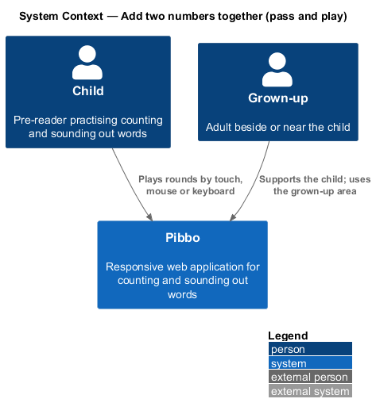
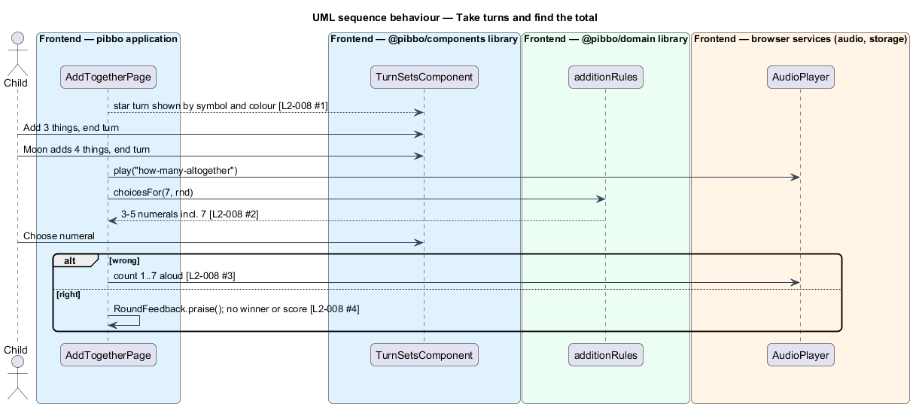

# Add two numbers together (pass and play)

## Overview

Two players share one device. In turn each adds a set of 1 to 5 things by touching, then Pibbo asks how many there are altogether (2 to 10). Each turn is shown by a symbol and colour — a star, a moon — never by a name. No names, avatars, scores, winners or losers exist.

- **turn symbol** — star or moon marking whose turn it is, shown by shape as well as colour

## Description

The feature is a vertical slice through the Angular workspace: the page in the `pibbo` application, presentation components in `@pibbo/components`, pure rules in `@pibbo/domain`, and the contracts and tokens in `@pibbo/api`.

- **`AddTogetherPage`** — route component in `pibbo`, loaded by `loadComponent` when the child chooses the activity. It is provided with its own `additionRules` state at route scope, asks the rules for each round, plays recordings through `AUDIO_PLAYER` and hands state to the presentation component.
- **`TurnSetsComponent`** — presentation component in `@pibbo/components` (selector `pb-turnsets`). It takes the round state as signal inputs, emits a `touched` output per target, and injects no service.
- **`AddRound`** — immutable round state in `@pibbo/domain/counting`; every transition returns a new value.
- **`additionRules`** — pure functions in `@pibbo/domain/counting` that build a round from the injected `RandomSource` and decide the outcome of each touch, with unit tests.
- **`AudioPlayer`** — contract in `@pibbo/api` bound to `AUDIO_PLAYER`. Playing a recording stops the one before it; a recording that cannot play resolves as `unavailable` and the screen shows the text instead.
- **`RoundFeedback`** — shared round behaviour (`retry-and-praise`): brief praise, hints after a wrong answer, and modelling the answer after three wrong answers.
- **`Nothing recorded`** — the round holds turn symbols and counts only, in memory, and is discarded when the round ends.

## Requirements

The feature realises the following level-2 (L2) requirements. Each L2 requirement refines a level-1 (L1) requirement, cited by identifier.

| L2 ID | Refines (L1) | Requirement |
|-------|--------------|-------------|
| `L2-008` | `L1-006` | Add two numbers together (pass and play). Two players share one device. Each player in turn adds a set of 1-5 things by touching; Pibbo then asks for the total (2-10). No names, avatars or scores are recorded. |

Acceptance criteria of `L2-008` (Add two numbers together (pass and play)):

1. Given a new round, when it starts, then each player's turn is shown by a symbol and colour (a star, a moon), never by a name.
2. Given player 1 added 3 and player 2 added 4, when both sets are shown, then "how many altogether?" is spoken and 7 is among 3-5 numeral choices.
3. Given the total is 7, when 6 is chosen, then all things are counted aloud from 1 to 7 and the players choose again.
4. Given the round ends, when it completes, then no winner, loser or score is shown.

## Diagrams

### System context

The child uses Pibbo directly; a grown-up is beside or nearby and is not needed to make the feature work. No third-party system takes part.

### Containers

The feature runs in the `pibbo` single-page application. Content arrives from `Pibbo.Api` through the service worker cache; nothing a child does is sent back.

### Components

`AddTogetherPage` composes `TurnSetsComponent` for presentation and calls `additionRules` for every decision. The page is the only part that injects tokens; the rules hold no Angular dependency.

### Class structure

`AddRound` is the value the rules transform; `AddTogetherPage` holds it in a signal and passes it to `TurnSetsComponent`.

### Take turns and find the total

Both turns add things; the total question offers 3–5 numerals; a wrong total counts all things aloud from 1.

