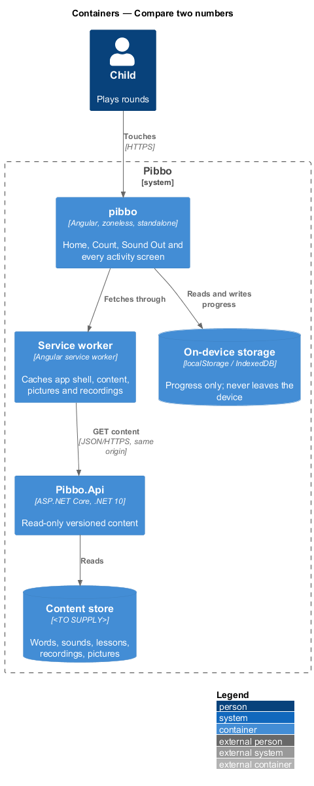
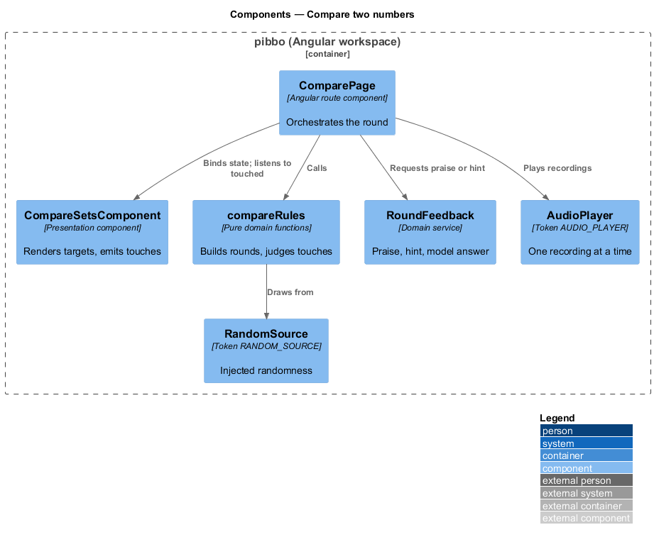
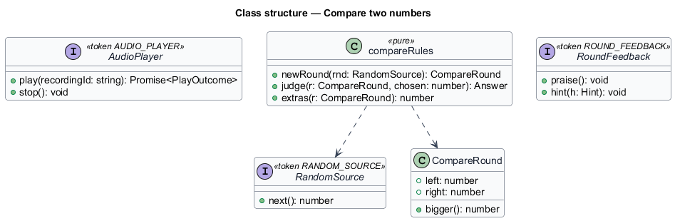
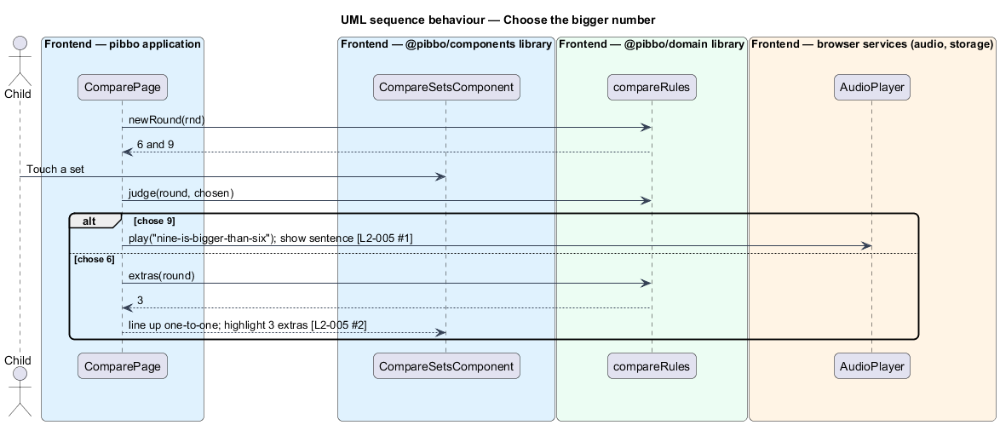

# Compare two numbers

## Overview

In this activity the child sees two different numbers from 0 to 20, each as a numeral and as a set of things, and touches the bigger one. A wrong choice lines the two sets up one-to-one so the extra things are visible.

## Description

The feature is a vertical slice through the Angular workspace: the page in the `pibbo` application, presentation components in `@pibbo/components`, pure rules in `@pibbo/domain`, and the contracts and tokens in `@pibbo/api`.

- **`ComparePage`** — route component in `pibbo`, loaded by `loadComponent` when the child chooses the activity. It is provided with its own `compareRules` state at route scope, asks the rules for each round, plays recordings through `AUDIO_PLAYER` and hands state to the presentation component.
- **`CompareSetsComponent`** — presentation component in `@pibbo/components` (selector `pb-comparesets`). It takes the round state as signal inputs, emits a `touched` output per target, and injects no service.
- **`CompareRound`** — immutable round state in `@pibbo/domain/counting`; every transition returns a new value.
- **`compareRules`** — pure functions in `@pibbo/domain/counting` that build a round from the injected `RandomSource` and decide the outcome of each touch, with unit tests.
- **`AudioPlayer`** — contract in `@pibbo/api` bound to `AUDIO_PLAYER`. Playing a recording stops the one before it; a recording that cannot play resolves as `unavailable` and the screen shows the text instead.
- **`RoundFeedback`** — shared round behaviour (`retry-and-praise`): brief praise, hints after a wrong answer, and modelling the answer after three wrong answers.
- **`CompareRound generation`** — `compareRules.newRound` never returns equal numbers and places the bigger number on the left in 40–60% of rounds (`L2-005` #3).

## Requirements

The feature realises the following level-2 (L2) requirements. Each L2 requirement refines a level-1 (L1) requirement, cited by identifier.

| L2 ID | Refines (L1) | Requirement |
|-------|--------------|-------------|
| `L2-005` | `L1-003` | Compare two numbers. Two different numbers from 0 to 20, each shown as a numeral and as a set of things. |

Acceptance criteria of `L2-005` (Compare two numbers):

1. Given 6 and 9 are shown, when the child touches 9, then "nine is bigger than six" is spoken and shown, and praise plays.
2. Given 6 and 9 are shown, when the child touches 6, then the sets are lined up one-to-one, the 3 extra things in the set of 9 are highlighted, and the child chooses again.
3. Given 100 generated rounds, when sampled, then no round has equal numbers and the bigger number is on the left in 40-60% of rounds.

## Diagrams

### System context

The child uses Pibbo directly; a grown-up is beside or nearby and is not needed to make the feature work. No third-party system takes part.

### Containers

The feature runs in the `pibbo` single-page application. Content arrives from `Pibbo.Api` through the service worker cache; nothing a child does is sent back.

### Components

`ComparePage` composes `CompareSetsComponent` for presentation and calls `compareRules` for every decision. The page is the only part that injects tokens; the rules hold no Angular dependency.

### Class structure

`CompareRound` is the value the rules transform; `ComparePage` holds it in a signal and passes it to `CompareSetsComponent`.

### Choose the bigger number

A right choice speaks and shows the comparison sentence; a wrong choice lines the sets up and highlights the extra things.

