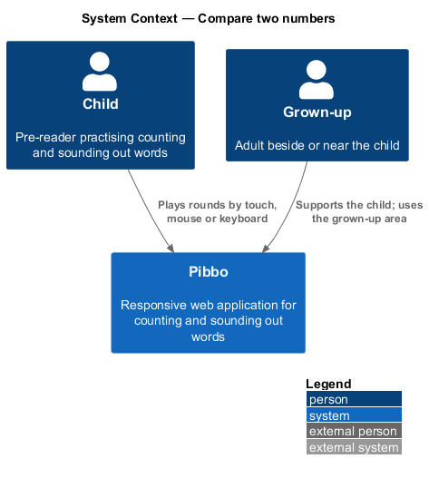

# Compare two numbers

## Overview

In this activity the child sees two different numbers from 0 to 20, each as a numeral and as a set of things, and touches the bigger one. A wrong choice lines the two sets up one-to-one so the extra things are visible.

## Description

The feature is a vertical slice through the Angular workspace: the page in the `pibbo` application, presentation components in `@pibbo/components`, pure rules in `@pibbo/domain`, and the contracts and tokens in `@pibbo/api`.

- **`WhichIsBigger`** — route component in `pibbo` (selector `pb-which-is-bigger`, route `/count/compare`), loaded by `loadComponent` when the child chooses the activity. It holds the round in a signal, asks the rules for each step, plays recordings through `AUDIO_PLAYER` and hands state to the presentation component (ADR 0010).
- **`Compare`** — presentation component in `@pibbo/components` (selector `pb-compare`, the `.compare` block of the mock): two cards, each a numeral over one or two ten-frames of dots. It takes the numbers, the chosen card, the won card, the extra dots and whether it is locked as signal inputs, emits `chose` with the card's index, and injects no service.
- **`CompareRound`** — immutable round state in `@pibbo/domain/counting` (`choosing`, `retry`, `right`); every transition returns a new value.
- **Compare rules** — pure functions in `@pibbo/domain/counting` with unit tests: `startCompareRound` builds a round from the injected `RandomSource`, `chooseCard` chooses a card, `checkChoice` decides the outcome of Check, `tryAgain` returns to choosing and `extraDots` names the dots of the bigger set beyond the smaller number.
- **`AudioPlayer`** — contract in `@pibbo/api` bound to `AUDIO_PLAYER`. Playing a recording stops the one before it; a recording that cannot play resolves as `unavailable`, and what it says is already shown.
- **Retry and praise** — a wrong choice speaks and shows "Look at the dots. Which has more?" with Try again; a right one speaks the comparison, then brief praise that never blocks Next. There is no modelled answer: with two cards, every wrong choice already shows the answer by its extra dots (ADR 0010).
- **Round generation** — `startCompareRound` never returns equal numbers and places the bigger number on the left in 40–60% of rounds (`L2-005` #3).

## Requirements

The feature realises the following level-2 (L2) requirements. Each L2 requirement refines a level-1 (L1) requirement, cited by identifier.

| L2 ID | Refines (L1) | Requirement |
|-------|--------------|-------------|
| `L2-005` | `L1-003` | Compare two numbers. Two different numbers from 0 to 20, each shown as a numeral and as a set of things. |

Acceptance criteria of `L2-005` (Compare two numbers):

1. Given 6 and 9 are shown, when the child touches 9 and then Check, then "nine is bigger than six" is spoken and shown, and praise plays.
2. Given 6 and 9 are shown, when the child touches 6 and then Check, then the sets stay lined up one-to-one in their ten-frames, the 3 extra dots in the set of 9 are highlighted (by shape as well as colour), "Look at the dots. Which has more?" is spoken and shown, and after Try again the child chooses again.
3. Given 100 generated rounds, when sampled, then no round has equal numbers and the bigger number is on the left in 40-60% of rounds.
4. Given a card is touched, when it is touched, then its number is spoken and the card is shown as chosen; touching the other card chooses it instead.

## Diagrams

### System context

The child uses Pibbo directly; a grown-up is beside or nearby and is not needed to make the feature work. No third-party system takes part.

### Containers

The feature runs in the `pibbo` single-page application. Content arrives from `Pibbo.Api` through the service worker cache; nothing a child does is sent back.

### Components

`WhichIsBigger` composes `Compare` for presentation and calls the compare rules for every decision. The page is the only part that injects tokens; the rules hold no Angular dependency.

### Class structure

`CompareRound` is the value the rules transform; `WhichIsBigger` holds it in a signal and passes it to `Compare`. (The diagrams still draw the earlier names `ComparePage`, `CompareSetsComponent` and `compareRules`; ADR 0010 maps them.)

### Choose the bigger number

A right choice, confirmed by Check, speaks and shows the comparison sentence; a wrong one highlights the extra dots in the lined-up ten-frames.

