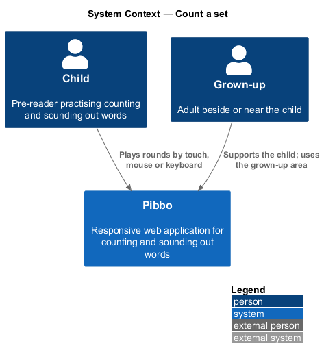
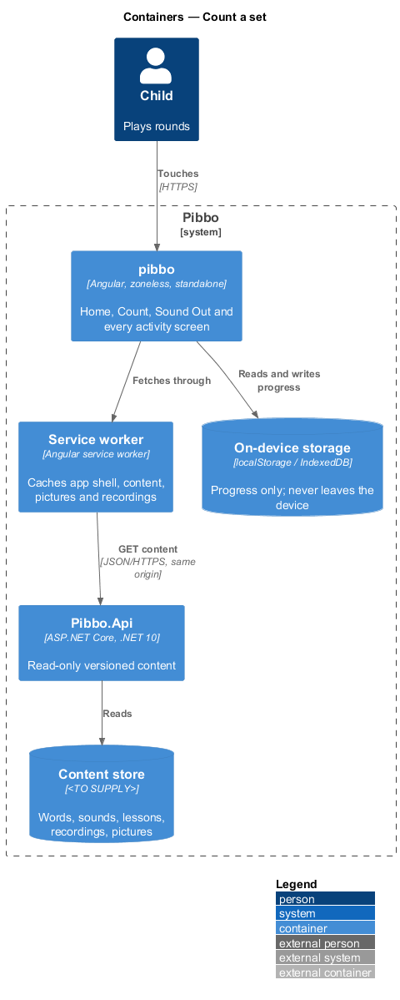
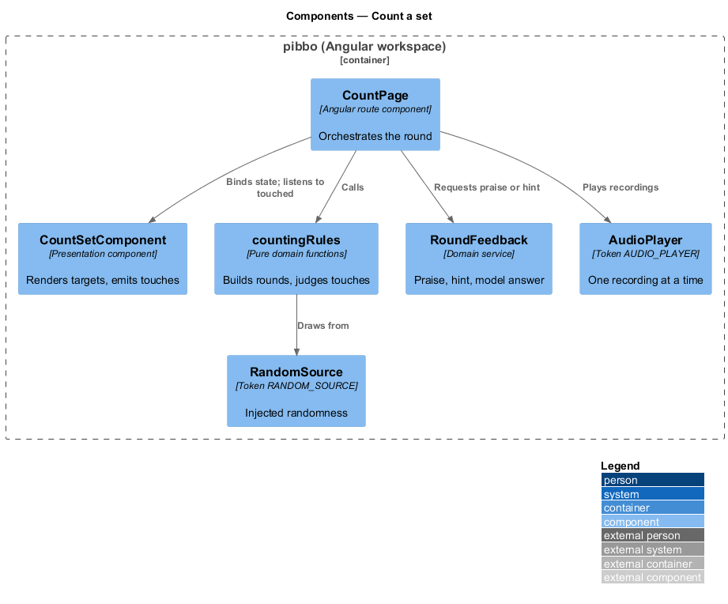
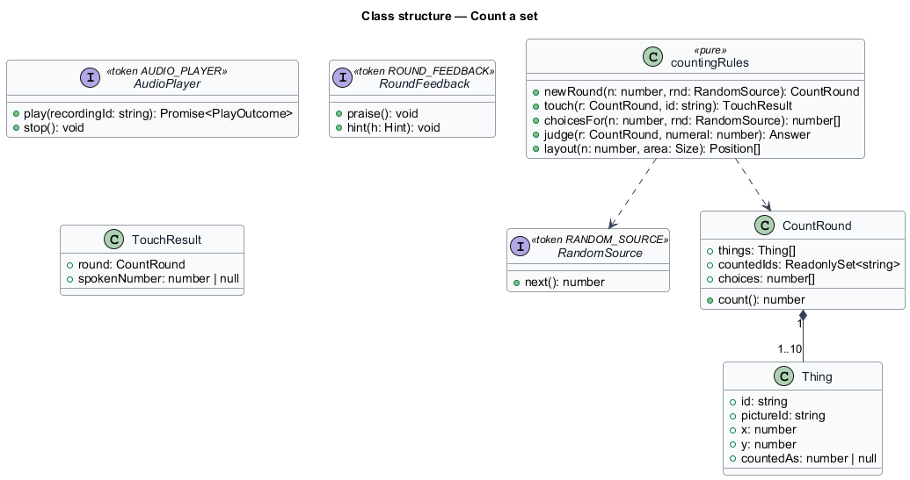
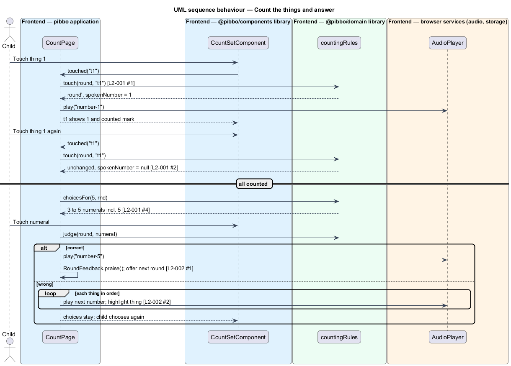

# Count a set

## Overview

Count is the counting activity. In one *round* the child sees between 1 and 10 *things*, touches each one, and hears the next number for each touch. When every thing is counted the child chooses the *numeral* for how many there are.

- **counted thing** — thing already touched in this round; it shows its number and a counted mark by shape and colour
- **numeral choice** — touch target showing one numeral, offered once the count completes

One touch counts one thing. A second touch on a counted thing changes nothing. A wrong numeral takes nothing away: Pibbo re-counts aloud and the child chooses again.

## Description

The feature is a vertical slice through the Angular workspace: the page in the `pibbo` application, presentation components in `@pibbo/components`, pure rules in `@pibbo/domain`, and the contracts and tokens in `@pibbo/api`.

- **`CountTheToys`** — route component in `pibbo` at `/count/toys`, loaded by `loadComponent` when the child chooses the activity. It holds the `CountRound` in a signal, asks the rules for each transition, plays recordings through `AUDIO_PLAYER` and hands state to the presentation components.
- **`CountSet`** — presentation component in `@pibbo/components` (selector `pb-count-set`, block `.rug`). It takes the things, the counted numbers and the lit thing as signal inputs, emits a `touched` output per target, and injects no service.
- **`NumeralChoices`** — presentation component (`pb-numeral-choices`, block `.tally`): the counted tally, then the numeral choices, the chosen one `aria-pressed`, the modelled one `numeral--answer`.
- **`CountRound`** — immutable round state in `@pibbo/domain/counting`; every transition returns a new value.
- **`countingRules`** — pure functions in `@pibbo/domain/counting` that build a round from the injected `RandomSource` and decide the outcome of each touch, with unit tests.
- **`AudioPlayer`** — contract in `@pibbo/api` bound to `AUDIO_PLAYER`. Playing a recording stops the one before it; a recording that cannot play resolves as `unavailable` and the screen shows the text instead.
- **`RoundFeedback`** — shared round behaviour (`retry-and-praise`): brief praise, hints after a wrong answer, and modelling the answer after three wrong answers.
- **`layout`** — placement: each thing takes its own cell of a 4 × 3 grid on the rug, chosen by the random source, so no two overlap and each target is at least 60 × 60 px (`L2-002` #3). Which numbers a round covers is not decided (`<TO SUPPLY>`); `COUNT_THE_TOYS.numbers` holds the cast.

## Requirements

The feature realises the following level-2 (L2) requirements. Each L2 requirement refines a level-1 (L1) requirement, cited by identifier.

| L2 ID | Refines (L1) | Requirement |
|-------|--------------|-------------|
| `L2-001` | `L1-001` | One touch, one number. A Count round shows N things (1-10). Touching an uncounted thing speaks and shows the next number and marks the thing counted; touching a counted thing does not change the count. |
| `L2-002` | `L1-001` | Answer how many |

Acceptance criteria of `L2-001` (One touch, one number):

1. Given a round with 5 toys and none counted, when the child touches toy 1, then "one" is spoken, the numeral 1 is shown on that toy, and the toy is marked counted by shape and colour, not colour alone.
2. Given toys 1-3 counted, when the child touches a counted toy again, then the count stays at 3 and no number is spoken.
3. Given two fingers touch two different uncounted toys at the same instant, when the touches are processed, then each toy is counted once and the count rises by exactly 2.
4. Given all 5 toys counted, when the count completes, then 3 to 5 numeral choices including 5 are offered, each at least 60 x 60 px.

Acceptance criteria of `L2-002` (Answer how many):

1. Given all toys counted and numerals offered, when the child chooses the correct numeral, then its number is spoken, brief praise plays, and the next round is offered.
2. Given the same state, when the child chooses a wrong numeral, then nothing is taken away, Pibbo re-counts the toys aloud highlighting each in turn, and the child chooses again.
3. Given a round is generated, when it is laid out, then no two things overlap and each is a separate target of at least 60 x 60 px.

## Diagrams

### System context

The child uses Pibbo directly; a grown-up is beside or nearby and is not needed to make the feature work. No third-party system takes part.

### Containers

The feature runs in the `pibbo` single-page application. Content arrives from `Pibbo.Api` through the service worker cache; nothing a child does is sent back.

### Components

`CountPage` composes `CountSetComponent` for presentation and calls `countingRules` for every decision. The page is the only part that injects tokens; the rules hold no Angular dependency.

### Class structure

`CountRound` is the value the rules transform; `CountPage` holds it in a signal and passes it to `CountSetComponent`.

### Count the things and answer

Each touch on an uncounted thing speaks the next number; a counted thing ignores further touches. Simultaneous touches on two things count each once, because touches are processed one at a time in the order received.

## Decisions (journey 3)

- The mock was reconciled first (ADR 0007): a wrong answer keeps every stamp; Pibbo counts again aloud, lighting each toy in turn, and the child chooses again. The third wrong answer is modelled (`modelled` state).
- The child chooses a numeral (its number is spoken) and touches Check, as the mock draws; `L2-002` #1 and #2 say so.
- `CountRound` is a pure state machine in `@pibbo/domain/counting` (`startRound`, `touchThing`, `chooseNumeral`, `checkAnswer`, `recountDone`). Touches are processed one at a time, so two fingers on two toys count each once.
- The choices are three consecutive numbers containing the answer (`numeralChoices`).
- Five rounds make a play, as the progress bar draws; after the fifth, Next returns to Home with Count chosen.
- When the count completes, "How many toys are there?" is spoken after the last number ends, never over it.
- Sound stops when the tab is hidden and nothing resumes on return.
- The design's `RoundFeedback` service was not needed: `answerOutcome` in `@pibbo/domain/rounds` and the page's praise timer cover it.

## Open questions

- Which numbers Count covers and in what order (`COUNT_THE_TOYS.numbers` is the cast: 5 and 7).
- The recordings of the numbers and of Pibbo's lines are placeholder silences; a person must record them.
- On a muted device the re-count lights the toys only as fast as the recordings fail, which is at once; a paced re-count needs a design decision.
- A phone on its side is not yet laid out to avoid scrolling; the rug shrinks with the viewport height but the stage stacks.
