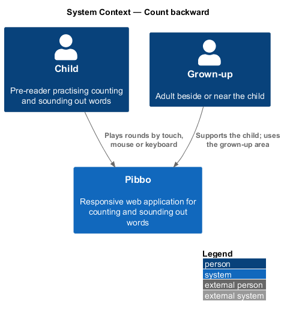

# Count backward

## Overview

In this activity a start number from 5 to 20 is spoken and shown, and the child chooses each next number down from three numerals until reaching 0. A *track* shows the numbers said so far, and a rocket rises one notch for each and blasts off at 0 (ADR 0011).

- **track** — row of the numbers said so far, the current one marked; it is shown, not touched

## Description

The feature is a vertical slice through the Angular workspace: the page in the `pibbo` application, presentation components in `@pibbo/components`, pure rules in `@pibbo/domain`, and the contracts and tokens in `@pibbo/api`.

- **`RocketCountdown`** — route component in `pibbo` (selector `pb-rocket-countdown`, route `/count/countdown`), loaded by `loadComponent` when the child chooses the activity. It holds the round in a signal, asks the rules for each step, plays recordings through `AUDIO_PLAYER` and hands state to the presentation component (ADR 0011).
- **`Countdown`** — presentation component in `@pibbo/components` (selector `pb-countdown`, the `.countdown` block of the mock): the track, the three numeral choices and the rocket. It takes the start, the current number, the choices, whether the round is done and whether it is locked as signal inputs, emits `chose` with the number touched, and injects no service.
- **`CountdownRound`** — immutable round state in `@pibbo/domain/counting` (`counting`, `retry`, `done`); every transition returns a new value.
- **Countdown rules** — pure functions in `@pibbo/domain/counting` with unit tests: `startCountdownRound` draws the start and orders the choices from the injected `RandomSource`, `chooseNext` decides the outcome of a choice, `countAgain` returns to counting and `rocketNotch` places the rocket.
- **`AudioPlayer`** — contract in `@pibbo/api` bound to `AUDIO_PLAYER`. Playing a recording stops the one before it; a recording that cannot play resolves as `unavailable`, and what it says is already shown.
- **Retry and praise** — a wrong choice speaks and shows "Going down from 7… try again." with Try again; 0 speaks "zero" and "Blast off!", brief praise that never blocks Next. There is no modelled answer (ADR 0011).

## Requirements

The feature realises the following level-2 (L2) requirements. Each L2 requirement refines a level-1 (L1) requirement, cited by identifier.

| L2 ID | Refines (L1) | Requirement |
|-------|--------------|-------------|
| `L2-006` | `L1-004` | Count backward. A start number from 5 to 20 is shown; the child chooses each next number down from three numerals until reaching 0. |

Acceptance criteria of `L2-006` (Count backward):

1. Given start 10, when the round begins, then "ten" is spoken and shown as the start.
2. Given start 10, when the child chooses 9, 8 ... 0 in order, then each number is spoken as chosen and shown on the track, and praise plays at 0.
3. Given the current number is 7, when the child chooses 5, then nothing advances, "Going down from 7… try again." is spoken and shown, and after Try again the child continues from 7.

## Diagrams

### System context

The child uses Pibbo directly; a grown-up is beside or nearby and is not needed to make the feature work. No third-party system takes part.

### Containers

The feature runs in the `pibbo` single-page application. Content arrives from `Pibbo.Api` through the service worker cache; nothing a child does is sent back.

### Components

`RocketCountdown` composes `Countdown` for presentation and calls the countdown rules for every decision. The page is the only part that injects tokens; the rules hold no Angular dependency.

### Class structure

`CountdownRound` is the value the rules transform; `RocketCountdown` holds it in a signal and passes it to `Countdown`. (The diagrams still draw the earlier names `CountBackwardPage`, `NumberTrackComponent`, `BackwardRound` and `backwardRules`; ADR 0011 maps them.)

### Step down to zero

Only the next number down advances; any other choice says and shows the number to go down from, and waits for Try again.

