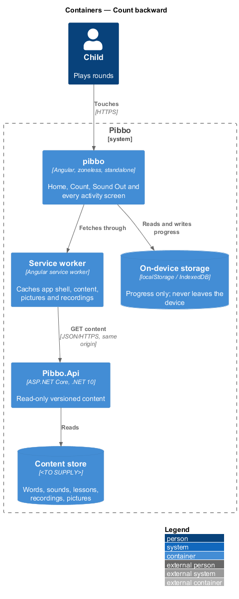
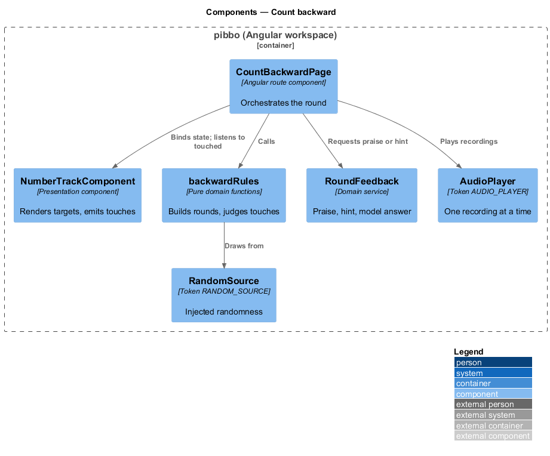
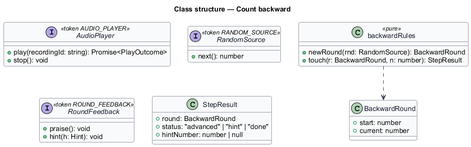
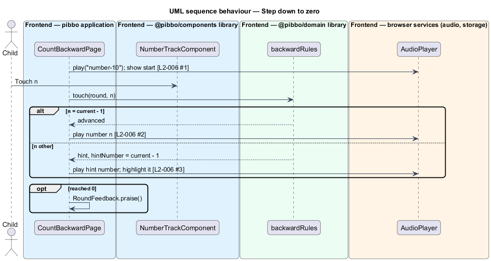

# Count backward

## Overview

In this activity a start number from 5 to 20 is spoken and shown, and the child touches each next number down on a *number track* until reaching 0.

- **number track** — row of numeral targets in order, used to step from one number to the next

## Description

The feature is a vertical slice through the Angular workspace: the page in the `pibbo` application, presentation components in `@pibbo/components`, pure rules in `@pibbo/domain`, and the contracts and tokens in `@pibbo/api`.

- **`CountBackwardPage`** — route component in `pibbo`, loaded by `loadComponent` when the child chooses the activity. It is provided with its own `backwardRules` state at route scope, asks the rules for each round, plays recordings through `AUDIO_PLAYER` and hands state to the presentation component.
- **`NumberTrackComponent`** — presentation component in `@pibbo/components` (selector `pb-numbertrack`). It takes the round state as signal inputs, emits a `touched` output per target, and injects no service.
- **`BackwardRound`** — immutable round state in `@pibbo/domain/counting`; every transition returns a new value.
- **`backwardRules`** — pure functions in `@pibbo/domain/counting` that build a round from the injected `RandomSource` and decide the outcome of each touch, with unit tests.
- **`AudioPlayer`** — contract in `@pibbo/api` bound to `AUDIO_PLAYER`. Playing a recording stops the one before it; a recording that cannot play resolves as `unavailable` and the screen shows the text instead.
- **`RoundFeedback`** — shared round behaviour (`retry-and-praise`): brief praise, hints after a wrong answer, and modelling the answer after three wrong answers.

## Requirements

The feature realises the following level-2 (L2) requirements. Each L2 requirement refines a level-1 (L1) requirement, cited by identifier.

| L2 ID | Refines (L1) | Requirement |
|-------|--------------|-------------|
| `L2-006` | `L1-004` | Count backward. A start number from 5 to 20 is shown; the child touches each next number down until reaching 0. |

Acceptance criteria of `L2-006` (Count backward):

1. Given start 10, when the round begins, then "ten" is spoken and shown as the start.
2. Given start 10, when the child touches 9, 8 ... 0 in order on a number track, then each number is spoken as touched and praise plays at 0.
3. Given the current number is 7, when the child touches 5, then nothing advances, 6 is highlighted and spoken, and the child continues from 7.

## Diagrams

### System context

The child uses Pibbo directly; a grown-up is beside or nearby and is not needed to make the feature work. No third-party system takes part.

### Containers

The feature runs in the `pibbo` single-page application. Content arrives from `Pibbo.Api` through the service worker cache; nothing a child does is sent back.

### Components

`CountBackwardPage` composes `NumberTrackComponent` for presentation and calls `backwardRules` for every decision. The page is the only part that injects tokens; the rules hold no Angular dependency.

### Class structure

`BackwardRound` is the value the rules transform; `CountBackwardPage` holds it in a signal and passes it to `NumberTrackComponent`.

### Step down to zero

Only the next number down advances; any other touch highlights and speaks the expected number.

