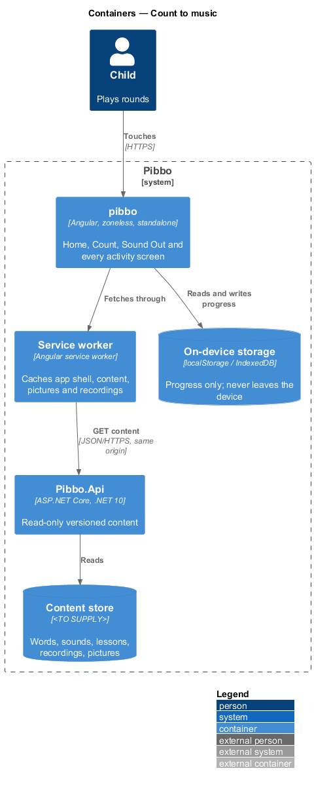
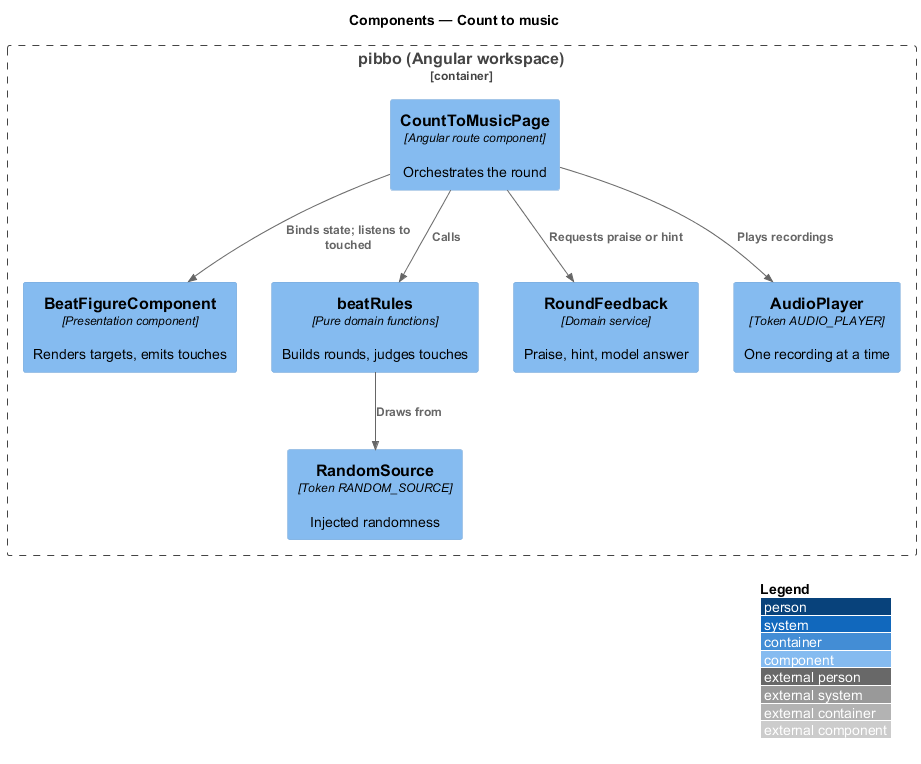

# Count to music

## Overview

A rhythm plays while a *figure*, Pibbo, makes one simple move on each *beat*. On each beat the next number, from 1 to 10, is spoken and its numeral shown and marked in a row of the numbers, for the child to chant along. The child starts the music, can pause it and keep dancing, and chooses Slow or Fast. No microphone or camera is used. With sound off each beat still shows; with reduced motion Pibbo keeps still and the numeral change alone shows the beat (ADR 0014).

- **beat** — one tick of the dance: 900 ms at Slow, 600 ms at Fast; each beat says the next number
- **figure** — Pibbo, who cheers while the music plays and sways on every other beat

## Description

The feature is a vertical slice through the Angular workspace: the page in the `pibbo` application, presentation components in `@pibbo/components`, pure rules in `@pibbo/domain`, and the contracts and tokens in `@pibbo/api`.

- **`CountingDance`** — route component in `pibbo` (`pb-counting-dance`, `/count/dance`), loaded by `loadComponent` when the child chooses the activity. It holds the `DanceRound` in a signal, schedules one beat at a time with the injected `CLOCK`, plays each beat's recording through `AUDIO_PLAYER` and hands state to the presentation component. Pause, the tab being hidden and leaving cancel the next beat and stop the recording.
- **`Dance`** — presentation component in `@pibbo/components` (`pb-dance`, the mock's `.dance`, `.chant` and `.controls`). It takes the round as signal inputs and emits `toggled` (Start the music, Pause, Keep dancing) and `paced` (Slow, Fast); it injects no service.
- **`DanceRound`** — immutable round state in `@pibbo/domain/counting`: `ready`, `playing`, `paused`, `done`, the number said and the beat's speed.
- **Dance rules** — `startDance`, `playDance`, `danceBeat`, `pauseDance` and `danceAt`, pure functions with unit tests. `COUNTING_DANCE` is the content: the last number, the beat lengths and the recordings.
- **`AudioPlayer`** — contract in `@pibbo/api` bound to `AUDIO_PLAYER`. Each beat is one recording, the number said over that beat of the rhythm, so a new beat stops the one before and sound never piles up. A recording that cannot play resolves as `failed`; the beat is shown and the dance goes on.
- **`Loudness`** — recordings are mastered to at most −16 LUFS and within 2 LU of the others; this is checked on the content set, not at run time.

## Requirements

The feature realises the following level-2 (L2) requirements. Each L2 requirement refines a level-1 (L1) requirement, cited by identifier.

| L2 ID | Refines (L1) | Requirement |
|-------|--------------|-------------|
| `L2-009` | `L1-007` | Count to music. A rhythm plays while a figure makes a simple move on each beat; the numbers 1-10 are spoken and shown on the beat for the child to chant along to. The child starts the music, can pause it and keep dancing, and chooses Slow or Fast. No microphone or camera is used. |

Acceptance criteria of `L2-009` (Count to music):

1. Given the round has started, when each beat plays, then the next number is spoken, its numeral is shown and marked in the row of numbers, and the figure moves once.
2. Given the device sound is off, when the round plays, then the numeral and a visual beat pulse still show each count.
3. Given reduced motion is on, when the round plays, then the figure does not move and the numeral change alone shows the beat.
4. Given the round is playing, when the child touches Pause, then the music and numbers stop within 200 ms, and Keep dancing resumes from the same number, saying the next one.
5. Given the round's audio, when measured, then its integrated loudness does not exceed -16 LUFS and matches the other recordings within 2 LU.
6. Given any music round, when it runs, then no microphone or camera permission is requested.
7. Given the round is playing, when the tab is hidden, then the music and motion stop, and nothing plays again until the child touches Keep dancing.
8. Given the last number is said, when the dance ends, then "You danced all the way to 10!" is spoken and shown, and Next goes back to Home.

## Diagrams

### System context

The child uses Pibbo directly; a grown-up is beside or nearby and is not needed to make the feature work. No third-party system takes part.

The diagrams predate ADR 0014 and still name `CountToMusicPage`, `BeatFigureComponent` and a `BeatScheduler`; the text above is current.

### Containers

The feature runs in the `pibbo` single-page application. Content arrives from `Pibbo.Api` through the service worker cache; nothing a child does is sent back.

### Components

`CountToMusicPage` composes `BeatFigureComponent` for presentation and calls `beatRules` for every decision. The page is the only part that injects tokens; the rules hold no Angular dependency.

### Class structure

`BeatState` is the value the rules transform; `CountToMusicPage` holds it in a signal and passes it to `BeatFigureComponent`.

### Play, pause and resume the beat

Each beat advances the number, speaks it and pulses. Pause stops music and numbers within 200 ms; resume continues from the same number.

## Open questions

- **Loudness (`L2-009` #5).** The recordings are placeholder silences; measuring −16 LUFS and the 2 LU match waits for the real recordings and a content check that measures them.
- **1 to 20.** The requirement once allowed a dance to 20; the mock draws 1 to 10, so `COUNTING_DANCE.last` is 10 until a requirement decides otherwise.
