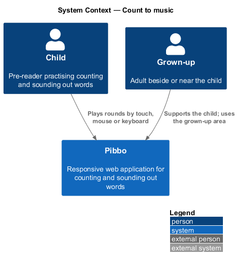
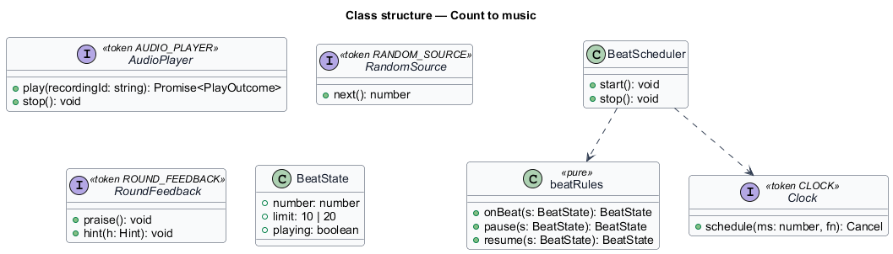
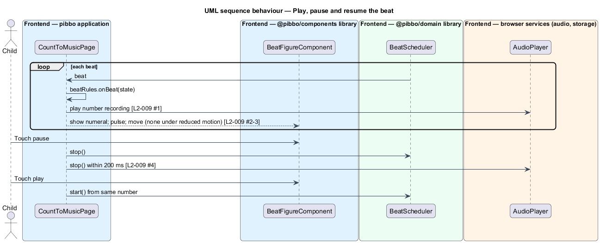

# Count to music

## Overview

A rhythm plays while a *figure* makes one simple move on each *beat*. On each beat the next number is spoken and its numeral shown, for the child to chant along. No microphone or camera is used. With sound off a visual beat pulse still shows each count; with reduced motion the figure stays still.

- **beat** — one tick of the music clock; each beat advances the count by one
- **figure** — drawn character whose move marks the beat

## Description

The feature is a vertical slice through the Angular workspace: the page in the `pibbo` application, presentation components in `@pibbo/components`, pure rules in `@pibbo/domain`, and the contracts and tokens in `@pibbo/api`.

- **`CountToMusicPage`** — route component in `pibbo`, loaded by `loadComponent` when the child chooses the activity. It is provided with its own `beatRules` state at route scope, asks the rules for each round, plays recordings through `AUDIO_PLAYER` and hands state to the presentation component.
- **`BeatFigureComponent`** — presentation component in `@pibbo/components` (selector `pb-beatfigure`). It takes the round state as signal inputs, emits a `touched` output per target, and injects no service.
- **`BeatState`** — immutable round state in `@pibbo/domain/counting`; every transition returns a new value.
- **`beatRules`** — pure functions in `@pibbo/domain/counting` that build a round from the injected `RandomSource` and decide the outcome of each touch, with unit tests.
- **`AudioPlayer`** — contract in `@pibbo/api` bound to `AUDIO_PLAYER`. Playing a recording stops the one before it; a recording that cannot play resolves as `unavailable` and the screen shows the text instead.
- **`RoundFeedback`** — shared round behaviour (`retry-and-praise`): brief praise, hints after a wrong answer, and modelling the answer after three wrong answers.
- **`BeatScheduler`** — route-scoped service driven by the injected `CLOCK`; it cancels its schedule on pause, on tab hidden and on destroy.
- **`Loudness`** — music recordings are mastered to at most −16 LUFS and within 2 LU of the other recordings; this is checked on the content set, not at run time.

## Requirements

The feature realises the following level-2 (L2) requirements. Each L2 requirement refines a level-1 (L1) requirement, cited by identifier.

| L2 ID | Refines (L1) | Requirement |
|-------|--------------|-------------|
| `L2-009` | `L1-007` | Count to music. A rhythm plays while a figure makes a simple move on each beat; the numbers 1-10 (or 1-20) are spoken and shown on the beat for the child to chant along to. No microphone or camera is used. |

Acceptance criteria of `L2-009` (Count to music):

1. Given the round has started, when each beat plays, then the next number is spoken, its numeral is shown, and the figure moves once.
2. Given the device sound is off, when the round plays, then the numeral and a visual beat pulse still show each count.
3. Given reduced motion is on, when the round plays, then the figure does not move and the numeral change alone shows the beat.
4. Given the round is playing, when the child touches pause, then the music and numbers stop within 200 ms, and play resumes from the same number.
5. Given the round's audio, when measured, then its integrated loudness does not exceed -16 LUFS and matches the other recordings within 2 LU.
6. Given any music round, when it runs, then no microphone or camera permission is requested.

## Diagrams

### System context

The child uses Pibbo directly; a grown-up is beside or nearby and is not needed to make the feature work. No third-party system takes part.

### Containers

The feature runs in the `pibbo` single-page application. Content arrives from `Pibbo.Api` through the service worker cache; nothing a child does is sent back.

### Components

`CountToMusicPage` composes `BeatFigureComponent` for presentation and calls `beatRules` for every decision. The page is the only part that injects tokens; the rules hold no Angular dependency.

### Class structure

`BeatState` is the value the rules transform; `CountToMusicPage` holds it in a signal and passes it to `BeatFigureComponent`.

### Play, pause and resume the beat

Each beat advances the number, speaks it and pulses. Pause stops music and numbers within 200 ms; resume continues from the same number.

