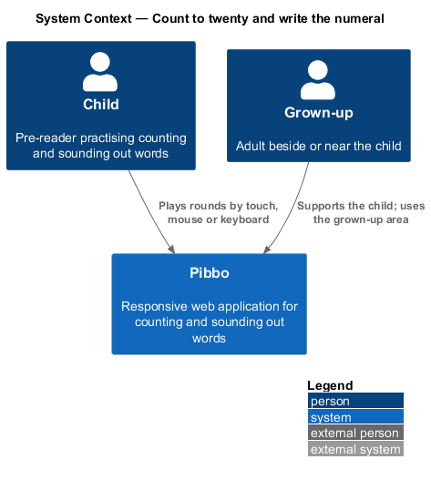
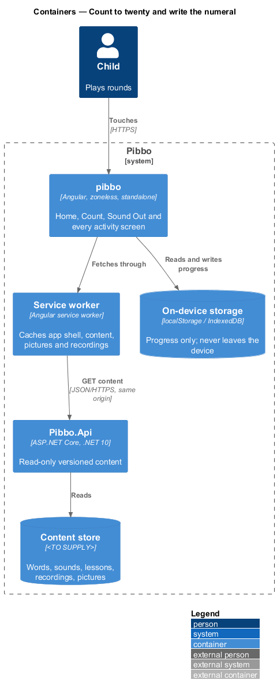
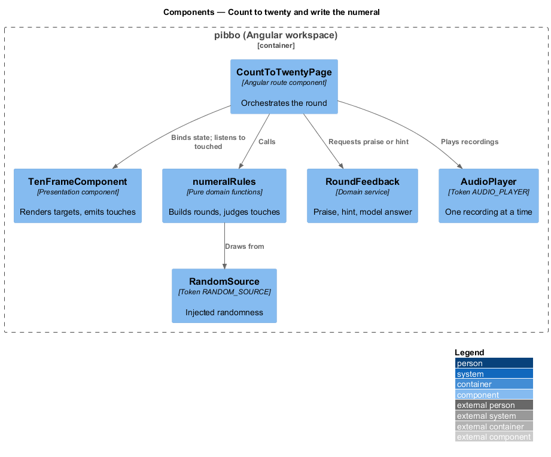
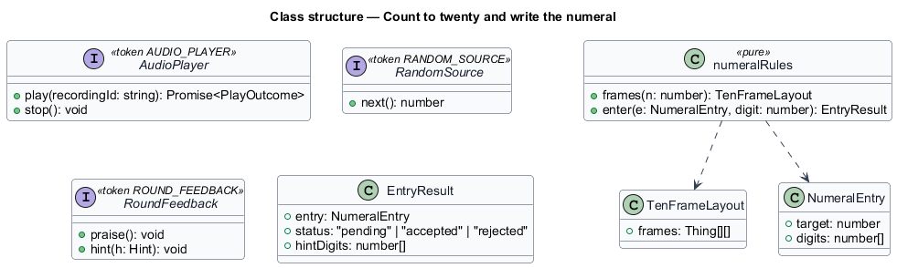

# Count to twenty and write the numeral

## Overview

This activity, *Count and write* on Home, extends counting to sets of up to 20 things. The things are grouped in *ten-frames* so all of them fit one screen with no scrolling. When the count completes the child writes the numeral by touching *digit tiles*, then Check.

- **ten-frame**: grid of two rows of five cells that holds up to ten things, filled in order
- **digit tile**: touch target for one digit 0 to 9; touching tiles in order writes a numeral, with no handwriting or drag

## Description

The feature is a vertical slice through the Angular workspace: the page in the `pibbo` application, presentation components in `@pibbo/components`, pure rules in `@pibbo/domain`, and the contracts and tokens in `@pibbo/api`. The mocks are `docs/mocks/pages/count-and-write/` (`counting`, `default`, `written`, `hint`, `correct`, `modelled`); ADR 0009 records the decisions.

- **`CountAndWrite`**: route component in `pibbo` at `/count/write`, loaded by `loadComponent` when the child chooses the activity. It asks the rules for each round, plays recordings through `AUDIO_PLAYER`, sets the praise timer through `CLOCK` and hands state to the presentation components. Its state goes when the child leaves.
- **`Tenframes`**: presentation component in `@pibbo/components` (`pb-tenframes`). It takes the things and what each is counted as, emits `touched` per thing, and shrinks (`small`) once the count is done, when it takes no touches.
- **`DigitPad`**: presentation component (`pb-digit-pad`): two boxes for the written digits, Clear, and ten digit tiles, each at least 60 x 60 px. It emits `wrote` and `cleared`; the tile Pibbo lights in a hint is `lit`.
- **`CountAndWriteRound`**: immutable round state in `@pibbo/domain/counting` (`counting`, `writing`, `hinting`, `right`, `modelled`); every transition returns a new value. Earlier drafts called it `NumeralEntry`.
- **Round rules**: pure functions beside it (`startCountAndWriteRound`, `tenFrames`, `countThing`, `writeDigit`, `clearDigits`, `checkNumeral`, `hintDone`), with unit tests. The injected `RandomSource` picks the number and the toys; things fill each ten-frame in order. Wrong answers follow `answerOutcome` (`L2-026`).
- **`COUNT_AND_WRITE`**: content in `@pibbo/domain`: the numbers (the cast, 14 and 7, until the range is decided), the toys, the instructions and their recordings.
- **`AudioPlayer`**: contract in `@pibbo/api` bound to `AUDIO_PLAYER`. Playing a recording stops the one before it; a recording that cannot play resolves as `unavailable` and the screen already shows the text.

Nothing is fetched from anywhere but Pibbo's own origin, and nothing a child does leaves the device. The frontend does not call the backend (ADR 0034).

## Requirements

The feature realises the following level-2 (L2) requirements. Each L2 requirement refines a level-1 (L1) requirement, cited by identifier.

| L2 ID | Refines (L1) | Requirement |
|-------|--------------|-------------|
| `L2-003` | `L1-002` | Count to twenty. Rounds of 11-20 things are grouped in ten-frames so they fit one screen without scrolling. |
| `L2-004` | `L1-002` | Write the numeral. The child writes the numeral by touching digit tiles 0-9 in order, then Check; no handwriting or drag is needed. |

Acceptance criteria of `L2-003` (Count to twenty):

1. Given a round of 14 things on a 360 x 640 px viewport, when it is shown, then all 14 are visible without scrolling, each at least 60 x 60 px, as one full ten-frame and one partial ten-frame.
2. Given 14 things counted, when the count reaches 14, then "fourteen" is spoken and the child is asked to write the numeral.

Acceptance criteria of `L2-004` (Write the numeral):

1. Given the count is 14, when the child touches 1 then 4 and then Check, then "fourteen" is spoken and the answer is accepted.
2. Given the count is 14, when the child touches 4 then 1 and then Check, then the answer is not accepted, the tiles clear, and Pibbo shows 1 then 4 being touched as a hint, saying each digit; then the child writes again.
3. Given the count is 7, when the child touches 7 and then Check, then the answer is accepted without a second digit.
4. Given two digits entered, when a third digit is touched, then it is ignored.
5. Given a digit tile is touched, when it is written, then the digit is spoken and shown in the next box, and Clear empties the boxes.

## Diagrams

### System context

The child uses Pibbo directly; a grown-up is beside or nearby and is not needed to make the feature work. No third-party system takes part.

### Containers

The feature runs in the `pibbo` single-page application in the browser. Its pictures and recordings are bundled and served from Pibbo's own origin; nothing a child does is sent anywhere.

### Components

`CountAndWrite` composes `Tenframes` and `DigitPad` for presentation and calls the round rules for every decision. The page is the only part that injects tokens; the rules hold no Angular dependency.

### Class structure

`CountAndWriteRound` is the value the rules transform; `CountAndWrite` holds it in a signal and passes it to `Tenframes` and `DigitPad`.

### Write the numeral with digit tiles

The boxes take at most two digits and Check checks them. A one-digit count is checked with one digit; a wrong numeral clears the boxes and Pibbo lights the right tiles in turn as a hint.

## Open questions

- The PNG renders of the diagrams predate journey 5; the `.puml` sources of the class and sequence diagrams are current. Re-render them when PlantUML is to hand.
- Which numbers Count and write covers, and in what order, is not decided (ADR 0009).
