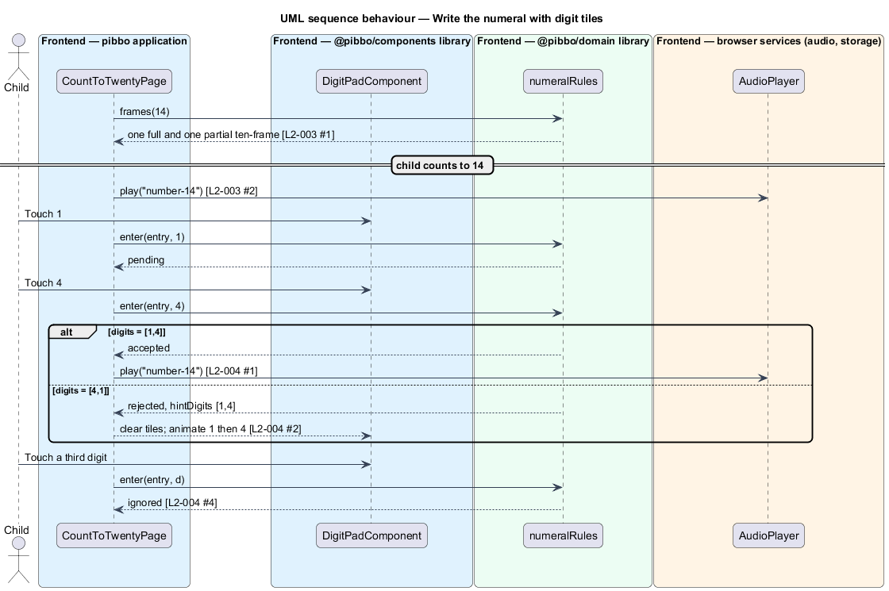

# Count to twenty and write the numeral

## Overview

This activity extends counting to sets of 11 to 20 things. The things are grouped in *ten-frames* so all of them fit one screen with no scrolling. When the count completes the child writes the numeral by touching *digit tiles*.

- **ten-frame** — grid of two rows of five cells that holds up to ten things
- **digit tile** — touch target for one digit 0–9; touching tiles in order writes a numeral, with no handwriting or drag

## Description

The feature is a vertical slice through the Angular workspace: the page in the `pibbo` application, presentation components in `@pibbo/components`, pure rules in `@pibbo/domain`, and the contracts and tokens in `@pibbo/api`.

- **`CountToTwentyPage`** — route component in `pibbo`, loaded by `loadComponent` when the child chooses the activity. It is provided with its own `numeralRules` state at route scope, asks the rules for each round, plays recordings through `AUDIO_PLAYER` and hands state to the presentation component.
- **`TenFrameComponent`** — presentation component in `@pibbo/components` (selector `pb-tenframe`). It takes the round state as signal inputs, emits a `touched` output per target, and injects no service.
- **`NumeralEntry`** — immutable round state in `@pibbo/domain/counting`; every transition returns a new value.
- **`numeralRules`** — pure functions in `@pibbo/domain/counting` that build a round from the injected `RandomSource` and decide the outcome of each touch, with unit tests.
- **`AudioPlayer`** — contract in `@pibbo/api` bound to `AUDIO_PLAYER`. Playing a recording stops the one before it; a recording that cannot play resolves as `unavailable` and the screen shows the text instead.
- **`RoundFeedback`** — shared round behaviour (`retry-and-praise`): brief praise, hints after a wrong answer, and modelling the answer after three wrong answers.
- **`DigitPadComponent`** — presentation component (`pb-digit-pad`) with ten digit tiles, each at least 60 × 60 px.

## Requirements

The feature realises the following level-2 (L2) requirements. Each L2 requirement refines a level-1 (L1) requirement, cited by identifier.

| L2 ID | Refines (L1) | Requirement |
|-------|--------------|-------------|
| `L2-003` | `L1-002` | Count to twenty. Rounds of 11-20 things are grouped in ten-frames so they fit one screen without scrolling. |
| `L2-004` | `L1-002` | Write the numeral. The child writes the numeral by touching digit tiles 0-9 in order; no handwriting or drag is needed. |

Acceptance criteria of `L2-003` (Count to twenty):

1. Given a round of 14 things on a 360 x 640 px viewport, when it is shown, then all 14 are visible without scrolling, each at least 60 x 60 px, as one full ten-frame and one partial ten-frame.
2. Given 14 things counted, when the count reaches 14, then "fourteen" is spoken and the child is asked to write the numeral.

Acceptance criteria of `L2-004` (Write the numeral):

1. Given the count is 14, when the child touches 1 then 4, then "fourteen" is spoken and the answer is accepted.
2. Given the count is 14, when the child touches 4 then 1, then the answer is not accepted, the tiles clear, and Pibbo shows 1 then 4 being touched as a hint.
3. Given the count is 7, when the child touches 7, then the answer is accepted without a second digit.
4. Given two digits entered, when a third digit is touched, then it is ignored.

## Diagrams

### System context

The child uses Pibbo directly; a grown-up is beside or nearby and is not needed to make the feature work. No third-party system takes part.

### Containers

The feature runs in the `pibbo` single-page application. Content arrives from `Pibbo.Api` through the service worker cache; nothing a child does is sent back.

### Components

`CountToTwentyPage` composes `TenFrameComponent` for presentation and calls `numeralRules` for every decision. The page is the only part that injects tokens; the rules hold no Angular dependency.

### Class structure

`NumeralEntry` is the value the rules transform; `CountToTwentyPage` holds it in a signal and passes it to `TenFrameComponent`.

### Write the numeral with digit tiles

The entry accepts at most two digits. A single-digit count is accepted at once; a wrong order clears the tiles and shows the right touches as a hint.

