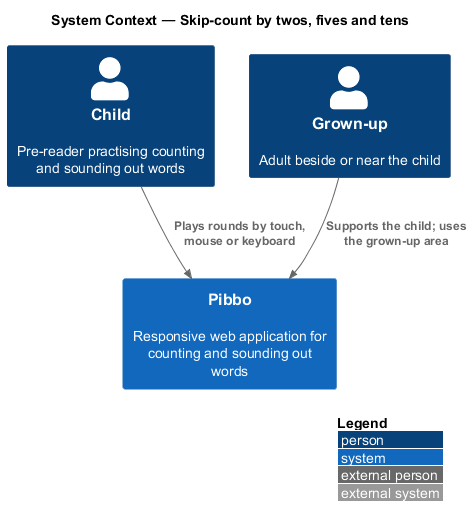
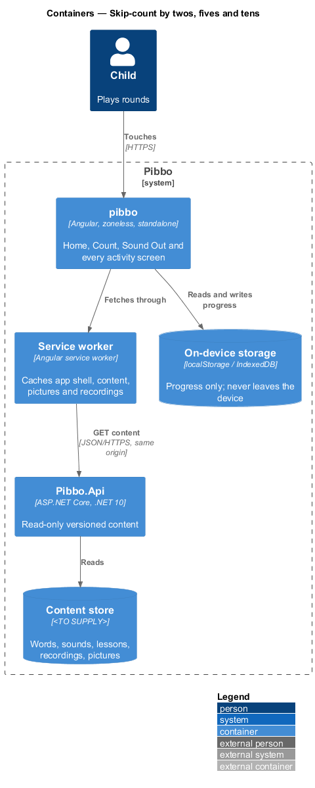
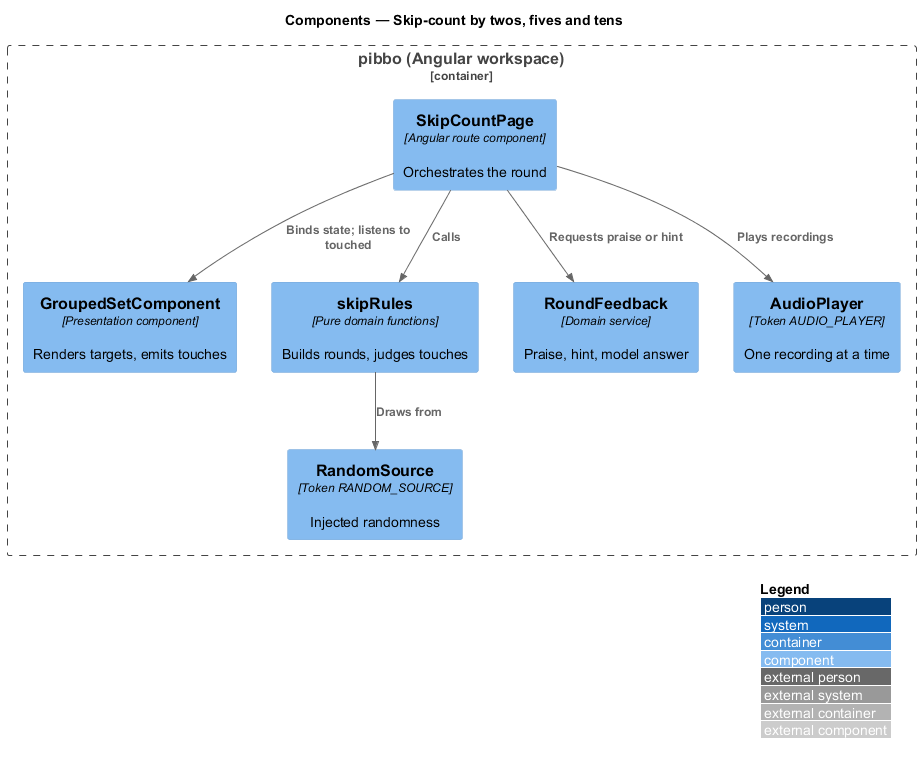
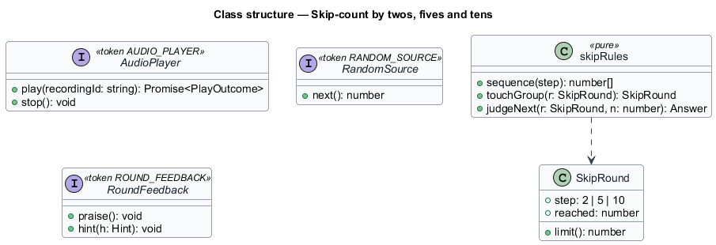

# Skip-count by twos, fives and tens

## Overview

Skip-counting is counting in steps larger than one. The child touches groups of 2, 5 or 10 things and hears the running total (2, 4, 6 …; 5, 10 …; 10, 20 …). The child is also asked what comes next.

- **step** — size of each group and of each increase in the count: 2, 5 or 10

## Description

The feature is a vertical slice through the Angular workspace: the page in the `pibbo` application, presentation components in `@pibbo/components`, pure rules in `@pibbo/domain`, and the contracts and tokens in `@pibbo/api`.

- **`SkipCountPage`** — route component in `pibbo`, loaded by `loadComponent` when the child chooses the activity. It is provided with its own `skipRules` state at route scope, asks the rules for each round, plays recordings through `AUDIO_PLAYER` and hands state to the presentation component.
- **`GroupedSetComponent`** — presentation component in `@pibbo/components` (selector `pb-groupedset`). It takes the round state as signal inputs, emits a `touched` output per target, and injects no service.
- **`SkipRound`** — immutable round state in `@pibbo/domain/counting`; every transition returns a new value.
- **`skipRules`** — pure functions in `@pibbo/domain/counting` that build a round from the injected `RandomSource` and decide the outcome of each touch, with unit tests.
- **`AudioPlayer`** — contract in `@pibbo/api` bound to `AUDIO_PLAYER`. Playing a recording stops the one before it; a recording that cannot play resolves as `unavailable` and the screen shows the text instead.
- **`RoundFeedback`** — shared round behaviour (`retry-and-praise`): brief praise, hints after a wrong answer, and modelling the answer after three wrong answers.
- **`Sequence limits`** — `skipRules.sequence` ends at 20 for step 2, 50 for step 5 and 100 for step 10.

## Requirements

The feature realises the following level-2 (L2) requirements. Each L2 requirement refines a level-1 (L1) requirement, cited by identifier.

| L2 ID | Refines (L1) | Requirement |
|-------|--------------|-------------|
| `L2-007` | `L1-005` | Skip-count by twos, fives and tens |

Acceptance criteria of `L2-007` (Skip-count by twos, fives and tens):

1. Given step 2 and groups of 2 things, when the child touches each group, then 2, 4, 6 ... 20 are spoken and shown.
2. Given step 5, when counting, then the sequence runs 5, 10 ... 50.
3. Given step 10, when counting, then the sequence runs 10, 20 ... 100.
4. Given step 5 and the sequence 5, 10, when the child is asked what comes next and touches 11, then the next group of 5 is shown and counted on aloud, and the child chooses again.

## Diagrams

### System context

The child uses Pibbo directly; a grown-up is beside or nearby and is not needed to make the feature work. No third-party system takes part.

### Containers

The feature runs in the `pibbo` single-page application. Content arrives from `Pibbo.Api` through the service worker cache; nothing a child does is sent back.

### Components

`SkipCountPage` composes `GroupedSetComponent` for presentation and calls `skipRules` for every decision. The page is the only part that injects tokens; the rules hold no Angular dependency.

### Class structure

`SkipRound` is the value the rules transform; `SkipCountPage` holds it in a signal and passes it to `GroupedSetComponent`.

### Count in groups and predict the next number

A wrong prediction shows the next group and counts it on aloud before the child chooses again.

