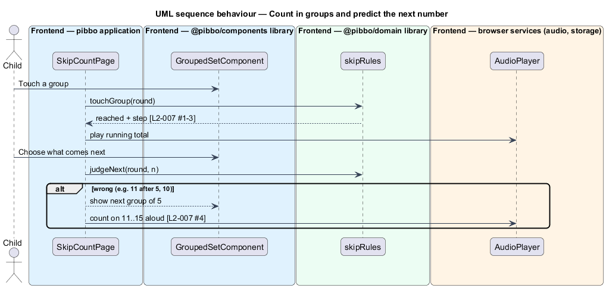

# Skip-count by twos, fives and tens

## Overview

Skip-counting is counting in steps larger than one. The child hops along a *number line* from 0 in steps of 2, 5 or 10, choosing where each hop lands from three numerals, and hears each landing (2, 4, 6 …; 5, 10 …; 10, 20 …). A switch changes the step and starts the line again from 0 (ADR 0012).

- **step** — size of each hop: 2, 5 or 10
- **number line** — the line from 0 with a hop to each number said and a `?` at the next; it is shown, not touched

## Description

The feature is a vertical slice through the Angular workspace: the page in the `pibbo` application, presentation components in `@pibbo/components`, pure rules in `@pibbo/domain`, and the contracts and tokens in `@pibbo/api`.

- **`SkipCount`** — route component in `pibbo` (selector `pb-skip-count`, route `/count/skip`), loaded by `loadComponent` when the child chooses the activity. It holds the round in a signal, asks the rules for each hop, plays recordings through `AUDIO_PLAYER` and hands state to the presentation component.
- **`NumberLine`** — presentation component in `@pibbo/components` (selector `pb-number-line`): the step switch, the `.number-line` and the three numeral choices. It takes the step, the numbers said, the choices, the steps offered and whether it is locked as signal inputs, emits `chose` with the number touched and `stepped` with the step touched, and injects no service.
- **`SkipRound`** — immutable round state in `@pibbo/domain/counting` (`counting`, `retry`, `done`); every transition returns a new value.
- **Skip rules** — pure functions in `@pibbo/domain/counting` with unit tests: `startSkipRound` draws the step and `skipChoices` orders the choices from the injected `RandomSource`, `skipBy` starts the line again with another step, `chooseLanding` decides the outcome of a choice and `hopAgain` returns to counting.
- **`AudioPlayer`** — contract in `@pibbo/api` bound to `AUDIO_PLAYER`. Playing a recording stops the one before it; a recording that cannot play resolves as `unavailable`, and what it says is already shown.
- **Retry and praise** — a wrong choice speaks and shows "Count on 5 more from 10." with Try again; the last hop speaks its number and "Hop, hop, hop — all the way to 50!", brief praise that never blocks Next. There is no modelled answer (ADR 0012).
- **Sequence limits** — a line has ten hops (`SKIP_COUNT.hops`): it ends at 20 for step 2, 50 for step 5 and 100 for step 10.

## Requirements

The feature realises the following level-2 (L2) requirements. Each L2 requirement refines a level-1 (L1) requirement, cited by identifier.

| L2 ID | Refines (L1) | Requirement |
|-------|--------------|-------------|
| `L2-007` | `L1-005` | Skip-count by twos, fives and tens. The child hops along a number line from 0, choosing where each hop lands from three numerals. |

Acceptance criteria of `L2-007` (Skip-count by twos, fives and tens):

1. Given step 2, when the child chooses 2, 4, 6 ... 20 in order, then each number is spoken as chosen and shown on the number line.
2. Given step 5, when counting, then the sequence runs 5, 10 ... 50.
3. Given step 10, when counting, then the sequence runs 10, 20 ... 100.
4. Given step 5 and the sequence 5, 10, when the child chooses 14, then nothing advances, "Count on 5 more from 10." is spoken and shown, and after Try again the child chooses again.

## Diagrams

### System context

The child uses Pibbo directly; a grown-up is beside or nearby and is not needed to make the feature work. No third-party system takes part.

### Containers

The feature runs in the `pibbo` single-page application. Content arrives from `Pibbo.Api` through the service worker cache; nothing a child does is sent back.

### Components

`SkipCount` composes `NumberLine` for presentation and calls the skip rules for every decision. The page is the only part that injects tokens; the rules hold no Angular dependency.

### Class structure

`SkipRound` is the value the rules transform; `SkipCount` holds it in a signal and passes it to `NumberLine`. The diagrams predate ADR 0012 and still draw the earlier names.

### Count in groups and predict the next number

A wrong choice says how far to hop and waits for Try again before the child chooses again.

