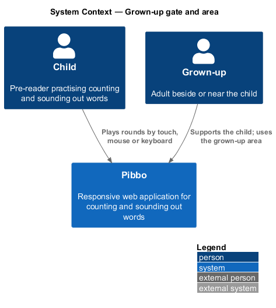

# Grown-up gate and area

## Overview

Settings and information for a grown-up sit behind a *gate*. The gate entry is a small corner control at least 48 px from any activity picture. Passing the gate needs a text-only task a pre-reader cannot pass by chance, such as touching 7, 3, 9 in order. The grown-up area offers volume, clear progress and about Pibbo, with no external links.

- **gate** — CDK dialog holding a reading task that only a reader passes

## Description

The feature is a vertical slice through the Angular workspace: the page in the `pibbo` application, presentation components in `@pibbo/components`, pure rules in `@pibbo/domain`, and the contracts and tokens in `@pibbo/api`.

- **`GrownUpEntryComponent`** — corner control on Home.
- **`GateDialog`** — CDK Dialog asking for a numeral sequence shown as words; failing or dismissing closes it and Home is unchanged.
- **`gateRules`** — pure functions generating the sequence from `RANDOM_SOURCE` and judging touches.
- **`GrownUpPage`** — lazy route with volume, clear progress (`ProgressStore.clearAll`) and about Pibbo.

## Requirements

The feature realises the following level-2 (L2) requirements. Each L2 requirement refines a level-1 (L1) requirement, cited by identifier.

| L2 ID | Refines (L1) | Requirement |
|-------|--------------|-------------|
| `L2-037` | `L1-030` | Grown-up gate |

Acceptance criteria of `L2-037` (Grown-up gate):

1. Given Home, when shown, then the grown-up entry is a small corner control at least 48 px from any activity picture.
2. Given the grown-up entry is touched, when the gate opens, then a text-only task a pre-reader cannot pass by chance (for example "touch 7, 3, 9 in order") must be completed to go on.
3. Given the gate is failed or dismissed, when that happens, then Home returns unchanged.
4. Given the grown-up area, when shown, then it offers volume, clear progress and about Pibbo, and has no external links.

## Diagrams

### System context

The child uses Pibbo directly; a grown-up is beside or nearby and is not needed to make the feature work. No third-party system takes part.

### Containers

The feature runs in the `pibbo` single-page application. Content arrives from `Pibbo.Api` through the service worker cache; nothing a child does is sent back.

### Components

The gate is a CDK dialog opened from Home; only a passed gate navigates to the lazy grown-up route.

### Class structure

The gate holds only the sequence and the touches so far.

### Pass or fail the gate

Only the exact sequence opens the grown-up area; anything else returns to Home unchanged.

