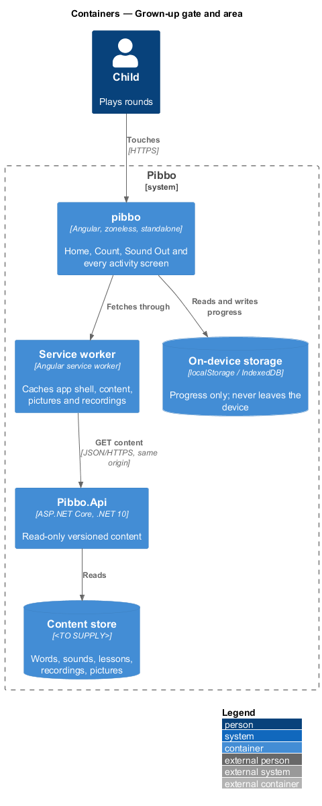
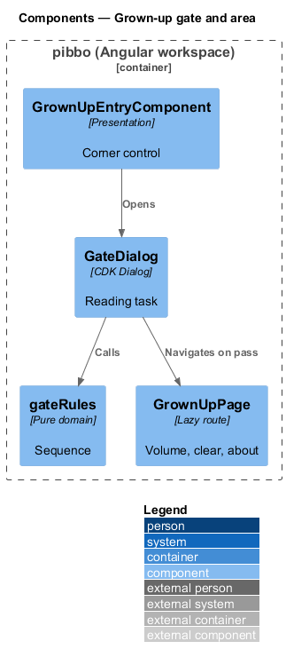
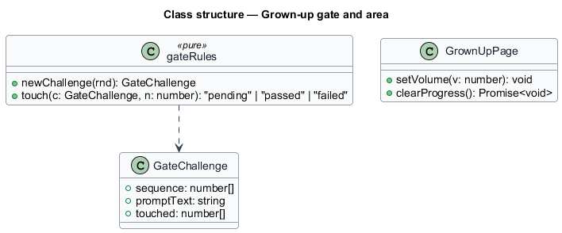
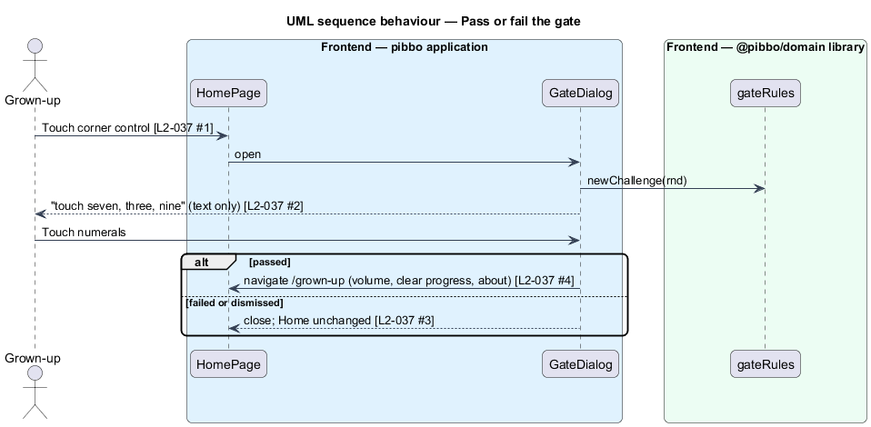

# Grown-up gate and area

## Overview

Settings and information for a grown-up sit behind a *gate*. The gate entry is a small corner control at least 48 px from any activity picture. Passing the gate needs a text-only task a pre-reader cannot pass by chance, such as touching 7, 3, 9 in order. The grown-up area offers volume, clear progress and about Pibbo, with no external links.

- **gate** — CDK dialog holding a reading task that only a reader passes; nothing in it is spoken

## Description

The feature is a vertical slice through the Angular workspace: the page in the `pibbo` application, presentation components in `@pibbo/components`, pure rules in `@pibbo/domain`, and the contracts and tokens in `@pibbo/api` (ADRs 0025 and 0027).

- **`GrownUpEntry`** (`pb-grown-up-entry`) — the corner control on Home (`.grown-up-entry`): an outline padlock, 48 × 48 px, "For grown-ups", in the top bar; Home's row under it keeps every activity picture at least 48 px away.
- **`GateDialog`** — a CDK Dialog in the app, opened by the entry, holding `pb-gate` (`.dialog.gate`): three numbers written as words, a 3 × 3 keypad and dots for progress. Nothing is spoken. The first wrong number, Close, Escape or a touch outside closes it and Home is unchanged; the right three navigate to the area with the gate's pass in the navigation state.
- **`gateRules`** — pure functions in `@pibbo/domain/grown-up`: `newGate` (three different numbers from 1 to 9, from `RANDOM_SOURCE`), `gateTask` ("Touch seven, three, nine in order."), `touchGate` (`pending`, `passed` or `failed`).
- **`GrownUpArea`** — lazy route `/grown-up` behind `grownUpGuard`, which lets in only a navigation carrying the pass: Back to Pibbo, Volume (`pb-volume-switch`, Quiet, Medium or Loud, kept as `pibbo:volume` and applied through `AudioPlayer.setVolume`), Progress with Clear progress, and About Pibbo. No links.
- **`ClearProgressDialog`** — a CDK Dialog holding `pb-confirm` (`.dialog.confirm`, `role="alertdialog"`), focus on Keep it; Clear progress calls `ProgressStore.clearProgress()` and the area says "Progress cleared.".

## Requirements

The feature realises the following level-2 (L2) requirements. Each L2 requirement refines a level-1 (L1) requirement, cited by identifier.

| L2 ID | Refines (L1) | Requirement |
|-------|--------------|-------------|
| `L2-037` | `L1-030` | Grown-up gate |

Acceptance criteria of `L2-037` (Grown-up gate):

1. Given Home, when shown, then the grown-up entry is a small corner control at least 48 px from any activity picture.
2. Given the grown-up entry is touched, when the gate opens, then a text-only task a pre-reader cannot pass by chance (for example "touch 7, 3, 9 in order") must be completed to go on.
3. Given the gate is failed or dismissed, when that happens, then Home returns unchanged.
4. Given the grown-up area, when shown, then it offers volume, clear progress and about Pibbo, and has no external links.
5. Given the grown-up area, when "clear progress" is touched, then a confirmation asks first, starting on Keep it; confirming erases all progress on the device and says "Progress cleared.", keeping the volume.
6. Given the grown-up area, when a volume is chosen, then every recording plays at it and it is kept on the device.
7. Given the grown-up area, when it is opened in any other way than by passing the gate (typed, reloaded, Back), then Home shows instead.

## Diagrams

### System context

The child uses Pibbo directly; a grown-up is beside or nearby and is not needed to make the feature work. No third-party system takes part.

### Containers

The feature runs in the `pibbo` single-page application. Content arrives from `Pibbo.Api` through the service worker cache; nothing a child does is sent back.

### Components

The gate is a CDK dialog opened from Home; only a passed gate navigates to the lazy grown-up route.

### Class structure

The gate holds only the sequence and the touches so far.

### Pass or fail the gate

Only the exact sequence opens the grown-up area; anything else returns to Home unchanged.

