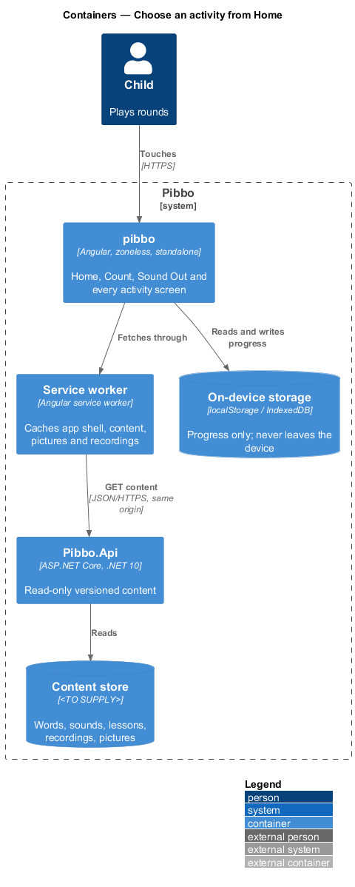
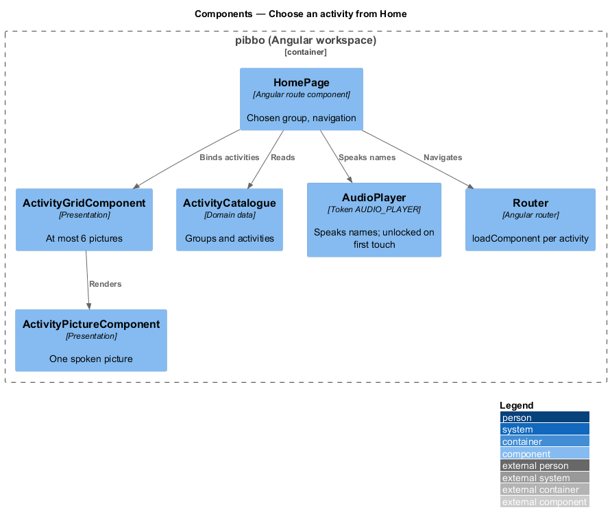
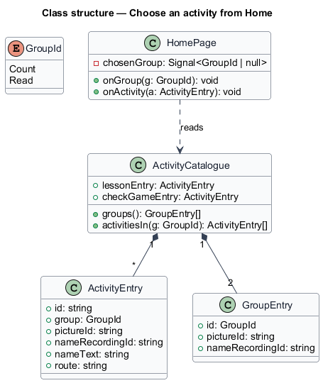

# Choose an activity from Home

## Overview

Home is the first screen of Pibbo and the prototype's landing page (ADR 0035). A child chooses a
subject, Reading or Counting, then an activity; today's lesson and the check game each have a card.

- **subject** — set of activities of one kind, Reading or Counting (`GroupId` `read` / `count`)
- **section** — named run of a subject's activities: Letters, Sounds into words, Words and sentences; Counting, Numbers
- **activity card** — touch target naming an activity by glyph, name, stars and a spoken recording
- **sample child** — the prototype's "Maya" and her stars: shown, never asked for, earned or kept

Touching a subject speaks its name and lists its activities in sections; the page scrolls. Touching an activity card once speaks its name and opens it. Home is also the touch that unlocks sound in the browser.

## Description

The feature is a vertical slice through the Angular workspace: the page in the `pibbo` application, presentation components in `@pibbo/components`, pure rules and data in `@pibbo/domain`, and the contracts and tokens in `@pibbo/api`.

- **`Home`** — route component in `pibbo` at `/`, in the initial bundle. It reads the catalogue, the sample child (`CHILD_PROFILE`) and the chosen lesson's kept place (`PROGRESS_STORE`), keeps the chosen subject in a signal and in `?group=`, and navigates to lazy routes.
- **`ChildBadge`** — `pb-child-badge` (`.pill--stars`, `.pill--child`): total stars and the child's initial and name; below 384 px the name is visually hidden but still read.
- **`LessonCard`** — `pb-lesson-card` (`.lesson-card`): greeting, lesson title, one `.dot` a game (done, now, waiting; named "2 of 5 games done"), the Start / Keep going button and Pibbo from 640 px.
- **`CheckCard`** — `pb-check-card` (`.check-card`): Pibbo, "What do I know?" and its line; a row on a phone, a column from 768 px.
- **`GroupSwitch`** — `pb-group-switch` (`.switch--subjects`): Reading and Counting on one tray, the chosen one `aria-pressed` and filled in its colour.
- **`ActivityGrid`** — `pb-activity-grid` (`.game-group` per section): a heading and a grid of `pb-activity-picture`, 2, 3 or 5 a row.
- **`ActivityPicture`** — `pb-activity-picture` (`.game-card`): glyph, name and `pb-star-rating`; greyed with the no-network symbol when it could not open offline.
- **`StarRating`** — `pb-star-rating` (`.stars`): 0 to 3 of 3 stars, one image named "2 of 3 stars".
- **`ACTIVITY_CATALOGUE`** — data in `@pibbo/domain`: subjects, activities in order with their section, glyph, recording and route; `activitySections` groups a subject's activities by section.
- **`SAMPLE_CHILD`**, **`starsFor`**, **`totalStars`** — sample data and pure functions in `@pibbo/domain`; stars are clamped to 0..3 and only activities that exist count.
- **`lessonDone`** — pure function in `@pibbo/domain`: the games done before the kept step, 0 when nothing valid is kept.
- **`GrownUpEntry`** — the padlock after the child's name, leading to the grown-up gate (ADR 0029).

## Requirements

The feature realises the following level-2 (L2) requirements. Each L2 requirement refines a level-1 (L1) requirement, cited by identifier.

| L2 ID | Refines (L1) | Requirement |
|-------|--------------|-------------|
| `L2-024` | `L1-022` | Home screen: the prototype's landing page, with sample name and stars, lesson and check cards, Reading / Counting and the activities in sections. |

Acceptance criteria of `L2-024` (Home screen):

1. Given Home, when the child touches Counting, then "Counting" is spoken and the counting activities are shown in their sections, Counting then Numbers.
2. Given any activity card, when touched once, then its name is spoken and it opens.
3. Given Home on any viewport from 320 px to 1920 px wide, when shown, then nothing scrolls sideways and every target is at least 60 x 60 px with at least 16 px between targets.
4. Given Home, when shown, then today's lesson card shows the chosen subject's lesson title and how many of its games are done, and its button ("Start" before the first game, then "Keep going") is spoken and opens the lesson; the "What do I know?" card is spoken and opens the check game.
5. Given Home, when the child touches Reading, then "Reading" is spoken and the reading activities are shown in their sections, Letters, Sounds into words, then Words and sentences.
6. Given Home has just opened, when nothing has been touched, then nothing is spoken and Reading is chosen.
7. Given Home, when shown, then the top bar shows the sample child's name and total stars, and each activity card shows its stars out of three, each named for a screen reader ("3 of 3 stars").

## Diagrams

### System context

The child uses Pibbo directly; a grown-up is beside or nearby and is not needed to make the feature work. No third-party system takes part.

### Containers

The feature runs in the `pibbo` single-page application. Content arrives from `Pibbo.Api` through the service worker cache; nothing a child does is sent back.

### Components

`HomePage` reads `ActivityCatalogue`, renders it through `ActivityGridComponent`, and navigates to the chosen activity's lazy route.

### Class structure

The catalogue and the sample child are plain data; `Home` holds only the chosen subject. The
diagram source (`diagrams/class.puml`) is updated for ADR 0035; its image still shows journey 2
and needs re-rendering with PlantUML.

### Choose a group and an activity

The first touch unlocks sound. The group name is spoken and shown, then one touch on an activity speaks its name and opens it (`L2-024`).

## Decisions (journey 2)

- Home shows only activities that exist in `ACTIVITY_CATALOGUE`: Count the toys and Sound it out, each behind a lazy placeholder route until journeys 3 and 4 (ADR 0006).
- `HomePage` is the lazy route at `/`. The chosen group is a signal, also kept in the URL as `?group=count|read` so the placeholder's Home button returns to the group; nothing is stored.
- Once an activity picture is touched, Home ignores every further touch until it has navigated (`L2-035` #3).
- `L2-024` #4 (lesson and check game pictures) is deferred to journeys 22 and 23. Content comes from the bundle; there is no `Pibbo.Api` (journey 27).

## Decisions (ADR 0035)

- Home is the prototype's landing page; it scrolls, and More and its screens are gone.
- The child's name and stars come from `CHILD_PROFILE`, bound to `SAMPLE_CHILD`; nothing asks for, earns or keeps them.
- Reading is chosen when Home opens and when `?group=` names nothing; nothing is spoken until the first touch.
- The lesson card's dots read the lesson's kept place through `readLessonPlace`; a damaged value counts as nothing done.
- The grown-up padlock stays, after the child's name; every target stays at least 60 px.

## Open questions

- The recordings for "Count", "Read" and each activity name are placeholder silences; a person must record them.
- The tap thresholds (48 px palm, 12 px movement, 700 ms long press) need tuning on real devices.
