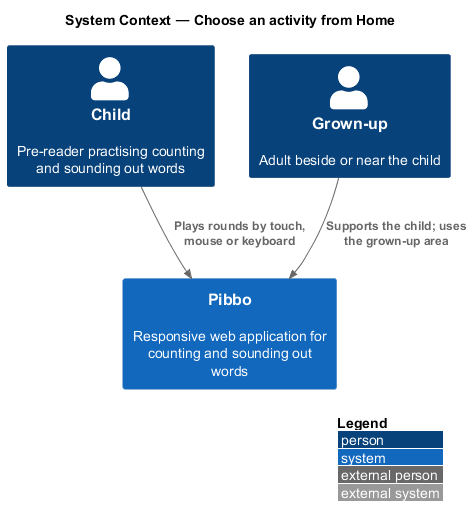
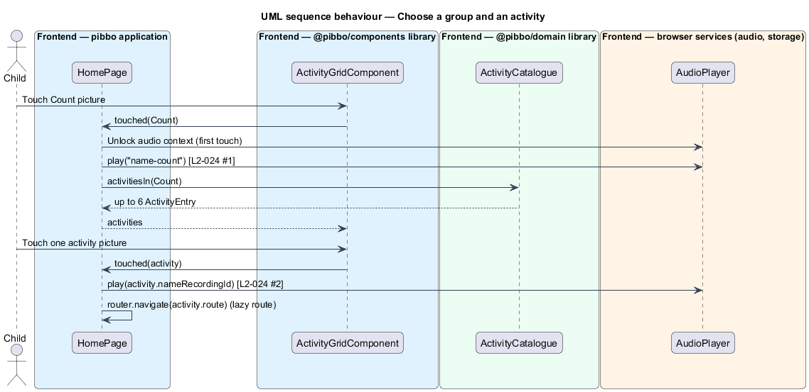

# Choose an activity from Home

## Overview

Home is the first screen of Pibbo. It lets a child who cannot read choose what to practise.
It shows two *groups* — Count and Read — as pictures, plus a picture for guided lessons and one for the check game.

- **group** — set of activities of one kind shown together, Count or Read
- **activity picture** — touch target that names an activity by picture and by a spoken recording

Touching a group picture speaks its name and shows that group's activities, at most 6 per screen. Touching an activity picture once speaks its name and opens it. Home is also the touch that unlocks sound in the browser.

## Description

The feature is a vertical slice through the Angular workspace: the page in the `pibbo` application, presentation components in `@pibbo/components`, pure rules in `@pibbo/domain`, and the contracts and tokens in `@pibbo/api`.

- **`HomePage`** — route component in `pibbo` at `/`, in the initial bundle. It reads the activity catalogue, tracks the chosen group in a signal and navigates to the lazy activity route.
- **`GroupSwitch`** — presentation component (`pb-group-switch`, block `.switch--groups`): the Count and Read group pictures, the chosen one marked with `aria-pressed` and a tick.
- **`ActivityGridComponent`** — presentation component (`pb-activity-grid`, block `.game-group`) laying out at most 6 `pb-activity-picture` targets, each at least 60 × 60 px with at least 16 px between targets.
- **`ActivityPictureComponent`** — presentation component (`pb-activity-picture`, block `.game-card`): picture, accessible name and `touched` output, through `pbTap`.
- **`ActivityPlaceholder`** — lazy route component in `pibbo` standing in for an activity not built yet: its name and one large way back to Home (ADR 0006).
- **`ActivityCatalogue`** — data in `@pibbo/domain` listing groups, activities, their pictures, recordings and route paths.
- **`AudioUnlock`** — part of the `AudioPlayer` implementation; the first touch on Home resumes the audio context.
- **`GrownUpEntry`** — small corner control leading to the grown-up gate (`grown-up/grown-up-gate`). Deferred to journey 24.

## Requirements

The feature realises the following level-2 (L2) requirements. Each L2 requirement refines a level-1 (L1) requirement, cited by identifier.

| L2 ID | Refines (L1) | Requirement |
|-------|--------------|-------------|
| `L2-024` | `L1-022` | Home screen. Home shows two groups, Count and Read, each a picture spoken when touched. Choosing a group shows its activities as pictures, at most 6 per screen. |

Acceptance criteria of `L2-024` (Home screen):

1. Given Home, when the child touches the Count picture, then "Count" is spoken and the counting activities are shown.
2. Given any activity picture, when touched once, then its name is spoken and it opens.
3. Given Home on any viewport, when shown, then nothing scrolls and every target is at least 60 x 60 px with at least 16 px between targets.
4. Given Home, when shown, then guided lessons and the check game each have their own picture.

## Diagrams

### System context

The child uses Pibbo directly; a grown-up is beside or nearby and is not needed to make the feature work. No third-party system takes part.

### Containers

The feature runs in the `pibbo` single-page application. Content arrives from `Pibbo.Api` through the service worker cache; nothing a child does is sent back.

### Components

`HomePage` reads `ActivityCatalogue`, renders it through `ActivityGridComponent`, and navigates to the chosen activity's lazy route.

### Class structure

The catalogue is plain data; `HomePage` holds only the chosen group.

### Choose a group and an activity

The first touch unlocks sound. The group name is spoken and shown, then one touch on an activity speaks its name and opens it (`L2-024`).

## Decisions (journey 2)

- Home shows only activities that exist in `ACTIVITY_CATALOGUE`: Count the toys and Sound it out, each behind a lazy placeholder route until journeys 3 and 4 (ADR 0006).
- `HomePage` is the lazy route at `/`. The chosen group is a signal, also kept in the URL as `?group=count|read` so the placeholder's Home button returns to the group; nothing is stored.
- Once an activity picture is touched, Home ignores every further touch until it has navigated (`L2-035` #3).
- `L2-024` #4 (lesson and check game pictures) is deferred to journeys 22 and 23. Content comes from the bundle; there is no `Pibbo.Api` (journey 27).

## Open questions

- The recordings for "Count", "Read" and each activity name are placeholder silences; a person must record them.
- The tap thresholds (48 px palm, 12 px movement, 700 ms long press) need tuning on real devices.
