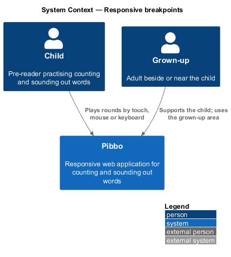
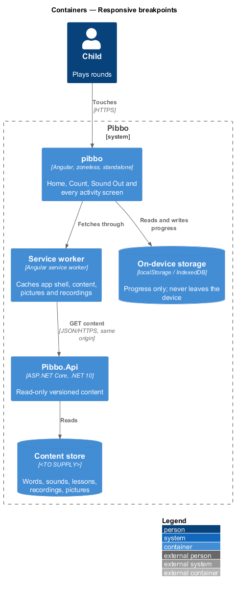
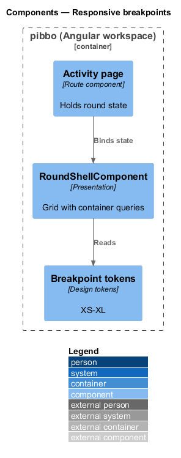
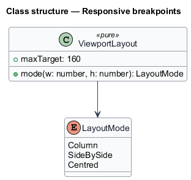
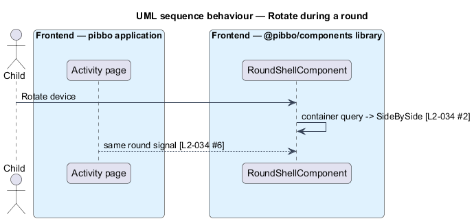

# Responsive breakpoints

## Overview

Every screen works from 320 × 480 px to 2560 × 1440 px, upright and on its side, with nothing scrolling. XS upright is one column; a landscape viewport under 480 px tall is side by side. Larger breakpoints show the same items larger, not more items, and XL centres content within a maximum width with no target above 160 px. Rotation keeps the round state.

## Description

The feature is a vertical slice through the Angular workspace: the page in the `pibbo` application, presentation components in `@pibbo/components`, pure rules in `@pibbo/domain`, and the contracts and tokens in `@pibbo/api`.

- **`Breakpoint tokens`** — XS < 576, SM ≥ 576, MD ≥ 768, LG ≥ 992, XL ≥ 1200 px, in the design system (`<TO SUPPLY>` until it exists).
- **`RoundShellComponent layout`** — CSS grid with container queries; `100dvh` with no overflow.
- **`Route-scoped round state`** — state lives in signals owned by the page, not the view, so a rotation re-layout keeps it.

## Requirements

The feature realises the following level-2 (L2) requirements. Each L2 requirement refines a level-1 (L1) requirement, cited by identifier.

| L2 ID | Refines (L1) | Requirement |
|-------|--------------|-------------|
| `L2-034` | `L1-028` | Responsive breakpoints |

Acceptance criteria of `L2-034` (Responsive breakpoints):

1. Given XS width (< 576 px) upright, when any activity is shown, then it uses one column with every target visible without scrolling.
2. Given a landscape viewport under 480 px tall, when shown, then the layout is side by side (picture one side, choices the other) with no scrolling.
3. Given SM (>= 576 px), MD (>= 768 px) and LG (>= 992 px), when shown, then the same items are shown larger with more space, not more items.
4. Given XL (>= 1200 px), when shown, then content is centred within a maximum width and no target exceeds 160 px.
5. Given viewports from 320 x 480 px to 2560 x 1440 px, when each activity's first round is screenshotted, then nothing overflows or overlaps and no scrollbar appears.
6. Given a round in progress, when the device rotates, then the round state (counted things, filled slots) is kept.

## Diagrams

### System context

The child uses Pibbo directly; a grown-up is beside or nearby and is not needed to make the feature work. No third-party system takes part.

### Containers

The feature runs in the `pibbo` single-page application. Content arrives from `Pibbo.Api` through the service worker cache; nothing a child does is sent back.

### Components

Layout is CSS only; state lives in the page so a rotation changes nothing but the layout.

### Class structure

The only types are layout modes derived from the viewport.

### Rotate during a round

A rotation changes the layout mode; counted things and filled slots stay.

