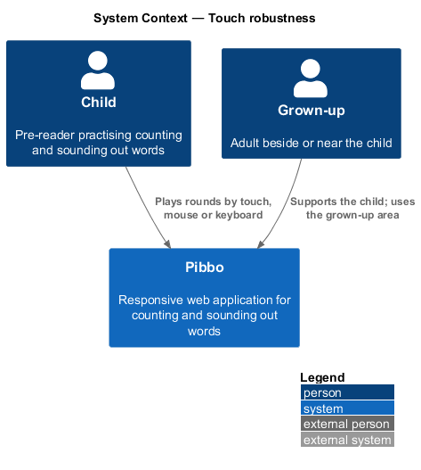
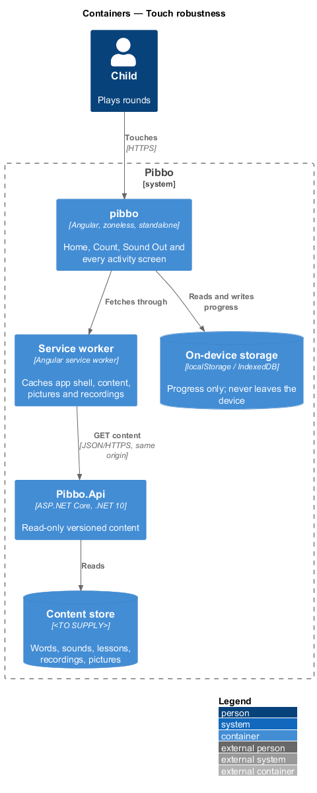
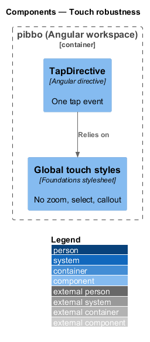
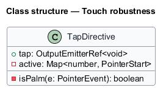

# Touch robustness

## Overview

A small child pinches, double-taps, long-presses and rests a palm on the screen. None of these zooms the page, selects text, opens a context menu or makes an answer. A tap from another finger is still handled.

## Description

The feature is a vertical slice through the Angular workspace: the page in the `pibbo` application, presentation components in `@pibbo/components`, pure rules in `@pibbo/domain`, and the contracts and tokens in `@pibbo/api`.

- **`Global touch styles`** — `touch-action: manipulation`, `user-select: none` and `-webkit-touch-callout: none` on activity screens; viewport meta prevents pinch zoom inside activities.
- **`TapDirective`** — directive `pbTap` turning a primary-pointer short press into one `tap` event; it judges each pointer on its own and ignores contacts larger than a palm threshold, contacts that move and long presses (thresholds in ADR 0006), and suppresses `contextmenu`. It cancels each touch's end with a listener the element itself keeps, not a host binding, so the browser's synthetic click is stopped even when the tap has already destroyed the view: a tap that leaves a page never also activates what appears under the finger.

## Requirements

The feature realises the following level-2 (L2) requirements. Each L2 requirement refines a level-1 (L1) requirement, cited by identifier.

| L2 ID | Refines (L1) | Requirement |
|-------|--------------|-------------|
| `L2-035` | `L1-028` | Touch robustness |

Acceptance criteria of `L2-035` (Touch robustness):

1. Given any activity, when the child pinches, double-taps or long-presses, then the page does not zoom, select text or open a context menu, and no answer is made.
2. Given a palm resting on the screen edge, when another finger taps a target, then the tap is handled and the resting contact activates nothing.

## Diagrams

### System context

The child uses Pibbo directly; a grown-up is beside or nearby and is not needed to make the feature work. No third-party system takes part.

### Containers

The feature runs in the `pibbo` single-page application. Content arrives from `Pibbo.Api` through the service worker cache; nothing a child does is sent back.

### Components

Every target in `@pibbo/components` uses `pbTap` rather than raw click handling.

### Class structure

`TapDirective` holds per-pointer state and releases its listeners on destroy.

### A resting palm and a tap

The palm contact is ignored; the finger tap is emitted once.

## Decisions (journey 2)

- The rule is the pure function `tapVerdict` in `@pibbo/components` with unit tests; `TapDirective` (`[pbTap]`) applies it per pointer. A touch is a tap when its contact is at most 48 × 48 px, it moved under 12 px and was held under 700 ms. Mouse and keyboard activation arrive as `click` and always count.
- Each pointer is judged alone, so a resting palm, primary or not, never blocks another finger's tap. No edge zone is needed.
- Global styles keep `touch-action: manipulation`, `user-select: none` and `-webkit-touch-callout: none` (journey 1).
