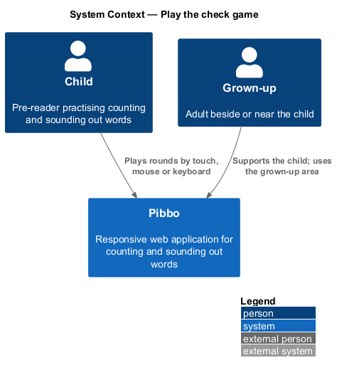
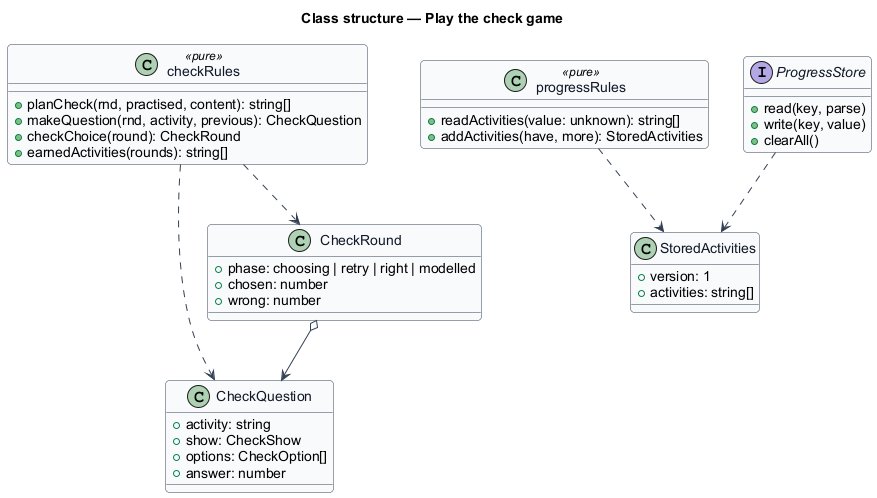
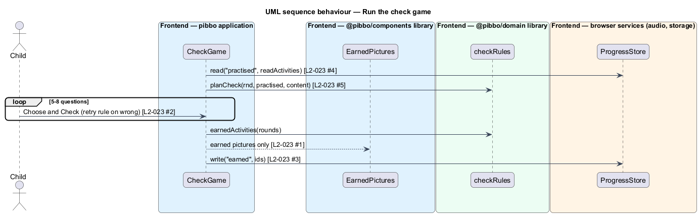

# Play the check game

## Overview

The *check game* presents 5 to 8 mixed *check questions* from what the child has practised and ends with *earned pictures* of what they can do. It shows no score, percentage, red mark, count of misses or name (ADR 0026).

- **check question** — one instruction, something shown, three choices and Check
- **practised** — an activity the child has opened from Home
- **earned picture** — an activity's picture, standing for a question answered right

With nothing practised the questions come from the first lesson's activities. Wrong answers follow the normal retry rule.

## Description

The feature is a vertical slice through the Angular workspace: the page in the `pibbo` application, presentation components in `@pibbo/components`, pure rules in `@pibbo/domain`, and the contracts and tokens in `@pibbo/api`.

- **`CheckGame`** — lazy route `/check` that plays the questions and then shows the results. It provides the asset preloader, fetches this question's and the next question's pictures and recordings, and stops sound and timers when it is destroyed or hidden.
- **`CheckQuestionView`** (`pb-check-question`) — presentation of what is shown and the three choices (`.stage--question`, `.show`, `.pick`).
- **`EarnedPictures`** (`pb-earned-pictures`) — presentation of the results: earned pictures grouped as Reading and Counting, each a button, and Home (`.results`, `.skills`).
- **`CheckCard`** (`pb-check-card`) — the check game's picture on Home (`.check-card--home`).
- **`ProgressBar`** (`pb-progress-bar`) — the shell's progress bar, also for 6 to 8 rounds.
- **`planCheck`**, **`makeQuestion`** — pure functions in `@pibbo/domain/rounds`: which activities are asked, and one question for each, from the activities' own content and the injected random source.
- **`CheckRound`** — pure state machine: `choosing`, `retry`, `right`, `modelled`, using `answerOutcome` (`L2-026`).
- **`earnedActivities`** — the activities answered right, once each, in Home's order.
- **Practice and results** (`@pibbo/domain/storage`) — `readActivities` checks a stored value (version 1, known ids, no repeats); `addActivities` adds without duplicates.
- **`ProgressStore`** — contract `PROGRESS_STORE` in `@pibbo/api`; `BrowserProgressStore` keeps JSON in `localStorage` under `pibbo:`, never throws, and `clearAll` removes every `pibbo:` key. Home records `pibbo:practised` when an activity is opened; the check game writes `pibbo:earned` when its results are shown.
- **`CHECK_GAME`** — content in `check-game-content.json`: the number of rounds, the first lesson's activities (a stand-in until journey 22), each question's instruction and hint, and the result lines. The content check fails the build when a recording is missing.

### Questions

| Activity | Shown | Choices | Hint |
|---|---|---|---|
| Count the toys, Count and write | toys | numerals | count them one more time |
| Which is bigger? | — | three numbers | which has more |
| Rocket countdown, Skip-count, Counting dance | numbers in order | numerals | listen to the numbers again |
| Add together | two sets | numerals | count them all |
| Sound it out | a word | pictures | its sounds, one by one |
| Letter sounds | a sound as shown | letters | the sound again |
| Big and small letters | a big letter | small letters | look at its shape |
| Spell by sound | — (the word is spoken) | words | say it slowly |
| Words and pictures | a picture | words | say each word slowly |
| Spot the word | — (the word is spoken) | common words | listen again |
| Rhyme time | — | pictures | the rhyme's own hint |

Reading choices are silent, a numeral says its number and a picture its word. In Spell by sound and Spot the word the asked word is spoken and shown in the instruction.

## Requirements

The feature realises the following level-2 (L2) requirements. Each L2 requirement refines a level-1 (L1) requirement, cited by identifier.

| L2 ID | Refines (L1) | Requirement |
|-------|--------------|-------------|
| `L2-023` | `L1-021` | Check game. A check game presents 5-8 mixed rounds from what the child has practised and ends with pictures of what they can do. |

Acceptance criteria of `L2-023` (Check game), in short:

1. Results show only earned pictures: no score, percentage, red mark, count of misses or name. They are spoken and shown; each says its name when touched; with none, "You played the check game!" is shown with no list.
2. A wrong answer follows the normal retry rule (`L2-026`); a question answered only by being shown earns nothing.
3. Saved results stay on the device only and are erased by "clear progress": only the ids of activities practised and earned.
4. With no practice history, or one that is damaged or unreadable, the questions come from the first lesson's activities.
5. With history, the questions come from the practised activities only, 5 to 8 of them, never the same activity twice in a row when there are two or more.
6. Each question is spoken and shown, offers three choices, and Check takes no touch until one is chosen.
7. Home's check game picture says "What do I know?" and opens the game.

## Diagrams

### System context

The child uses Pibbo directly; a grown-up is beside or nearby and is not needed to make the feature work. No third-party system takes part.

### Containers

The feature runs in the `pibbo` single-page application. Its content and recordings are bundled and served from Pibbo's own origin; nothing a child does is sent anywhere.

### Components

`CheckGame` asks the rules for a plan and its questions, draws them with the presentation components, and reads and writes progress through `ProgressStore`.

### Class structure

Only activity ids are stored; misses are never stored.

### Run the check game

Selection falls back to the first lesson; results show earned pictures and are saved on the device only.

## Open questions

- Whether Pibbo remembers what a child has practised is for the repository owner to confirm (ADR 0026 #5).
- The first lesson's activities are a stand-in until journey 22 (ADR 0026 #4).
- "Clear progress" has no screen until journey 24; `ProgressStore.clearAll` is ready for it.
