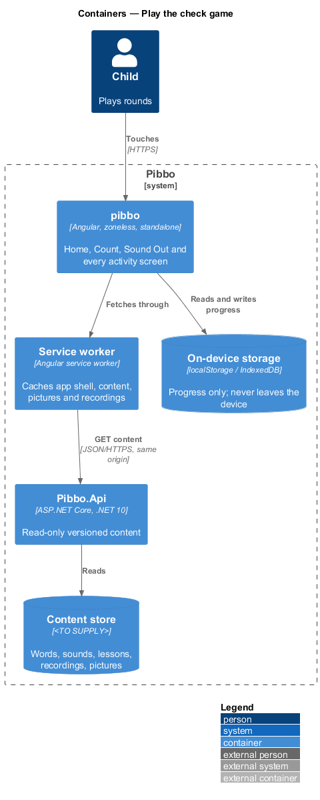
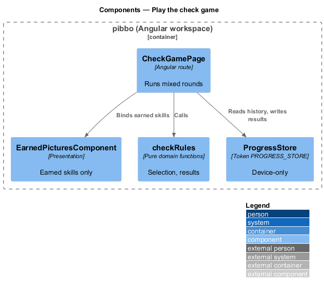

# Play the check game

## Overview

The *check game* presents 5 to 8 mixed rounds from what the child has practised and ends with *earned pictures* of what they can do. It shows no score, percentage, red mark or count of misses.

- **earned picture** — picture standing for a skill the child answered correctly

With no practice history on the device the rounds come from the first lesson's activities. Wrong answers follow the normal retry rule.

## Description

The feature is a vertical slice through the Angular workspace: the page in the `pibbo` application, presentation components in `@pibbo/components`, pure rules in `@pibbo/domain`, and the contracts and tokens in `@pibbo/api`.

- **`CheckGamePage`** — lazy route that runs the rounds and then the results.
- **`EarnedPicturesComponent`** — presentation component showing only earned skills.
- **`checkRules`** — pure functions selecting 5–8 rounds from history or the first lesson, and listing earned skills.
- **`ProgressStore`** — device-only results, erased by clear progress (`grown-up/grown-up-gate`).

## Requirements

The feature realises the following level-2 (L2) requirements. Each L2 requirement refines a level-1 (L1) requirement, cited by identifier.

| L2 ID | Refines (L1) | Requirement |
|-------|--------------|-------------|
| `L2-023` | `L1-021` | Check game. A check game presents 5-8 mixed rounds from what the child has practised and ends with pictures of what they can do. |

Acceptance criteria of `L2-023` (Check game):

1. Given the check game ends, when results are shown, then only skills answered correctly are shown, as earned pictures; no score, percentage, red mark or count of misses is shown.
2. Given a wrong answer in the check game, when it happens, then the normal retry rule (L2-026) applies.
3. Given results, when saved, then they stay in on-device storage only and are erased by "clear progress" in the grown-up area.
4. Given no practice history on the device, when the check game starts, then its rounds come from the first lesson's activities.

## Diagrams

### System context

The child uses Pibbo directly; a grown-up is beside or nearby and is not needed to make the feature work. No third-party system takes part.

### Containers

The feature runs in the `pibbo` single-page application. Content arrives from `Pibbo.Api` through the service worker cache; nothing a child does is sent back.

### Components

`CheckGamePage` reuses each activity's component for its rounds and `checkRules` for selection and results.

### Class structure

`CheckResult` holds earned skills only; misses are never stored.

### Run the check game

Selection falls back to the first lesson; results show earned pictures and are saved on the device only.

