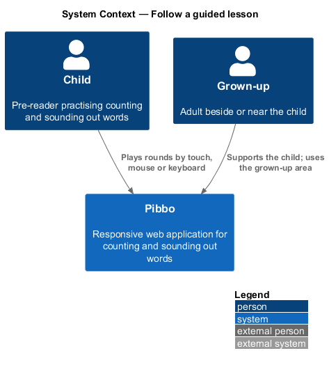
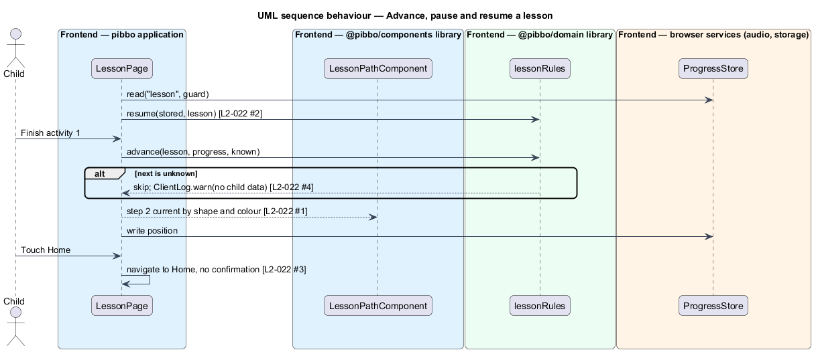

# Follow a guided lesson

## Overview

A *guided lesson* is an ordered list of 3 to 6 activities defined in content. The child moves from one activity to the next automatically after brief praise, and a *lesson path* shows where they are.

- **lesson path** — row of step marks, with the current step shown by shape and colour

Leaving a lesson pauses it with no confirmation, and returning on the same device resumes at the same activity.

## Description

The feature is a vertical slice through the Angular workspace: the page in the `pibbo` application, presentation components in `@pibbo/components`, pure rules in `@pibbo/domain`, and the contracts and tokens in `@pibbo/api`.

- **`LessonPage`** — lazy route in `pibbo` that hosts each activity's component in turn and owns the lesson path.
- **`LessonPathComponent`** — presentation component (`pb-lesson-path`) drawing steps with `aria-current` on the current one.
- **`lessonRules`** — pure functions in `@pibbo/domain/rounds`: `start`, `advance`, `resume`, and skipping unknown activities.
- **`ProgressStore`** — on-device position of the lesson; validated on read.
- **`ClientLog`** — token `CLIENT_LOG` for warnings that carry no child data.

## Requirements

The feature realises the following level-2 (L2) requirements. Each L2 requirement refines a level-1 (L1) requirement, cited by identifier.

| L2 ID | Refines (L1) | Requirement |
|-------|--------------|-------------|
| `L2-022` | `L1-020` | Guided lesson. A lesson is an ordered list of 3-6 activities defined in content; the child moves from one to the next automatically. |

Acceptance criteria of `L2-022` (Guided lesson):

1. Given a lesson of 4 activities, when the child finishes activity 1, then activity 2 starts after brief praise, and a path of 4 steps shows step 2 as current by shape and colour.
2. Given a lesson in progress, when the child leaves and returns on the same device, then it resumes at that activity.
3. Given a lesson in progress, when the child touches Home, then the lesson pauses and Home shows with no confirmation dialog.
4. Given lesson content that names an unknown activity, when the lesson runs, then that step is skipped and a client warning with no child data is logged.

## Diagrams

### System context

The child uses Pibbo directly; a grown-up is beside or nearby and is not needed to make the feature work. No third-party system takes part.

### Containers

The feature runs in the `pibbo` single-page application. Content arrives from `Pibbo.Api` through the service worker cache; nothing a child does is sent back.

### Components

`LessonPage` reads the lesson content, asks `lessonRules` for the next step and stores the position on the device.

### Class structure

A `Lesson` is content; `LessonProgress` is the small device-only state.

### Advance, pause and resume a lesson

Finishing an activity advances after praise; Home pauses without a dialog; an unknown activity is skipped with a warning.

