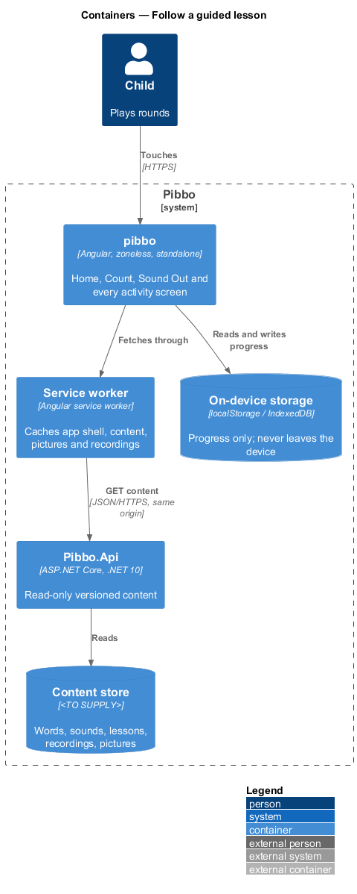
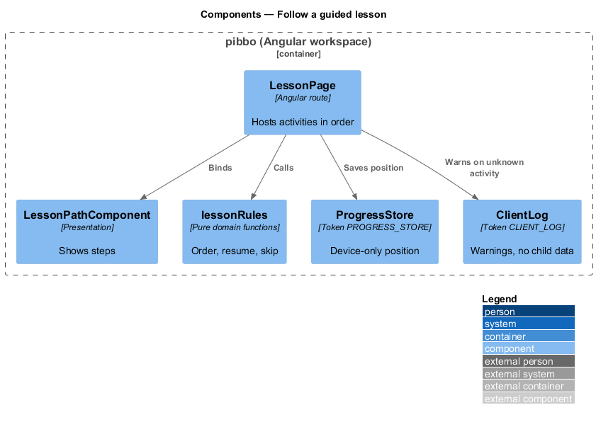
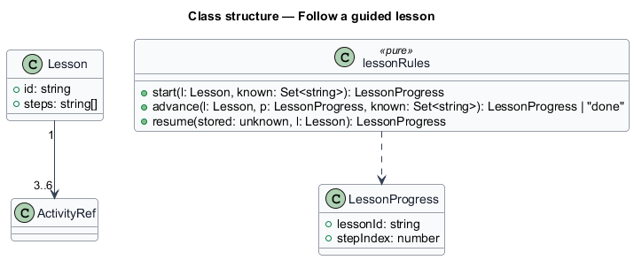

# Follow a guided lesson

## Overview

A *guided lesson* is an ordered list of 3 to 6 activities defined in content, drawn as a *lesson path* (`docs/mocks/pages/guided-lesson`). Finishing an activity and touching Next returns to the path with the next step current; "Up next" and its name are spoken and shown, and one touch plays it. The child never chooses what comes next (ADR 0025).

- **lesson path** — row of step marks, with the current step shown by shape (larger, with a play mark) and colour

Home on the path pauses the lesson with no confirmation; returning on the same device resumes at the same activity. Home's Count and Read screens each show their lesson as a Lesson picture.

## Description

The feature is a vertical slice through the Angular workspace: the page in the `pibbo` application, presentation components in `@pibbo/components`, pure rules in `@pibbo/domain`, and the contracts and tokens in `@pibbo/api`.

- **`LessonPage`** — lazy route `/lesson/:subject` in `pibbo`: reads the lesson and its stored place, speaks "Up next", opens the current activity at its own route with `?lesson=<id>&step=<n>`, and advances on `?finished=<n>`.
- **`LessonPath`** — presentation component (`pb-lesson-path`) keeping the mock's `.path` classes: done nodes play again, the current node has `aria-current="step"`, later nodes are disabled.
- **`lessonRules`** — pure functions in `@pibbo/domain/lessons`: `lessonSteps` (drops unknown activities), `readLessonPlace` (checks a stored value), `lessonPlace`, `finishStep`.
- **`LESSONS`** — the lesson content in `@pibbo/domain/lessons`; which activities and in what order is not decided.
- **`ProgressStore`** — token `PROGRESS_STORE`, bound to `BrowserProgressStore` over `localStorage` (`pibbo:` prefix); a read that throws or finds nothing is absent; `clearAll` is for the grown-up area's "clear progress".
- **`ActivityExit`** — token `ACTIVITY_EXIT`, bound to `RouterActivityExit`: an activity's Leave and its last Next go back to the path when opened from a lesson, and to Home with its group otherwise.
- **`ClientLog`** — token `CLIENT_LOG` (`console.warn`) for warnings that carry no child data.

## Requirements

The feature realises the following level-2 (L2) requirements. Each L2 requirement refines a level-1 (L1) requirement, cited by identifier.

| L2 ID | Refines (L1) | Requirement |
|-------|--------------|-------------|
| `L2-022` | `L1-020` | Guided lesson. A lesson is an ordered list of 3-6 activities defined in content, shown as a path; the child never chooses what comes next. |
| `L2-024` | `L1-022` | Home screen (#4: the lesson picture). |

Acceptance criteria of `L2-022` (Guided lesson):

1. Given a lesson of 5 activities, when the child finishes activity 1 and touches Next after its brief praise, then the path shows activity 1 done and step 2 current by shape and colour, and "Up next" and activity 2's name are spoken and shown; one touch on Play starts activity 2.
2. Given a lesson in progress, when the child leaves and returns on the same device, then it resumes at that activity; a stored position that is missing, of an old version, damaged or no longer matching the lesson is treated as not there and the lesson starts at step 1.
3. Given a lesson in progress, when the child touches Home on the path, then the lesson pauses and Home shows with no confirmation dialog; leaving an activity of the lesson returns to the path at the same step.
4. Given lesson content that names an unknown activity, when the lesson runs, then that step is left off the path and a client warning naming only the lesson and the activity (no child data) is logged.
5. Given the child finishes the last activity, when the path shows, then every step is done, "Lesson done! You played every game." is spoken and shown, and one touch returns Home.

## Open questions

- The mock's in-lesson progress bar ("game N of 5") is deferred; an activity's bar shows its own rounds.
- Whether a finished lesson should start again is not decided; it stays done until "clear progress" (journey 24).

## Diagrams

### System context

The child uses Pibbo directly; a grown-up is beside or nearby and is not needed to make the feature work. No third-party system takes part.

### Containers

The feature runs in the `pibbo` single-page application. Content arrives from `Pibbo.Api` through the service worker cache; nothing a child does is sent back.

### Components

`LessonPage` reads the lesson content, asks `lessonRules` for the next step and stores the position on the device.

### Class structure

A `Lesson` is content; `LessonProgress` is the small device-only state.

### Advance, pause and resume a lesson

Finishing an activity advances after praise; Home pauses without a dialog; an unknown activity is skipped with a warning.

