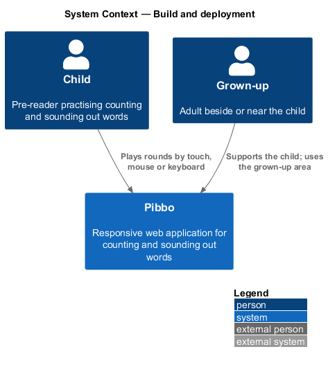
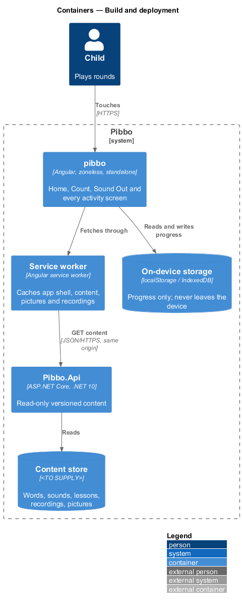
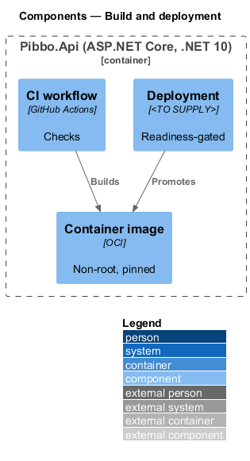
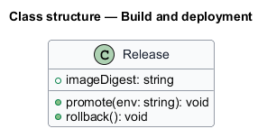
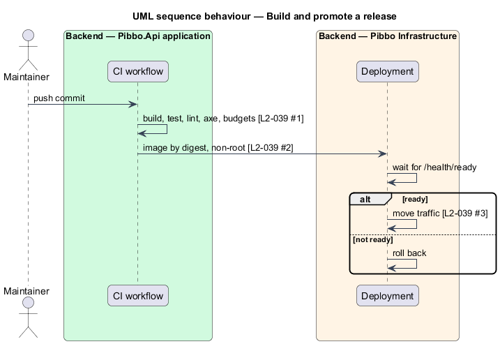

# Build and deployment

## Overview

CI builds the .NET and Angular projects and runs unit tests, acceptance tests, lint, axe checks and bundle-size checks, failing on any failure. A release is a container image running as a non-root user on a base image pinned by digest, promoted unchanged between environments. Traffic moves only after readiness passes, and a failed readiness check rolls back.

`L2-039` #1 asks CI to run unit tests, while `AGENTS.md` states unit tests run locally and never in CI; [ADR 0005](../../../adr/0005-unit-tests-run-locally.md) follows `AGENTS.md` until the repository owner decides.

**Built so far (journey 1):** the frontend half. `.github/workflows/ci.yml` runs format, lint, `npm audit`, the Angular build with its bundle budgets and the behaviour e2e; `node tools/verify/verify.mjs` adds the unit tests locally. The static host settings are in [`docs/deploy.md`](../../../deploy.md). Every commit to main that passes CI is published to Azure Static Web Apps by the workflow's `deploy` job ([ADR 0033](../../../adr/0033-publish-to-azure-static-web-apps-from-main.md)). The .NET build, container image and readiness-gated rollout wait for the backend ADR.

## Description

The feature is a vertical slice through the backend: `Pibbo.Api` (controllers and middleware), `Pibbo.Application` (MediatR handlers), `Pibbo.Domain` and `Pibbo.Infrastructure`, with the Angular client generated from its OpenAPI document. The backend exists only once the ADR required by `L2-028` is accepted.

- **`GitHub Actions workflow`** — `.github/workflows/ci.yml`: lint, build, one acceptance path per feature, bundle budgets, audits; under 5 minutes.
- **`Dockerfile`** — multi-stage, base pinned by digest, `USER` non-root.
- **`Deployment`** — rolling or blue-green with readiness gate and automatic rollback; platform Azure Static Web Apps for the static frontend (ADR 0033); the backend's `<TO SUPPLY>`.

## Requirements

The feature realises the following level-2 (L2) requirements. Each L2 requirement refines a level-1 (L1) requirement, cited by identifier.

| L2 ID | Refines (L1) | Requirement |
|-------|--------------|-------------|
| `L2-039` | `L1-031` | Build and deployment |

Acceptance criteria of `L2-039` (Build and deployment):

1. Given a commit, when CI runs, then it builds the .NET and Angular projects and runs unit tests, acceptance tests, lint, axe checks and bundle-size checks, failing on any failure.
2. Given a release, when built, then the backend is a container image running as a non-root user on a base image pinned by digest, and the same image is promoted between environments.
3. Given a deployment, when it completes, then traffic moves only after readiness passes, and a failed readiness check rolls back automatically.

## Diagrams

### System context

The child uses Pibbo directly; a grown-up is beside or nearby and is not needed to make the feature work. No third-party system takes part.

### Containers

`Pibbo.Api` serves read-only content to the `pibbo` application on the same origin; it receives nothing about a child.

### Components

The pipeline and the deployment are outside the application code.

### Class structure

Build artefacts flow one way: commit, image, environments.

### Build and promote a release

A digest-pinned image is promoted only when readiness passes; otherwise it rolls back.

