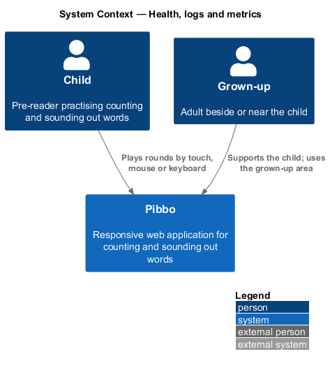
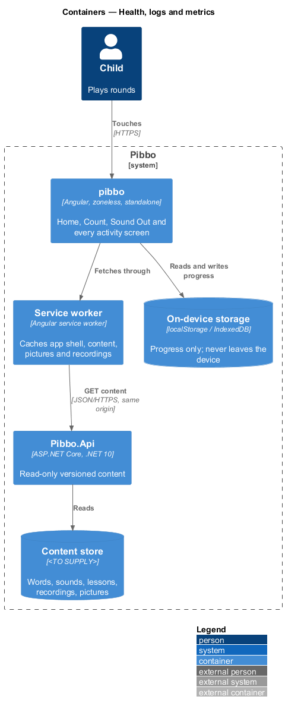
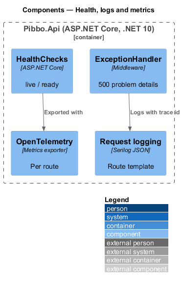
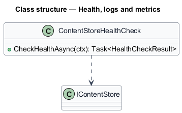
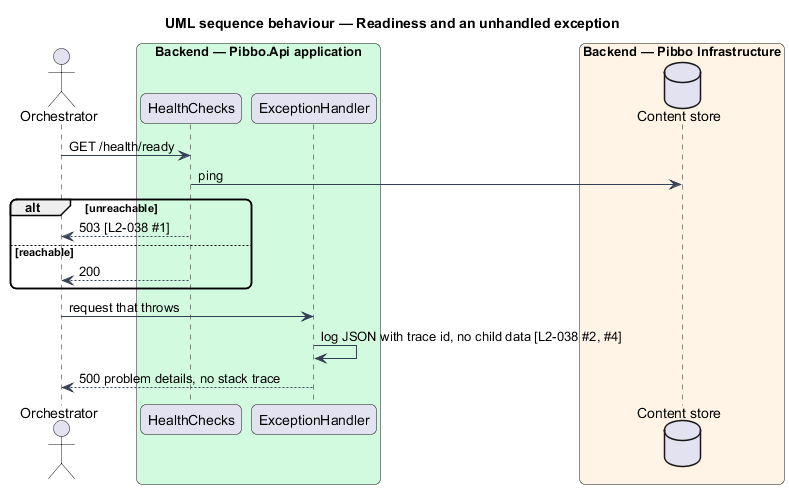

# Health, logs and metrics

## Overview

The backend exposes liveness and readiness checks, writes structured JSON logs and exports OpenTelemetry metrics. None holds child data or a full IP. An unhandled exception becomes a 500 problem-details response without a stack trace and is logged with its trace id.

## Description

The feature is a vertical slice through the backend: `Pibbo.Api` (controllers and middleware), `Pibbo.Application` (MediatR handlers), `Pibbo.Domain` and `Pibbo.Infrastructure`, with the Angular client generated from its OpenAPI document. The backend exists only once the ADR required by `L2-028` is accepted.

- **`Health checks`** — `/health/live` returns 200 while the process runs; `/health/ready` returns 503 until the content store is reachable.
- **`Structured logging`** — JSON with timestamp, route template, status, duration and trace id.
- **`OpenTelemetry metrics`** — request rate, error rate and latency per route template.
- **`ProblemDetails exception handler`** — `UseExceptionHandler` with `AddProblemDetails`; no stack trace in the body.

## Requirements

The feature realises the following level-2 (L2) requirements. Each L2 requirement refines a level-1 (L1) requirement, cited by identifier.

| L2 ID | Refines (L1) | Requirement |
|-------|--------------|-------------|
| `L2-038` | `L1-031` | Health, logs and metrics |

Acceptance criteria of `L2-038` (Health, logs and metrics):

1. Given the backend, when `/health/live` and `/health/ready` are called, then live returns 200 while the process runs and ready returns 503 until the content store is reachable.
2. Given any request, when logged, then the entry is structured JSON with timestamp, route template, status, duration and trace id, and holds no child data and no full IP.
3. Given the backend running, when scraped, then OpenTelemetry metrics show request rate, error rate and latency per route.
4. Given an unhandled exception, when it occurs, then the response is 500 problem details with no stack trace, and the exception is logged with its trace id.

## Diagrams

### System context

The child uses Pibbo directly; a grown-up is beside or nearby and is not needed to make the feature work. No third-party system takes part.

### Containers

`Pibbo.Api` serves read-only content to the `pibbo` application on the same origin; it receives nothing about a child.

### Components

Health, logging, metrics and the exception handler are registered in `Program.cs`.

### Class structure

The readiness check depends on `IContentStore`.

### Readiness and an unhandled exception

Readiness reflects the content store; an exception yields 500 problem details and a log entry with its trace id.

