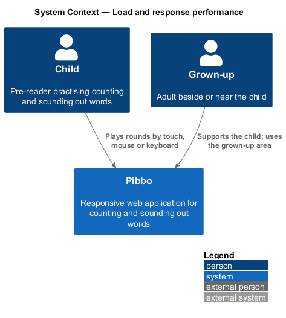
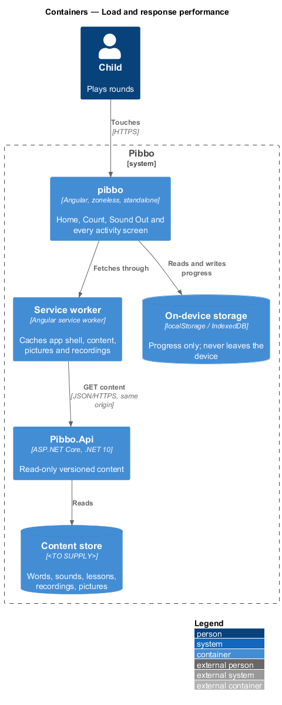
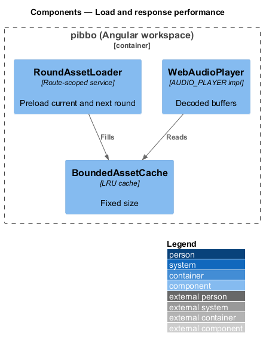
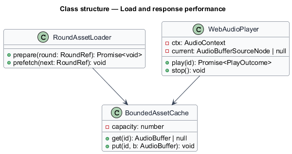
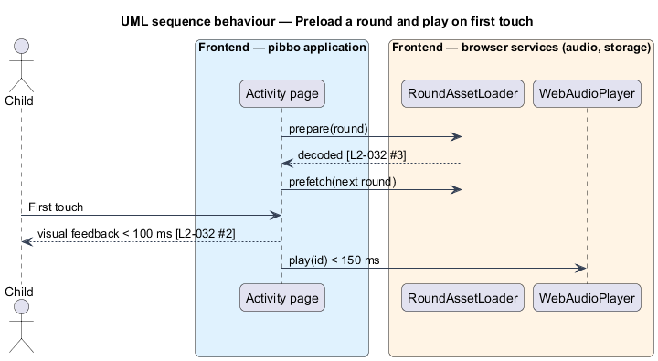

# Load and response performance

## Overview

Pibbo is often opened on an old phone on a slow network. Home loads cold with Largest Contentful Paint of at most 2.5 s and at most 250 KB of initial JavaScript gzipped. Every touch shows feedback within 100 ms, and an activity's recordings are preloaded so the first touch plays within 150 ms.

## Description

The feature is a vertical slice through the Angular workspace: the page in the `pibbo` application, presentation components in `@pibbo/components`, pure rules in `@pibbo/domain`, and the contracts and tokens in `@pibbo/api`.

- **`Lazy routes`** — every activity is a `loadComponent` route; `angular.json` warns above 240 kB initial and fails above 245 kB (239 kB raw, 64 kB gzipped today).
- **`BrowserAssetPreloader`** — route-scoped `ASSET_PRELOADER` that fetches a round's recordings and pictures before it shows and the next round's during it, keeping two rounds and aborting the rest; every activity uses it, the counting ones through `contentAssets` and `numberRecordings` (ADR 0030).
- **`BrowserAudioPlayer`** — `AUDIO_PLAYER` over one `<audio>` element, one recording at a time, at the grown-up's volume; a Web Audio player waits until a measured need.
- **`performance.spec.ts`** — what each activity's first touch plays has been fetched before the touch (`L2-032` #3).
- **`load.sweep.ts`** — on request: Home's Largest Contentful Paint, script size and touch response on a throttled phone, with time passing (`L2-032` #1, #2).
- **`Load test`** — the content API at 500 requests per second is possible since the backend (ADR 0032) and is not built.

## Requirements

The feature realises the following level-2 (L2) requirements. Each L2 requirement refines a level-1 (L1) requirement, cited by identifier.

| L2 ID | Refines (L1) | Requirement |
|-------|--------------|-------------|
| `L2-032` | `L1-027` | Load and response performance |

Acceptance criteria of `L2-032` (Load and response performance):

1. Given a mid-range phone on a throttled 4G profile, when Home loads cold, then Largest Contentful Paint is at most 2.5 s and the initial JS is at most 250 KB gzipped.
2. Given any touch on a target, when handled, then visual feedback appears within 100 ms, and INP is at most 200 ms at p75.
3. Given an activity is opened, when its first round shows, then its recordings are preloaded so the first touch plays within 150 ms.
4. Given the content API at 500 requests per second, when load-tested, then p95 latency is at most 200 ms and the error rate is below 0.1%.

## Diagrams

### System context

The child uses Pibbo directly; a grown-up is beside or nearby and is not needed to make the feature work. No third-party system takes part.

### Containers

The feature runs in the `pibbo` single-page application. Content arrives from `Pibbo.Api` through the service worker cache; nothing a child does is sent back.

### Components

`RoundAssetLoader` fills a bounded cache that `WebAudioPlayer` plays from.

### Class structure

The cache size is fixed so memory stays flat across a long play.

### Preload a round and play on first touch

The round shows only once its recordings are decoded; the first touch plays from memory.

