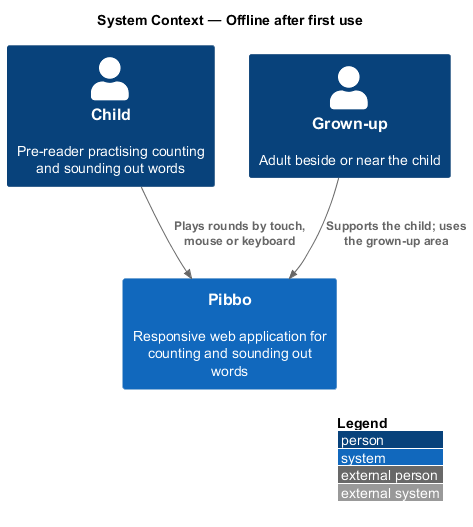
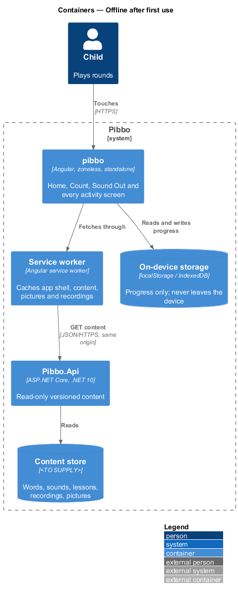

# Offline after first use

## Overview

An activity opened once online keeps working when the network drops, recordings included. Offline, an activity that was never cached shows its picture greyed with a no-network symbol and does not open. New content versions download in the background without interrupting a round.

## Description

The feature is a vertical slice through the Angular workspace: the page in the `pibbo` application, presentation components in `@pibbo/components`, pure rules in `@pibbo/domain`, and the contracts and tokens in `@pibbo/api`.

- **`ngsw-config.json`** — Angular service worker: app shell prefetched; content, pictures and recordings cached on first use.
- **`ActivityAvailability`** — service that reports whether each activity's assets are cached, read by `HomePage`.
- **`SwUpdate handling`** — checks for a new version and activates it only between rounds.

## Requirements

The feature realises the following level-2 (L2) requirements. Each L2 requirement refines a level-1 (L1) requirement, cited by identifier.

| L2 ID | Refines (L1) | Requirement |
|-------|--------------|-------------|
| `L2-033` | `L1-027` | Offline after first use |

Acceptance criteria of `L2-033` (Offline after first use):

1. Given an activity opened once while online, when the network is lost, then it still plays fully, recordings included.
2. Given the app is offline, when the child touches an uncached activity, then its picture shows greyed with a no-network symbol and it does not open.
3. Given a new content version, when the app is next online, then the service worker updates content in the background without interrupting a round.

## Diagrams

### System context

The child uses Pibbo directly; a grown-up is beside or nearby and is not needed to make the feature work. No third-party system takes part.

### Containers

The feature runs in the `pibbo` single-page application. Content arrives from `Pibbo.Api` through the service worker cache; nothing a child does is sent back.

### Components

`HomePage` greys activities that `ActivityAvailability` reports as uncached while offline.

### Class structure

Availability is derived from the cache and the online signal.

### Play offline and update later

Cached activities play; uncached ones are greyed; updates wait for a round boundary.

