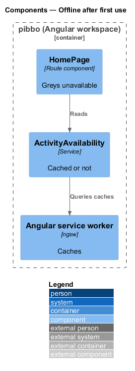
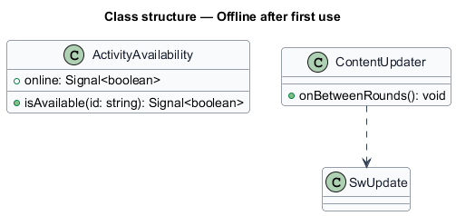
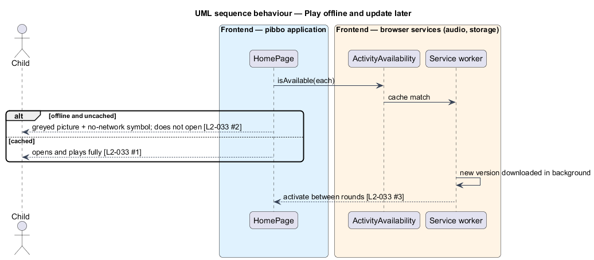

# Offline after first use

## Overview

An activity opened once online keeps working when the network drops, recordings included. Offline, an activity that was never cached shows its picture greyed with a no-network symbol and does not open. New content versions download in the background without interrupting a round.

## Description

The feature is a vertical slice through the Angular workspace: the page in the `pibbo` application, presentation components in `@pibbo/components`, pure rules in `@pibbo/domain`, and the contracts and tokens in `@pibbo/api`.

- **`sw.js`** — Pibbo's own service worker (ADR 0031), written after the build from `tools/service-worker/sw-template.js` with the build's version, shell and file list. It answers only GET requests for Pibbo's own files: the shell is cached on install; an activity's code, pictures and recordings when first used, and the rest of a recordings or pictures folder with the first file fetched from it. One cache of at most 400 files.
- **`registerServiceWorker`** (`app/browser/service-worker.ts`) — registers `sw.js` once the app has started, in production builds only.
- **`Home`** — opens an activity as before; when its code cannot load, it keeps the activity in `unavailable` and passes `offline` to its `ActivityPicture`, which greys it and draws the no-network symbol (`aria-disabled="true"`). The `online` event clears it.
- **Updates** — a new `sw.js` installs in the background, refreshes what the old cache held, and waits: no `skipWaiting`, no reload. It takes over when Pibbo is next opened.

Nothing about a child is kept or sent: the cache holds copies of Pibbo's files, and Home keeps no list of what was opened. Decisions and what is deferred are in [ADR 0031](../../../adr/0031-offline-after-first-use.md); the mock is [home/offline](../../../mocks/pages/home/offline.html).

## Requirements

The feature realises the following level-2 (L2) requirements. Each L2 requirement refines a level-1 (L1) requirement, cited by identifier.

| L2 ID | Refines (L1) | Requirement |
|-------|--------------|-------------|
| `L2-033` | `L1-027` | Offline after first use |

Acceptance criteria of `L2-033` (Offline after first use):

1. Given an activity opened once while online, when the network is lost, then it still plays fully, recordings included.
2. Given the app is offline, when the child touches an uncached activity, then its picture shows greyed with a no-network symbol and it does not open.
3. Given a new content version, when the app is next online, then the service worker updates content in the background without interrupting a round.

## Diagrams

### System context

The child uses Pibbo directly; a grown-up is beside or nearby and is not needed to make the feature work. No third-party system takes part.

### Containers

The feature runs in the `pibbo` single-page application. Pibbo's files arrive from its own static host through the service worker cache; nothing a child does is sent back.

### Components

`Home` greys an activity whose code could not load while offline; the service worker answers from its cache.

### Class structure

Availability is learnt from the touch: an activity whose code did not load is unavailable until the device is online.

### Play offline and update later

Cached activities play; uncached ones are greyed after a touch; a new version installs in the background and waits until Pibbo is next opened.

The PNGs were drawn for the first design; the `.puml` sources are current and are re-rendered with PlantUML when a person asks.

