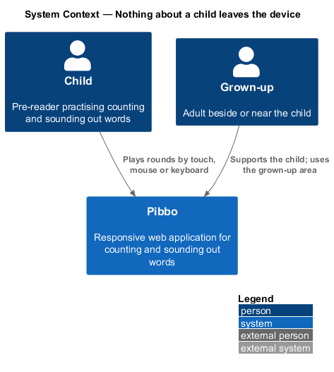
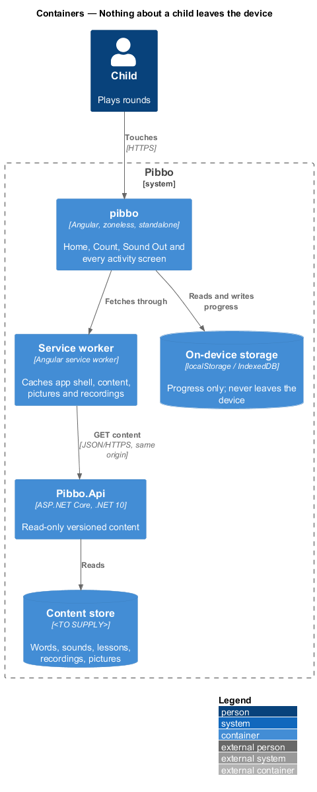
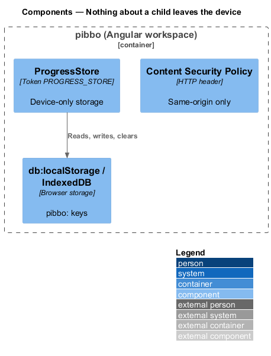
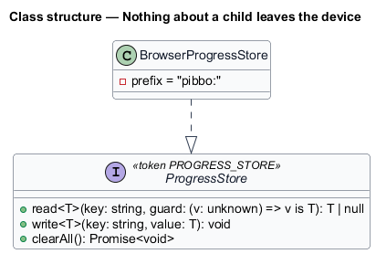
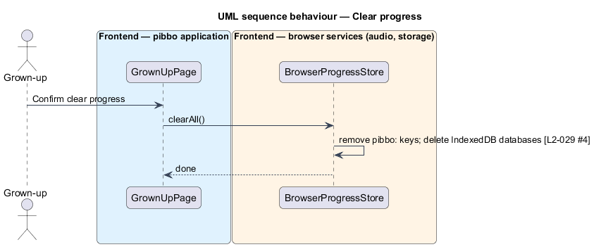

# Nothing about a child leaves the device

## Overview

Pibbo collects nothing about a child. The browser makes only GET requests to Pibbo's own origin, and none carries progress or answers. Pibbo asks for no microphone, camera, location or notification permission. Anything kept stays in on-device storage and is erased by clear progress.

## Description

The feature is a vertical slice through the Angular workspace: the page in the `pibbo` application, presentation components in `@pibbo/components`, pure rules in `@pibbo/domain`, and the contracts and tokens in `@pibbo/api`.

- **`ProgressStore`** — contract in `@pibbo/api` (`PROGRESS_STORE`) with `BrowserProgressStore` over `localStorage` under a `pibbo:` key prefix (ADR 0026). `read` takes a guard and treats missing, old or damaged data as absent; `clearProgress` removes every Pibbo key but the volume, and every IndexedDB database named `pibbo…`.
- **`Content Security Policy`** — `connect-src 'self'` and `default-src 'self'` stop calls to any other origin.
- **`Network-guard fixture`** — Playwright fixture that fails a spec on any request off the Pibbo origin, any request left unanswered and any ask for the microphone or the camera.
- **`privacy.spec.ts`** — opens every activity Home lists and plays it a little, then the check game and the grown-up area: only GET requests to the Pibbo origin, with no query and no body; no permission asked for; nothing on any screen leads to another origin (ADR 0030).

## Requirements

The feature realises the following level-2 (L2) requirements. Each L2 requirement refines a level-1 (L1) requirement, cited by identifier.

| L2 ID | Refines (L1) | Requirement |
|-------|--------------|-------------|
| `L2-029` | `L1-025` | Nothing about a child leaves the device |

Acceptance criteria of `L2-029` (Nothing about a child leaves the device):

1. Given a full Playwright run of every activity, when network traffic is captured, then only GET requests to the Pibbo origin are made and none carries progress or answers.
2. Given the app, when audited, then it requests no microphone, camera, location or notification permission.
3. Given the built app, when scanned, then it has no third-party analytics, advert, social or tracking script, and no link to another origin.
4. Given the grown-up area, when "clear progress" is confirmed, then all Pibbo progress in localStorage and IndexedDB is erased.

## Diagrams

### System context

The child uses Pibbo directly; a grown-up is beside or nearby and is not needed to make the feature work. No third-party system takes part.

### Containers

The feature runs in the `pibbo` single-page application. Content arrives from `Pibbo.Api` through the service worker cache; nothing a child does is sent back.

### Components

Only `ProgressStore` touches storage; nothing in the app sends progress anywhere.

### Class structure

Every stored value is versioned and guarded on read.

### Clear progress

Clear progress, confirmed in the grown-up area, removes every Pibbo key and database.

