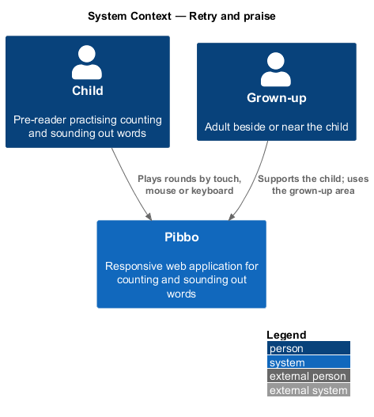
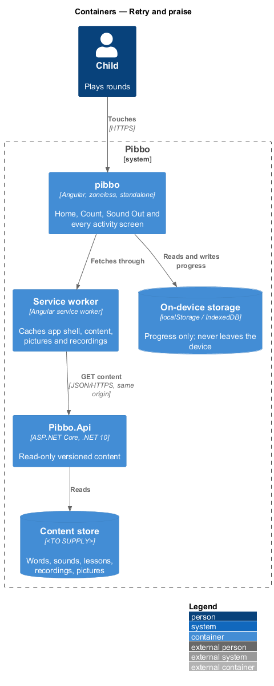
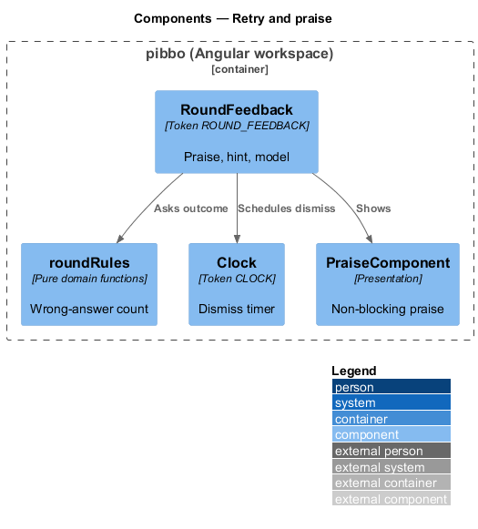
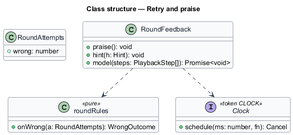
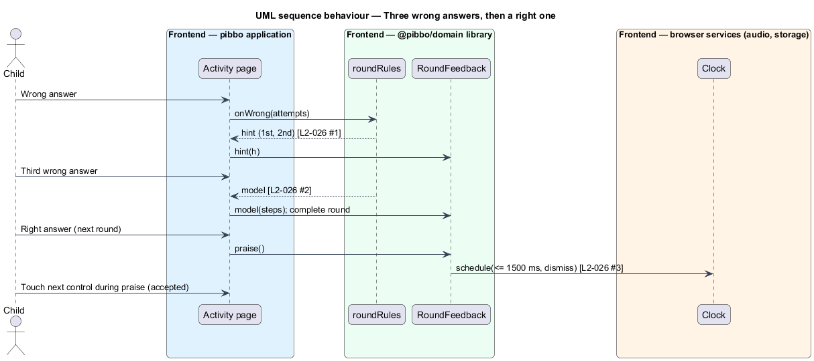

# Retry and praise

## Overview

These are the round rules every activity shares. A wrong answer removes nothing, plays no harsh sound and gives a *hint* before the child tries again. After three wrong answers in one round, Pibbo *models* the correct answer and the round completes. Praise lasts no more than 1.5 s and never blocks a touch on the next control.

- **hint** — shown and spoken help that points toward the right answer
- **model** — Pibbo performing the right answer itself

## Description

The feature is a vertical slice through the Angular workspace: the page in the `pibbo` application, presentation components in `@pibbo/components`, pure rules in `@pibbo/domain`, and the contracts and tokens in `@pibbo/api`.

- **`roundRules`** — pure functions in `@pibbo/domain/rounds` counting wrong answers per round and returning `hint` or `model`.
- **`RoundFeedback`** — route-scoped service bound to `ROUND_FEEDBACK`; plays praise without awaiting it and dismisses it through the injected `CLOCK` after at most 1.5 s.
- **`PraiseComponent`** — presentation component (`pb-praise`) that does not capture pointer events.

## Requirements

The feature realises the following level-2 (L2) requirements. Each L2 requirement refines a level-1 (L1) requirement, cited by identifier.

| L2 ID | Refines (L1) | Requirement |
|-------|--------------|-------------|
| `L2-026` | `L1-023` | Retry and praise |

Acceptance criteria of `L2-026` (Retry and praise):

1. Given any wrong answer, when it is made, then nothing earned is removed, no harsh sound plays, and a hint is given before the child tries again.
2. Given three wrong answers in one round, when the third occurs, then Pibbo models the correct answer and the round completes.
3. Given a correct answer, when praise plays, then it lasts no more than 1.5 s and a touch on the next control is accepted during it.

## Diagrams

### System context

The child uses Pibbo directly; a grown-up is beside or nearby and is not needed to make the feature work. No third-party system takes part.

### Containers

The feature runs in the `pibbo` single-page application. Content arrives from `Pibbo.Api` through the service worker cache; nothing a child does is sent back.

### Components

Activity pages report each answer to `roundRules` and act on the returned outcome through `RoundFeedback`.

### Class structure

`RoundAttempts` is the only state; the rest is behaviour.

### Three wrong answers, then a right one

The first two wrong answers give hints; the third models the answer and completes the round. Praise does not block the next touch.

## Decisions (journey 3)

- `answerOutcome(wrongSoFar, right)` in `@pibbo/domain/rounds` returns `right`, `hint`, or `model` on the third wrong answer (`MAX_WRONG_ANSWERS = 3`).
- Praise is Pibbo's cheer and the praise recording; the page ends the cheer through `CLOCK.after(1500)` (ADR 0007) and Next is live throughout. The answer bar's message ("Yes! 7 toys.") stays until the next round.
- A wrong answer plays no harsh sound: the hint is Pibbo saying "Let's count them together" and counting again.
