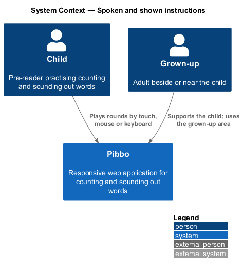
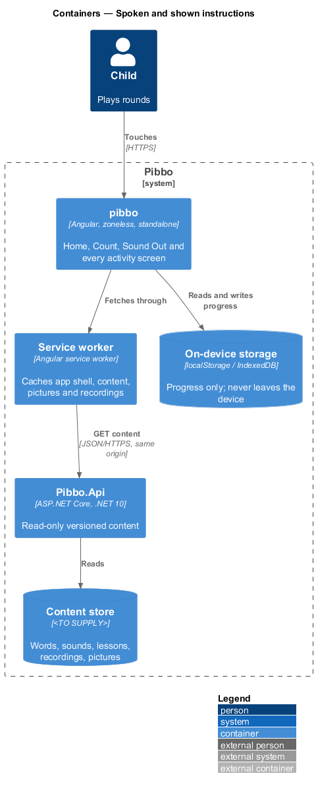
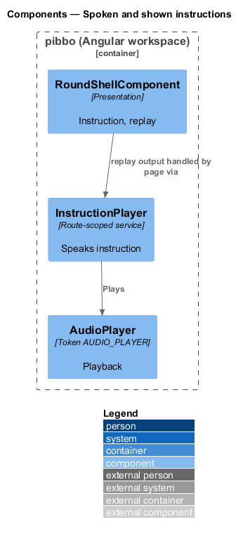
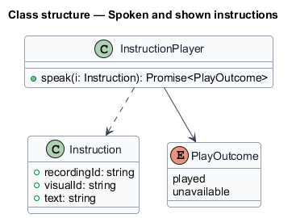
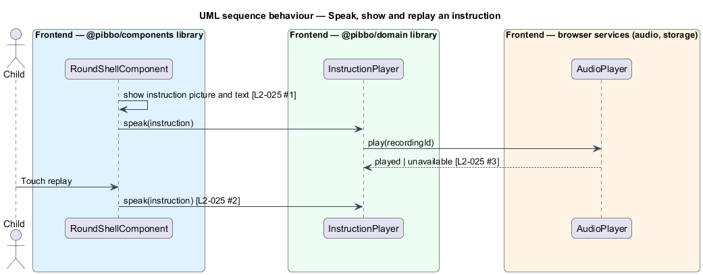

# Spoken and shown instructions

## Overview

Every round begins with an *instruction*: what the child is asked to do. The instruction is spoken and also shown by a picture or animation, so a muted device still works. A replay control speaks it again. No activity screen shows a countdown, timer, lives, streak or score.

- **instruction** — spoken recording plus picture or animation that says what a round asks

## Description

The feature is a vertical slice through the Angular workspace: the page in the `pibbo` application, presentation components in `@pibbo/components`, pure rules in `@pibbo/domain`, and the contracts and tokens in `@pibbo/api`.

- **`RoundShellComponent`** — presentation component (`pb-round-shell`) wrapping every activity: instruction picture slot, replay control and the activity content. It has no slot for a timer or score.
- **`Instruction`** — data item in `@pibbo/domain/rounds`: recording id, picture or animation id and text alternative.
- **`InstructionPlayer`** — route-scoped service that plays the instruction on round start and on replay; a recording that cannot play leaves the picture and text as the carrier.

## Requirements

The feature realises the following level-2 (L2) requirements. Each L2 requirement refines a level-1 (L1) requirement, cited by identifier.

| L2 ID | Refines (L1) | Requirement |
|-------|--------------|-------------|
| `L2-025` | `L1-023` | Spoken and shown instructions |

Acceptance criteria of `L2-025` (Spoken and shown instructions):

1. Given any round starts, when it is shown, then its instruction is spoken and also shown by a picture or animation.
2. Given any round, when the child touches replay, then the instruction is spoken again.
3. Given the device is muted, when any round is played, then it can be completed from what is shown alone.
4. Given any activity screen, when shown, then no countdown, timer, lives, streak or score is visible.

## Diagrams

### System context

The child uses Pibbo directly; a grown-up is beside or nearby and is not needed to make the feature work. No third-party system takes part.

### Containers

The feature runs in the `pibbo` single-page application. Content arrives from `Pibbo.Api` through the service worker cache; nothing a child does is sent back.

### Components

Every activity page places its content inside `RoundShellComponent` and asks `InstructionPlayer` to speak the instruction.

### Class structure

`Instruction` is content; the shell renders it whatever the audio outcome.

### Speak, show and replay an instruction

The instruction is always shown; it is spoken when sound is available and again on replay.

## Decisions (journey 3)

- `RoundShell` (`pb-round-shell`, block `.shell`) is the shared shell: the leave control, the progress bar, Pibbo, the speech bubble with the instruction's picture and text, and the replay control (`.hear`, 60 px). The activity content and the answer bar are projected. It has no slot for a timer or score.
- The instruction is a data item (`Instruction`: `text`, `recording`, `picture`) in `@pibbo/domain/rounds`; the page plays it on round start and on replay. The design's `InstructionPlayer` service was not needed for one activity.
- The text is always shown, so a recording that fails (`PlayOutcome` `failed`) changes nothing on screen.
