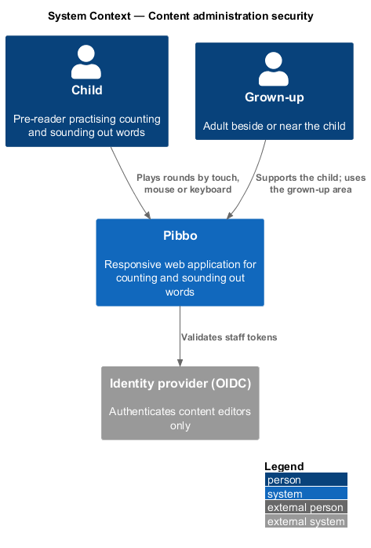
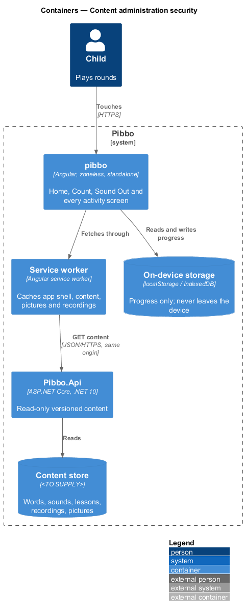
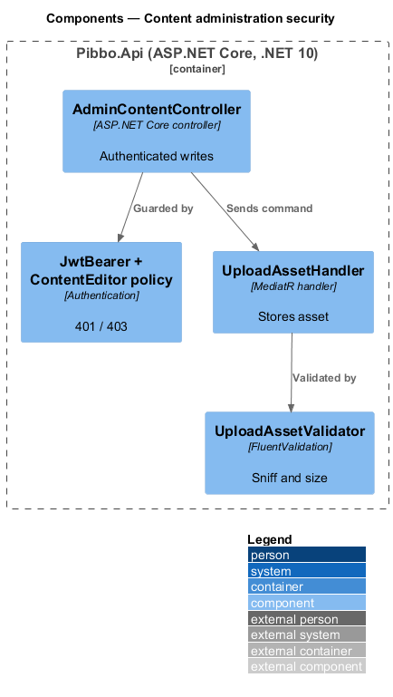
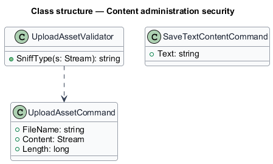

# Content administration security

## Overview

Staff edit content through endpoints under `/api/v1/admin`. Each call needs a valid OIDC token with the `content-editor` role. Uploaded files are checked by content sniffing and size; text is checked against a character allow-list and an 80-character maximum. CI fails on high or critical vulnerable packages.

## Description

The feature is a vertical slice through the backend: `Pibbo.Api` (controllers and middleware), `Pibbo.Application` (MediatR handlers), `Pibbo.Domain` and `Pibbo.Infrastructure`, with the Angular client generated from its OpenAPI document. The backend is in `backend/`, as [ADR 0032](../../../adr/0032-content-backend.md) records.

- **`AdminContentController`** — controller under `/api/v1/admin` with `[Authorize(Policy = "ContentEditor")]`.
- **`UploadAssetCommand + validator`** — FluentValidation checks sniffed type (audio/mpeg, audio/ogg, image/webp, sanitised image/svg+xml) and size (audio 1 MB, image 2 MB).
- **`SaveTextContentCommand + validator`** — allow-list and 80-character maximum.
- **`SvgSanitiser`** — removes scripts and external references from SVG.
- **`CI audit steps`** — `dotnet list package --vulnerable` and `npm audit` fail the build on high or critical findings.

## Requirements

The feature realises the following level-2 (L2) requirements. Each L2 requirement refines a level-1 (L1) requirement, cited by identifier.

| L2 ID | Refines (L1) | Requirement |
|-------|--------------|-------------|
| `L2-031` | `L1-026` | Content administration security. Staff edit content through authenticated endpoints under `/api/v1/admin`. |

Acceptance criteria of `L2-031` (Content administration security):

1. Given no token, when an admin endpoint is called, then 401 is returned.
2. Given a valid OIDC token without the `content-editor` role, when called, then 403 is returned.
3. Given an uploaded file, when received, then its type is checked by content sniffing (audio/mpeg, audio/ogg, image/webp, sanitised image/svg+xml), its size is capped (audio 1 MB, image 2 MB), and anything else is rejected with 415 or 413.
4. Given text content (words, sentences), when saved, then it is validated against a character allow-list and a maximum of 80 characters, and Angular renders it without bypassing sanitisation.
5. Given the CI pipeline, when it runs, then `dotnet list package --vulnerable` and `npm audit` fail the build on high or critical findings.

## Diagrams

### System context

The child uses Pibbo directly; a grown-up is beside or nearby and is not needed to make the feature work. No third-party system takes part.

### Containers

`Pibbo.Api` serves read-only content to the `pibbo` application on the same origin; it receives nothing about a child.

### Components

The policy runs before model binding of the file body.

### Class structure

Commands carry the raw input; validators enforce the rules before the handler runs.

### Upload an asset as a content editor

Authentication and role come first; then the file is sniffed and size-checked.

## As built (journey 27)

- **No OIDC provider for the MVP** (owner's decision). Endpoints need a JWT bearer token with the `content-editor` role, signed with keys configured under `Authentication:Schemes:Bearer` (`dotnet user-jwts` locally). Setting an `Authority` there trusts an OIDC provider instead, with no code change. With nothing configured every admin call is 401.
- `PUT /api/v1/admin/assets/{folder}/{**path}` takes the file as the body. `UploadAssetCommand` and its validator sniff the bytes (the declared type is never trusted), check the name and folder match, and cap recordings at 1 MB and pictures at 2 MB; the API reads nothing past 2 MB. 413 and 415 come from the validator's error codes. `SvgSanitiser` keeps only SVG elements and drops scripts, styles, `foreignObject`, animation, event handlers and any reference outside the drawing; a DTD is refused.
- `POST /api/v1/admin/content/versions` publishes a version after `ContentSetValidator`, the same check the content file passes: text 1 to 80 characters from an allow-list, ids, and files that exist. A published version is never rewritten (409).
- The admin contract is its own document, `backend/openapi/admin.json`, so the frontend's generated types never name an admin endpoint. No component in the frontend bypasses Angular's sanitisation (#4).
- CI fails on high or critical vulnerable packages, through NuGet audit in the build, `backend/tools/audit-packages.sh` (over `dotnet list package --vulnerable`) and `npm audit` (#5).
- Acceptance tests: `ContentAdministrationTests.cs`.
