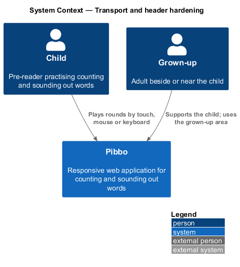
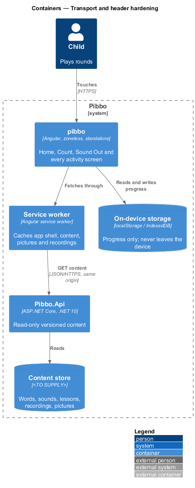
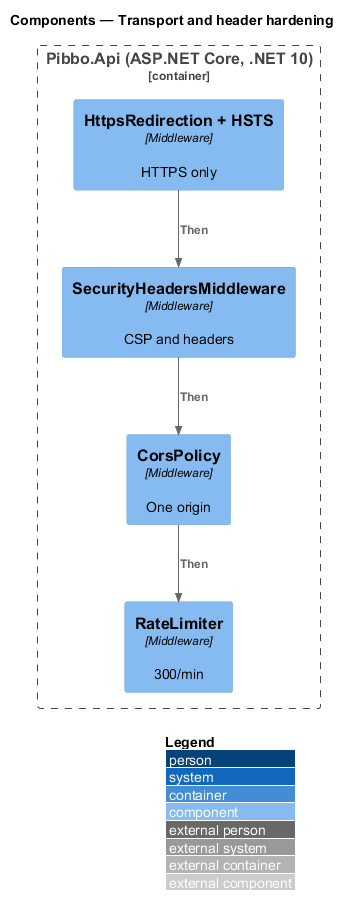
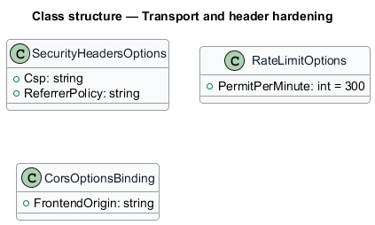
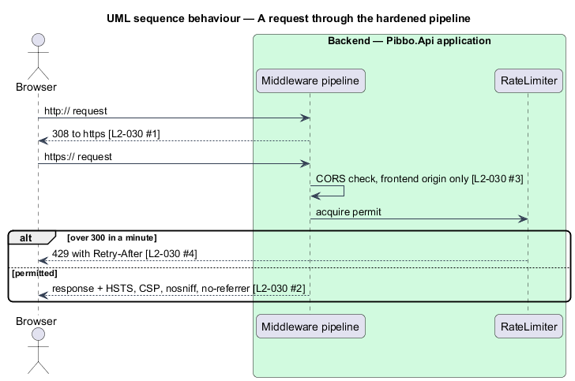

# Transport and header hardening

## Overview

Every response is served over HTTPS with HSTS, a strict Content-Security-Policy and further hardening headers. CORS allows only the configured frontend origin, and a rate limiter returns 429 with Retry-After above 300 requests per minute per client.

## Description

The feature is a vertical slice through the backend: `Pibbo.Api` (controllers and middleware), `Pibbo.Application` (MediatR handlers), `Pibbo.Domain` and `Pibbo.Infrastructure`, with the Angular client generated from its OpenAPI document. The backend exists only once the ADR required by `L2-028` is accepted.

- **`UseHttpsRedirection / UseHsts`** — ASP.NET Core middleware; HSTS max-age 31536000 or more.
- **`SecurityHeadersMiddleware`** — adds CSP (`default-src 'self'`, no `unsafe-inline` script, `frame-ancestors 'none'`), `X-Content-Type-Options: nosniff`, `Referrer-Policy: no-referrer`.
- **`CorsPolicy`** — named policy allowing only the configured frontend origin.
- **`RateLimiter`** — fixed-window limiter, 300 requests per minute per client partition.

## Requirements

The feature realises the following level-2 (L2) requirements. Each L2 requirement refines a level-1 (L1) requirement, cited by identifier.

| L2 ID | Refines (L1) | Requirement |
|-------|--------------|-------------|
| `L2-030` | `L1-026` | Transport and header hardening |

Acceptance criteria of `L2-030` (Transport and header hardening):

1. Given an HTTP request, when received, then it is redirected to HTTPS, and responses carry HSTS with max-age of at least 31536000.
2. Given any response, when inspected, then it carries a Content-Security-Policy with `default-src 'self'`, no `unsafe-inline` script, `frame-ancestors 'none'`, plus `X-Content-Type-Options: nosniff` and `Referrer-Policy: no-referrer`.
3. Given a cross-origin request, when made, then CORS allows only the configured frontend origin.
4. Given more than 300 requests in one minute from one client, when the limit is passed, then 429 with Retry-After is returned.

## Diagrams

### System context

The child uses Pibbo directly; a grown-up is beside or nearby and is not needed to make the feature work. No third-party system takes part.

### Containers

`Pibbo.Api` serves read-only content to the `pibbo` application on the same origin; it receives nothing about a child.

### Components

The middleware order is fixed in `Program.cs`.

### Class structure

Options classes bind from configuration documented with the deployment.

### A request through the hardened pipeline

HTTP redirects to HTTPS; headers are added to every response; excess requests get 429.

