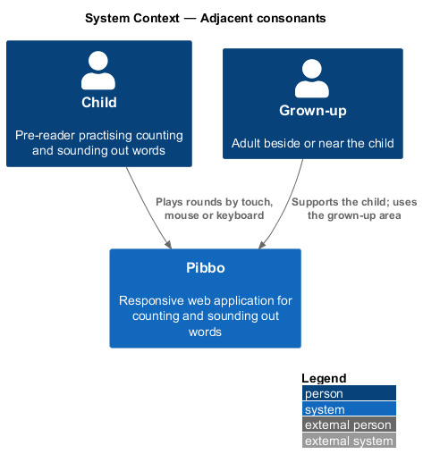
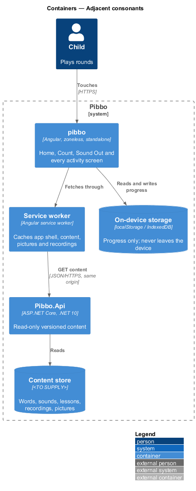
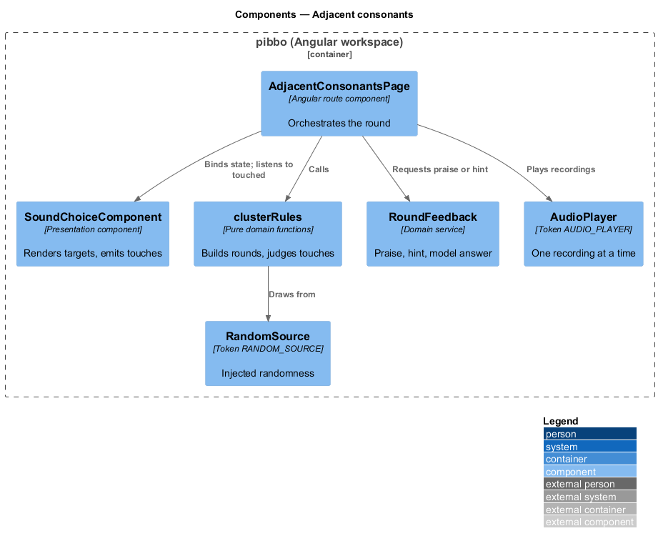
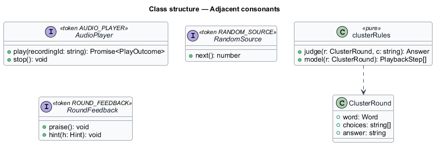
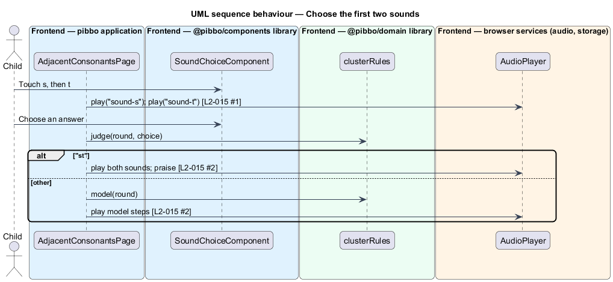

# Adjacent consonants

## Overview

Adjacent consonants are two consonant sounds side by side at the start or end of a word, as s and t in "stop". Each is a separate tile and a separate sound. A question then asks for the first two sounds.

## Description

The feature is a vertical slice through the Angular workspace: the page in the `pibbo` application, presentation components in `@pibbo/components`, pure rules in `@pibbo/domain`, and the contracts and tokens in `@pibbo/api`.

- **`AdjacentConsonantsPage`** — route component in `pibbo`, loaded by `loadComponent` when the child chooses the activity. It is provided with its own `clusterRules` state at route scope, asks the rules for each round, plays recordings through `AUDIO_PLAYER` and hands state to the presentation component.
- **`SoundChoiceComponent`** — presentation component in `@pibbo/components` (selector `pb-soundchoice`). It takes the round state as signal inputs, emits a `touched` output per target, and injects no service.
- **`ClusterRound`** — immutable round state in `@pibbo/domain/sounds`; every transition returns a new value.
- **`clusterRules`** — pure functions in `@pibbo/domain/sounds` that build a round from the injected `RandomSource` and decide the outcome of each touch, with unit tests.
- **`AudioPlayer`** — contract in `@pibbo/api` bound to `AUDIO_PLAYER`. Playing a recording stops the one before it; a recording that cannot play resolves as `unavailable` and the screen shows the text instead.
- **`RoundFeedback`** — shared round behaviour (`retry-and-praise`): brief praise, hints after a wrong answer, and modelling the answer after three wrong answers.

## Requirements

The feature realises the following level-2 (L2) requirements. Each L2 requirement refines a level-1 (L1) requirement, cited by identifier.

| L2 ID | Refines (L1) | Requirement |
|-------|--------------|-------------|
| `L2-015` | `L1-013` | Adjacent consonants |

Acceptance criteria of `L2-015` (Adjacent consonants):

1. Given "stop" shown as [s][t][o][p], when the child touches s then t, then "sss" and "t" are each spoken separately.
2. Given the question "what are the first two sounds?" with choices "st", "s" and "t", when "st" is chosen, then both sounds are spoken and praise plays; when another is chosen, then both sounds are modelled and the child chooses again.

## Diagrams

### System context

The child uses Pibbo directly; a grown-up is beside or nearby and is not needed to make the feature work. No third-party system takes part.

### Containers

The feature runs in the `pibbo` single-page application. Content arrives from `Pibbo.Api` through the service worker cache; nothing a child does is sent back.

### Components

`AdjacentConsonantsPage` composes `SoundChoiceComponent` for presentation and calls `clusterRules` for every decision. The page is the only part that injects tokens; the rules hold no Angular dependency.

### Class structure

`ClusterRound` is the value the rules transform; `AdjacentConsonantsPage` holds it in a signal and passes it to `SoundChoiceComponent`.

### Choose the first two sounds

A right choice speaks both sounds; a wrong one models both sounds and the child chooses again.

