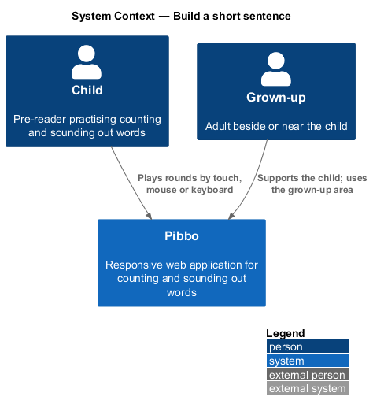
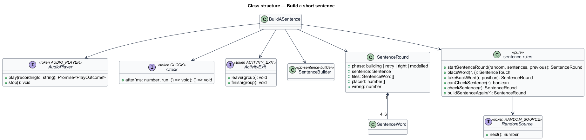
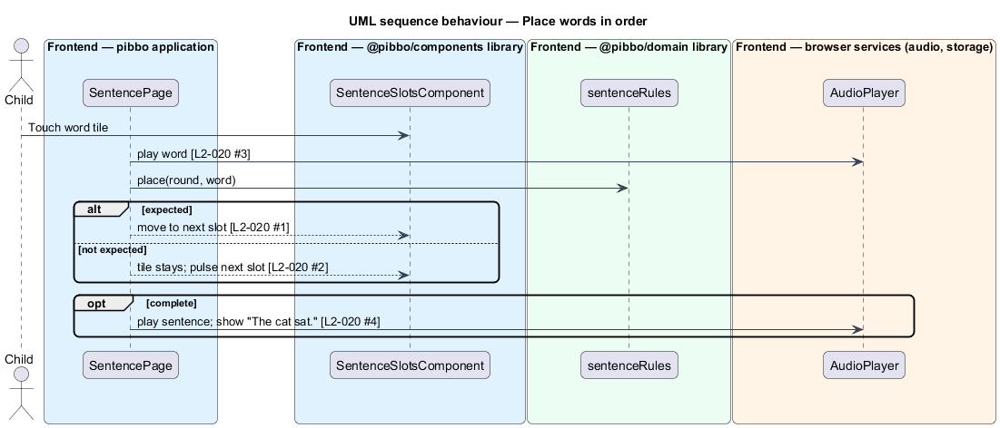

# Build a short sentence

## Overview

A picture, an empty strip and a bank of word tiles are shown: the words of a short sentence and one word that does not belong, in an order the random source chooses. Each tile speaks its word when touched and puts it at the end of the strip; a word on the strip goes back when touched. Once the strip is full, Check judges the sentence (ADR 0034, docs/mocks/pages/build-a-sentence).

## Description

The feature is a vertical slice through the Angular workspace: the page in the `pibbo` application, a presentation component in `@pibbo/components`, pure rules and content in `@pibbo/domain`, and the contracts and tokens in `@pibbo/api`.

- **`BuildASentence`** — route component in `pibbo` at `/read/sentence`, loaded by `loadComponent` when the child chooses the activity. It provides its own `ASSET_PRELOADER`, holds the round in a signal, plays recordings through `AUDIO_PLAYER`, times praise with `CLOCK` and ends through `ACTIVITY_EXIT`, so a guided lesson returns to its path.
- **`SentenceBuilder`** — presentation component in `@pibbo/components` (selector `pb-sentence-builder`): the picture, the strip (`.strip`, `.strip__word`, `.strip__hint`) and the word bank (`.word-bank`, `.word-tile`). It takes the round's parts as signal inputs, emits `tile` and `word` outputs, and injects no service. A used tile is `disabled` and named "cat, used"; a word on the strip is named "Take back cat" while it can be taken back.
- **`SentenceRound`** — immutable round state in `@pibbo/domain/sounds` (`sentence-round.ts`): `building`, `retry`, `right` or `modelled`, the sentence, its tiles in order shown, the tiles placed on the strip, and the wrong checks so far.
- **sentence rules** — pure functions with unit tests: `startSentenceRound` (never the sentence just played), `placeWord`, `takeBackWord`, `canCheckSentence`, `checkSentence` (the third wrong check models the sentence), `buildSentenceAgain` (empties the strip) and `sentenceAssets`.
- **`SENTENCES`** — `sentences-content.json` and its typed accessor, checked before every build by `tools/content/check-content.mjs`: each sentence's tiles, extra word, picture, its text alternative and a recording of the whole sentence, and a recording for each word. The tiles carry the capital and full stop ("The", "sit."), so the built sentence starts with a capital letter and ends with a full stop.
- **`AnswerBar`** — Check, then praise and Next (`right`), the hint and Try again (`retry`), or the modelled sentence and Next (`model`). Praise lasts no more than 1.5 s and never blocks Next (L2-026 #3).

## Requirements

The feature realises the following level-2 (L2) requirements. Each L2 requirement refines a level-1 (L1) requirement, cited by identifier.

| L2 ID | Refines (L1) | Requirement |
|-------|--------------|-------------|
| `L2-020` | `L1-018` | Build a short sentence |
| `L2-026` | `L1-023` | Retry and praise |

Acceptance criteria of `L2-020` (Build a short sentence):

1. Given a round starts, when it is shown, then a picture, an empty strip and the words of its sentence ("The", "cat", "can", "sit.") with one more word ("hat") in an order the random source chooses are shown; "Look at the picture. Put the words in order to tell about it." is spoken and shown, and Check takes no touch.
2. Given a word tile, when the child touches it, then its word is spoken and, while the strip has room, it moves to the end of the strip and its tile stays in place, used, taking no touch.
3. Given a word on the strip, when the child touches it, then it goes back to its tile and the words after it close up; nothing else is lost.
4. Given the strip holds as many words as the sentence, then Check takes a touch; given fewer, it takes none.
5. Given the strip holds the sentence in order, when Check is touched, then the strip shows as right, the sentence is spoken, "“The cat can sit.” What a great sentence!" is shown as praise, and Next is offered; the sentence starts with a capital letter and ends with a full stop. After the fifth round Next returns to Home with Read chosen.
6. Given any other order or word, when Check is touched, then "Read it out loud. Does it sound right?" is spoken and shown with Try again, the words take no touch, and Try again empties the strip so the child builds afresh.
7. Given the third wrong Check in one round, when it is made, then the strip shows the sentence in order as right, "Listen:" and the sentence are spoken, "Listen: “The cat can sit.”" is shown, and Next completes the round (L2-026 #2).

## Open questions

- Which sentences Pibbo covers, and in what order, is not decided; the three sentences are the mock's cast. The recordings are silent placeholders.
- The check game asks "What comes next?" about a practised Build a sentence (ADR 0034).

## Diagrams

### System context

The child uses Pibbo directly; a grown-up is beside or nearby and is not needed to make the feature work. No third-party system takes part.

### Containers

The feature runs in the `pibbo` single-page application. Content arrives from `Pibbo.Api` through the service worker cache; nothing a child does is sent back.

### Components

`BuildASentence` composes `SentenceBuilder` for presentation and calls the sentence rules for every decision. The page is the only part that injects tokens; the rules hold no Angular dependency.

### Class structure

`SentenceRound` is the value the rules transform; `BuildASentence` holds it in a signal and passes its parts to `SentenceBuilder`.

### Build the sentence and check it

Each touched tile is spoken and goes to the end of the strip; a word on the strip goes back when touched. Check praises the sentence in order, gives a hint otherwise, and after the third miss models the sentence.

