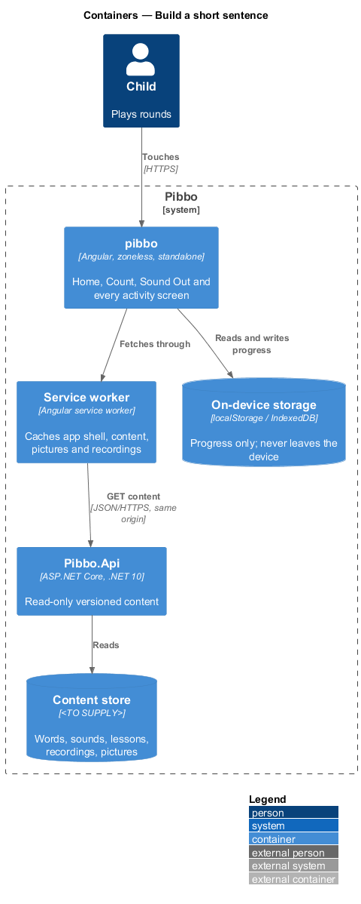
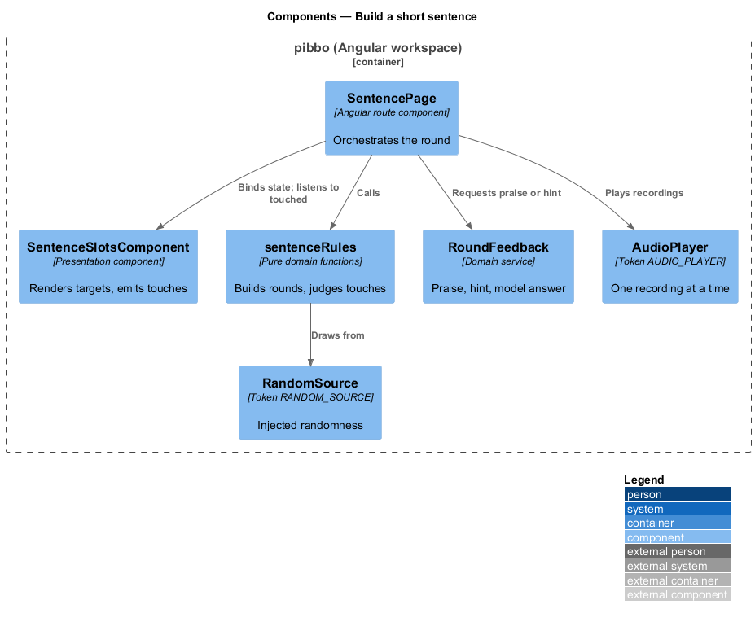

# Build a short sentence

## Overview

A picture and 3–5 shuffled word tiles are shown. The child touches the words in order to build a sentence that matches the picture. Each tile speaks its word when touched.

## Description

The feature is a vertical slice through the Angular workspace: the page in the `pibbo` application, presentation components in `@pibbo/components`, pure rules in `@pibbo/domain`, and the contracts and tokens in `@pibbo/api`.

- **`SentencePage`** — route component in `pibbo`, loaded by `loadComponent` when the child chooses the activity. It is provided with its own `sentenceRules` state at route scope, asks the rules for each round, plays recordings through `AUDIO_PLAYER` and hands state to the presentation component.
- **`SentenceSlotsComponent`** — presentation component in `@pibbo/components` (selector `pb-sentenceslots`). It takes the round state as signal inputs, emits a `touched` output per target, and injects no service.
- **`SentenceRound`** — immutable round state in `@pibbo/domain/sounds`; every transition returns a new value.
- **`sentenceRules`** — pure functions in `@pibbo/domain/sounds` that build a round from the injected `RandomSource` and decide the outcome of each touch, with unit tests.
- **`AudioPlayer`** — contract in `@pibbo/api` bound to `AUDIO_PLAYER`. Playing a recording stops the one before it; a recording that cannot play resolves as `unavailable` and the screen shows the text instead.
- **`RoundFeedback`** — shared round behaviour (`retry-and-praise`): brief praise, hints after a wrong answer, and modelling the answer after three wrong answers.
- **`display`** — the completed sentence starts with a capital letter and ends with a full stop.

## Requirements

The feature realises the following level-2 (L2) requirements. Each L2 requirement refines a level-1 (L1) requirement, cited by identifier.

| L2 ID | Refines (L1) | Requirement |
|-------|--------------|-------------|
| `L2-020` | `L1-018` | Build a short sentence |

Acceptance criteria of `L2-020` (Build a short sentence):

1. Given a picture and 3-5 shuffled word tiles ("the", "cat", "sat"), when the child touches them in the order "the cat sat", then each word moves to the next slot and the whole sentence is spoken.
2. Given the next slot expects "cat", when the child touches "sat", then "sat" is spoken, stays where it is, and the next slot is pulsed (outlined under reduced motion).
3. Given any word tile, when the child touches it before placing, then the word is spoken.
4. Given the sentence complete, when shown, then it starts with a capital letter and ends with a full stop.

## Diagrams

### System context

The child uses Pibbo directly; a grown-up is beside or nearby and is not needed to make the feature work. No third-party system takes part.

### Containers

The feature runs in the `pibbo` single-page application. Content arrives from `Pibbo.Api` through the service worker cache; nothing a child does is sent back.

### Components

`SentencePage` composes `SentenceSlotsComponent` for presentation and calls `sentenceRules` for every decision. The page is the only part that injects tokens; the rules hold no Angular dependency.

### Class structure

`SentenceRound` is the value the rules transform; `SentencePage` holds it in a signal and passes it to `SentenceSlotsComponent`.

### Place words in order

The expected word moves to the next slot; any other word is spoken and stays, and the next slot pulses (an outline under reduced motion).

