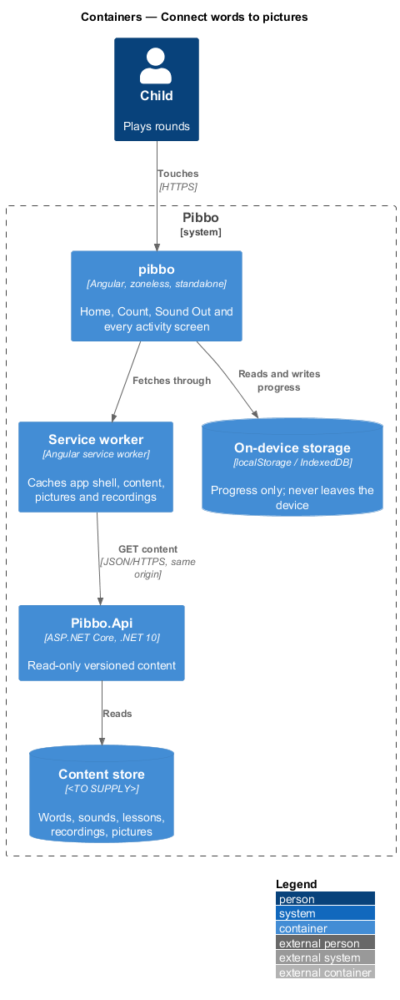
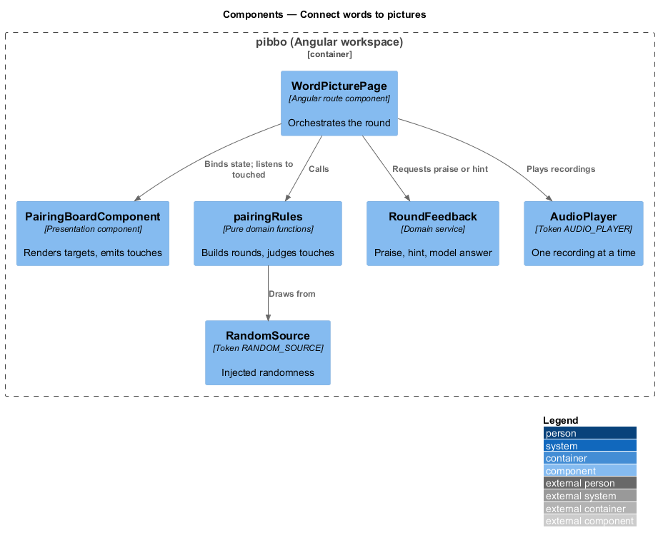
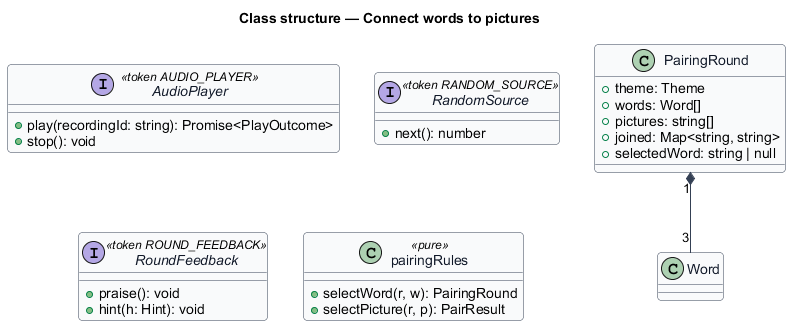

# Connect words to pictures

## Overview

A round shows three related words on one theme (for example farm animals) and their pictures. The child pairs each word with its picture by two touches: the word, then the picture. No drag is needed.

## Description

The feature is a vertical slice through the Angular workspace: the page in the `pibbo` application, presentation components in `@pibbo/components`, pure rules in `@pibbo/domain`, and the contracts and tokens in `@pibbo/api`.

- **`WordPicturePage`** — route component in `pibbo`, loaded by `loadComponent` when the child chooses the activity. It is provided with its own `pairingRules` state at route scope, asks the rules for each round, plays recordings through `AUDIO_PLAYER` and hands state to the presentation component.
- **`PairingBoardComponent`** — presentation component in `@pibbo/components` (selector `pb-pairingboard`). It takes the round state as signal inputs, emits a `touched` output per target, and injects no service.
- **`PairingRound`** — immutable round state in `@pibbo/domain/sounds`; every transition returns a new value.
- **`pairingRules`** — pure functions in `@pibbo/domain/sounds` that build a round from the injected `RandomSource` and decide the outcome of each touch, with unit tests.
- **`AudioPlayer`** — contract in `@pibbo/api` bound to `AUDIO_PLAYER`. Playing a recording stops the one before it; a recording that cannot play resolves as `unavailable` and the screen shows the text instead.
- **`RoundFeedback`** — shared round behaviour (`retry-and-praise`): brief praise, hints after a wrong answer, and modelling the answer after three wrong answers.

## Requirements

The feature realises the following level-2 (L2) requirements. Each L2 requirement refines a level-1 (L1) requirement, cited by identifier.

| L2 ID | Refines (L1) | Requirement |
|-------|--------------|-------------|
| `L2-018` | `L1-016` | Connect words to pictures. A round shows 3 related words (one theme, such as farm animals) and their pictures. |

Acceptance criteria of `L2-018` (Connect words to pictures):

1. Given words and pictures shown, when the child touches a word and then a picture, then a correct pair is joined and the word spoken; a wrong pair speaks both and they stay apart.
2. Given any word in the round, when its letters are touched, then they sound out as in L2-012.
3. Given all pairs joined, when the round ends, then praise plays and the theme is spoken.
4. Given any pairing, when made, then it needs two touches and no drag.

## Diagrams

### System context

The child uses Pibbo directly; a grown-up is beside or nearby and is not needed to make the feature work. No third-party system takes part.

### Containers

The feature runs in the `pibbo` single-page application. Content arrives from `Pibbo.Api` through the service worker cache; nothing a child does is sent back.

### Components

`WordPicturePage` composes `PairingBoardComponent` for presentation and calls `pairingRules` for every decision. The page is the only part that injects tokens; the rules hold no Angular dependency.

### Class structure

`PairingRound` is the value the rules transform; `WordPicturePage` holds it in a signal and passes it to `PairingBoardComponent`.

### Pair a word with its picture

A correct pair joins and speaks the word; a wrong pair speaks both and they stay apart. The final pair ends with praise and the theme spoken.

