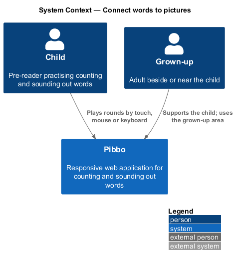
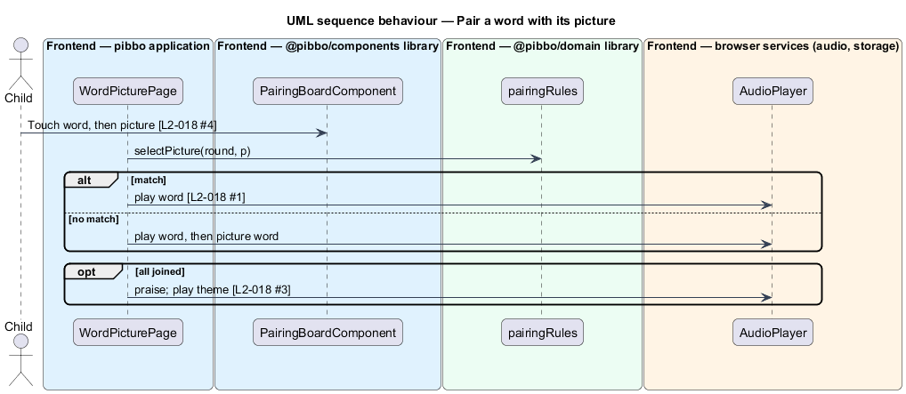

# Connect words to pictures

## Overview

A round shows words on one theme (for example "by the sea") in one column and their pictures in another, in a different order. The child touches a word, which sounds out, then its picture. No drag is needed. ADR 0023 records how this design was brought in line with the mocks (`docs/mocks/pages/words-and-pictures/`).

## Description

The feature is a vertical slice through the Angular workspace: the page in the `pibbo` application, presentation components in `@pibbo/components`, pure rules in `@pibbo/domain`, and the contracts and tokens in `@pibbo/api`.

- **`WordsAndPictures`** — route component in `pibbo` (`/read/word-pictures`), loaded by `loadComponent` when the child chooses the activity. It holds the round in a signal, asks the rules for every touch, plays recordings through `AUDIO_PLAYER` one after another, times praise and the shake with `CLOCK`, and provides its own `ASSET_PRELOADER` so its fetches end when the child leaves.
- **`WordPictures`** — presentation component in `@pibbo/components` (selector `pb-word-pictures`). It draws the mock's `.pairs.pairs--pictures`: the words (`.pair__word`) in one column and their pictures in the other, each a `.pair--tall` target. The held word is `aria-pressed`; a matched pair takes its colour and corner shape and "matched" in its name, and is disabled; a missed picture carries `.pair--miss`. It takes signal inputs, emits `word` and `picture` outputs, and injects no service.
- **Layout** — `WordPictures` is the game area's size container: rows share its height, never under 60 × 60 px. On a phone on its side the words and pictures make one row, words on the left, because the shell keeps the ask above the game there; `RoundShell` takes the mock's small-upright-phone rule for the ask so a 320 px phone keeps a readable instruction (ADR 0023 #6).
- **`WordPicturesRound`** — the immutable round state in `@pibbo/domain/sounds` (`matching`, `right`): the theme, its words in the content's order, the same words as pictures in a shuffled order, the held word and the words found. Every transition returns a new value.
- **`startWordPicturesRound`, `holdWord`, `matchPicture`, `wordJoined`, `pictureJoined`, `joinColour`, `wordPicturesAssets`** — pure functions in `@pibbo/domain/sounds`. The theme and the pictures' order come from the injected `RandomSource`, never the words' own order. Holding a word returns its sound recordings to speak in turn; matching returns the word (a join) or the word and the picture's word (a miss, which lets the word go). Unit-tested.
- **`WORD_PICTURES`** — the content (themes, rounds a play) in `sound-out-content.json`. A theme names Sound it out's words, its instruction and its praise; `tools/content/check-content.mjs` checks it before every build.
- **`AudioPlayer`** — contract in `@pibbo/api` bound to `AUDIO_PLAYER`. Playing a recording stops the one before it; a recording that cannot play never blocks the round, because every word is shown and every picture has a text alternative.

## Requirements

The feature realises the following level-2 (L2) requirements. Each L2 requirement refines a level-1 (L1) requirement, cited by identifier.

| L2 ID | Refines (L1) | Requirement |
|-------|--------------|-------------|
| `L2-018` | `L1-016` | Connect words to pictures. A round shows related words on one theme in one column and their pictures in another, in a different order: two to four pairs. |

Acceptance criteria of `L2-018` (Connect words to pictures):

1. Given words and pictures shown, when the child touches a word and then its picture, then the word is spoken, and the two are joined in the same colour, marked as matched and no longer take a touch; when the child touches a word and then another picture, then the word and the picture's word are both spoken, the picture gives a small shake (none with reduced motion), the word is let go, and they stay apart with nothing taken away.
2. Given any word in the round, when it is touched, then it is held and its sounds are spoken in turn as in L2-012 ("b", "oa", "t"), never the letters' names, for the child to blend; given no word is held, when a picture is touched, then its word is spoken.
3. Given all pairs joined, when the round ends, then brief praise naming the theme is spoken and shown ("You read all the by the sea words!") and Next is offered.
4. Given any pairing, when made, then it needs two touches and no drag; there is no timer and no limit on tries.

## Diagrams

The context and container diagrams are shared with every activity and draw a content API that does not exist yet; this activity's content is bundled in the app.

### System context

The child uses Pibbo directly; a grown-up is beside or nearby and is not needed to make the feature work. No third-party system takes part.

### Containers

The feature runs in the `pibbo` single-page application. Nothing a child does is sent anywhere.

### Components

`WordsAndPictures` composes `WordPictures` for presentation and calls the round rules for every decision. The page is the only part that injects tokens; the rules hold no Angular dependency.

### Class structure

`WordPicturesRound` is the value the rules transform; `WordsAndPictures` holds it in a signal and passes it to `WordPictures`.

### Pair a word with its picture

A touched word sounds out. Its picture joins the pair and speaks the word; another picture speaks both, shakes and lets the word go. The final pair ends with praise naming the theme.

## Open questions

- Which themes and words the activity covers, how many pairs a round shows (two to four) and in what order themes come are content decisions, not made here. The one theme is the mock's "by the sea" without sunset, which waits for journey 17's two-syllable words.
- The recordings are placeholders, like every recording so far.
