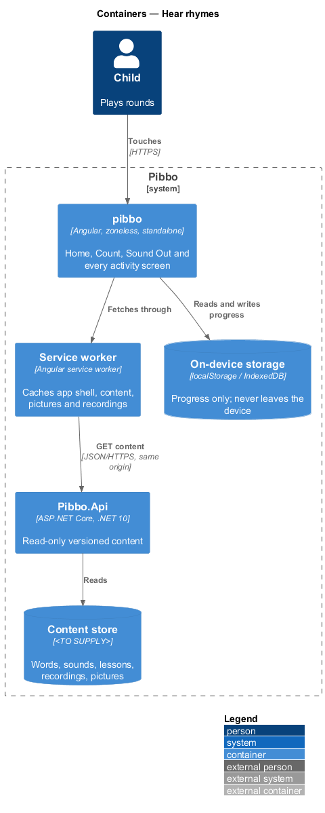
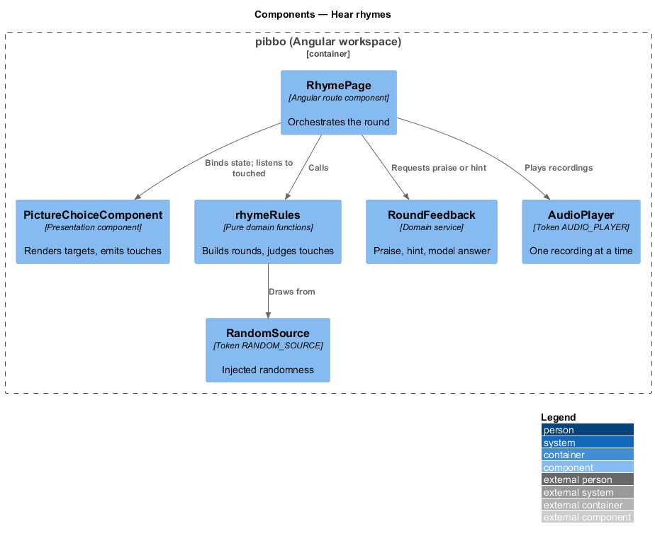
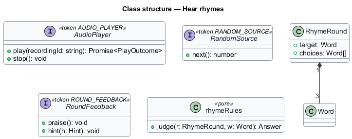

# Hear rhymes

## Overview

A word is spoken with its picture and three choices, each with a picture, are offered. The child touches the one that rhymes. The round needs no reading.

## Description

The feature is a vertical slice through the Angular workspace: the page in the `pibbo` application, presentation components in `@pibbo/components`, pure rules in `@pibbo/domain`, and the contracts and tokens in `@pibbo/api`.

- **`RhymePage`** — route component in `pibbo`, loaded by `loadComponent` when the child chooses the activity. It is provided with its own `rhymeRules` state at route scope, asks the rules for each round, plays recordings through `AUDIO_PLAYER` and hands state to the presentation component.
- **`PictureChoiceComponent`** — presentation component in `@pibbo/components` (selector `pb-picturechoice`). It takes the round state as signal inputs, emits a `touched` output per target, and injects no service.
- **`RhymeRound`** — immutable round state in `@pibbo/domain/sounds`; every transition returns a new value.
- **`rhymeRules`** — pure functions in `@pibbo/domain/sounds` that build a round from the injected `RandomSource` and decide the outcome of each touch, with unit tests.
- **`AudioPlayer`** — contract in `@pibbo/api` bound to `AUDIO_PLAYER`. Playing a recording stops the one before it; a recording that cannot play resolves as `unavailable` and the screen shows the text instead.
- **`RoundFeedback`** — shared round behaviour (`retry-and-praise`): brief praise, hints after a wrong answer, and modelling the answer after three wrong answers.

## Requirements

The feature realises the following level-2 (L2) requirements. Each L2 requirement refines a level-1 (L1) requirement, cited by identifier.

| L2 ID | Refines (L1) | Requirement |
|-------|--------------|-------------|
| `L2-021` | `L1-019` | Hear rhymes |

Acceptance criteria of `L2-021` (Hear rhymes):

1. Given "cat" is spoken with its picture and choices "hat", "dog", "cup", when the child touches "hat", then "cat, hat" is spoken and praise plays.
2. Given the same round, when "dog" is touched, then "cat, dog" is spoken and the child chooses again.
3. Given any choice, when shown, then it has a picture and is spoken on touch, so the round needs no reading.

## Diagrams

### System context

The child uses Pibbo directly; a grown-up is beside or nearby and is not needed to make the feature work. No third-party system takes part.

### Containers

The feature runs in the `pibbo` single-page application. Content arrives from `Pibbo.Api` through the service worker cache; nothing a child does is sent back.

### Components

`RhymePage` composes `PictureChoiceComponent` for presentation and calls `rhymeRules` for every decision. The page is the only part that injects tokens; the rules hold no Angular dependency.

### Class structure

`RhymeRound` is the value the rules transform; `RhymePage` holds it in a signal and passes it to `PictureChoiceComponent`.

### Find the rhyming word

Both outcomes speak the target and the chosen word together.

