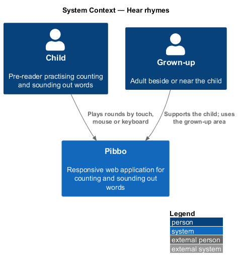
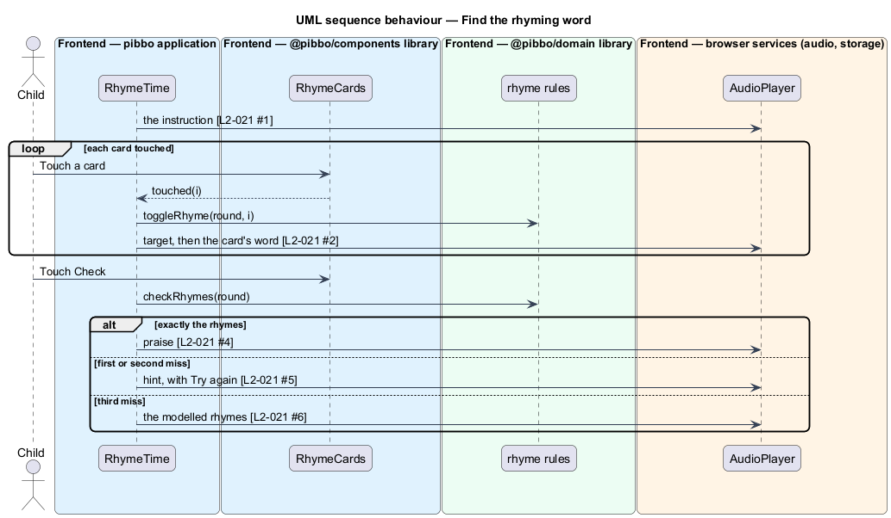

# Hear rhymes

## Overview

A word is spoken with its picture and four cards, each with a picture and a word, are offered. The child chooses every card that rhymes with it, then touches Check. Each touched card says the pair, so the round needs no reading (ADR 0025).

## Description

The feature is a vertical slice through the Angular workspace: the page in the `pibbo` application, presentation components in `@pibbo/components`, pure rules in `@pibbo/domain`, and the contracts and tokens in `@pibbo/api`.

- **`RhymeTime`** — route component in `pibbo` (`read/rhymes`), loaded by `loadComponent` when the child chooses the activity. It asks the rules for each round, plays recordings through `AUDIO_PLAYER`, times praise on `CLOCK` and hands state to the presentation component inside `pb-round-shell` with `pb-answer-bar`.
- **`RhymeCards`** — presentation component in `@pibbo/components` (selector `pb-rhyme-cards`): the target word with its picture and marked ending (`.rhyme-target`) and the cards (`.word-cards`). It emits `touched` with a card's index and injects no service.
- **`RhymeRound`** — immutable round state in `@pibbo/domain/sounds`: `choosing`, `retry`, `right` or `modelled`; every rule returns a new value.
- **Rules** — pure functions `startRhymeRound`, `toggleRhyme`, `canCheck`, `checkRhymes`, `chooseRhymesAgain` and `rhymeAssets`, with unit tests. The round and the card order come from the injected `RandomSource`.
- **Content** — `rhymes-content.json` in `@pibbo/domain/sounds`: each round names its target, its cards and its lines. The content check requires a picture and a recording for every word and a recording for every line.
- **`AudioPlayer`** — contract in `@pibbo/api` bound to `AUDIO_PLAYER`. Playing a recording stops the one before it; one that cannot play never blocks the round, whose words are shown.

## Requirements

The feature realises the following level-2 (L2) requirements. Each L2 requirement refines a level-1 (L1) requirement, cited by identifier.

| L2 ID | Refines (L1) | Requirement |
|-------|--------------|-------------|
| `L2-021` | `L1-019` | Hear rhymes |

Acceptance criteria of `L2-021` (Hear rhymes):

1. Given a round starts, when it is shown, then "cat" is shown with its picture and its ending marked, with four cards ("hat", "sun", "bat", "map") in an order the random source chooses; "Which words rhyme with “cat”? Find them all." is spoken and shown, and Check takes no touch.
2. Given a card, when shown, then it has a picture and its word; when touched, then "cat" and then that card's word are spoken, and the card is chosen and ticked, or unchosen if it was chosen, so the round needs no reading and more than one card can be chosen.
3. Given at least one chosen card, then Check takes a touch; given none, it takes none.
4. Given exactly "hat" and "bat" are chosen, when Check is touched, then both show as right, "Cat, hat, bat — they all end in “at”!" is spoken and shown as praise, and Next is offered; after the fifth round Next returns to Home with Read chosen.
5. Given any other choice, when Check is touched, then "Listen to the ends of the words: c-at…" is spoken and shown with Try again, the cards take no touch, and Try again lets the child choose afresh.
6. Given the third wrong Check in one round, when it is made, then "Listen: cat, hat, bat — they all end in “at”." is spoken and shown, "hat" and "bat" show as right, and Next completes the round (L2-026 #2).

## Diagrams

### System context

The child uses Pibbo directly; a grown-up is beside or nearby and is not needed to make the feature work. No third-party system takes part.

### Containers

The feature runs in the `pibbo` single-page application. Content arrives from `Pibbo.Api` through the service worker cache; nothing a child does is sent back.

### Components

`RhymeTime` composes `RhymeCards` for presentation and calls the rhyme rules for every decision. The page is the only part that injects tokens; the rules hold no Angular dependency.

### Class structure

`RhymeRound` is the value the rules transform; `RhymeTime` holds it in a signal and passes it to `RhymeCards`.

### Find the rhyming word

Each touched card speaks the target and its word; Check judges the whole choice.

## Open questions

- Which rhymes Hear rhymes covers, in what order, and the real recordings (ADR 0025).
