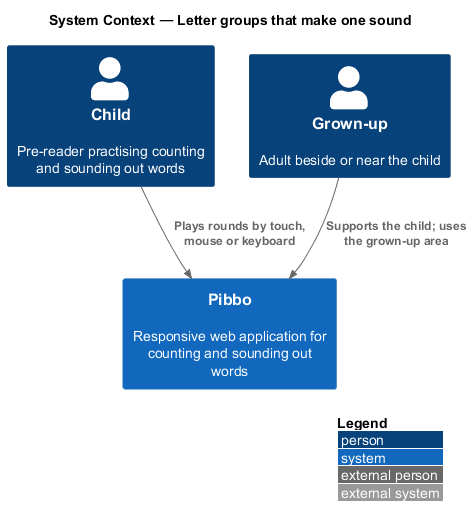
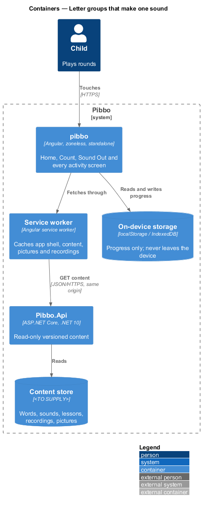
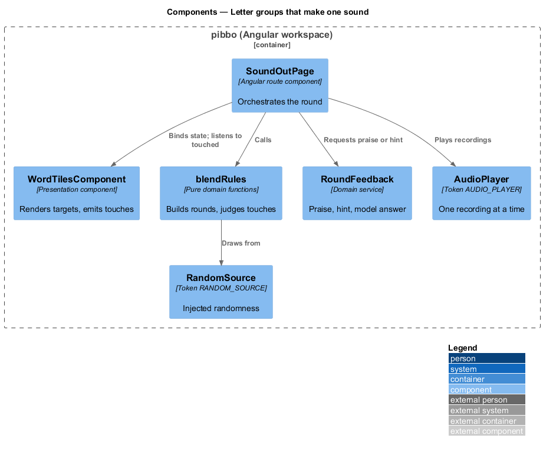
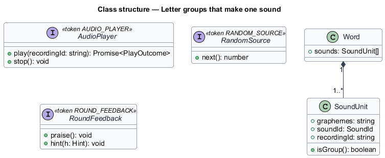
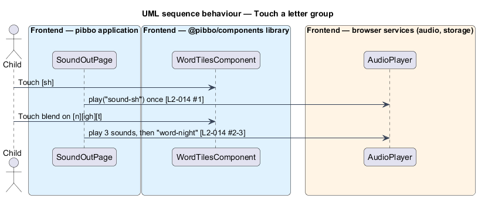

# Letter groups that make one sound

## Overview

Some sounds are written with more than one letter: *digraphs* (sh, ch, th, ck), *trigraphs* (igh, tch) and *vowel teams* (oa, ai, ee). Pibbo shows each as one joined tile that plays one recording.

- **letter group** — two or three letters that make one sound, shown as one tile

## Description

The feature is a vertical slice through the Angular workspace: the page in the `pibbo` application, presentation components in `@pibbo/components`, pure rules in `@pibbo/domain`, and the contracts and tokens in `@pibbo/api`.

- **`SoundOutPage`** — route component in `pibbo`, loaded by `loadComponent` when the child chooses the activity. It is provided with its own `blendRules` state at route scope, asks the rules for each round, plays recordings through `AUDIO_PLAYER` and hands state to the presentation component.
- **`WordTilesComponent`** — presentation component in `@pibbo/components` (selector `pb-wordtiles`). It takes the round state as signal inputs, emits a `touched` output per target, and injects no service.
- **`SoundOutRound`** — immutable round state in `@pibbo/domain/sounds`; every transition returns a new value.
- **`blendRules`** — pure functions in `@pibbo/domain/sounds` that build a round from the injected `RandomSource` and decide the outcome of each touch, with unit tests.
- **`AudioPlayer`** — contract in `@pibbo/api` bound to `AUDIO_PLAYER`. Playing a recording stops the one before it; a recording that cannot play resolves as `unavailable` and the screen shows the text instead.
- **`RoundFeedback`** — shared round behaviour (`retry-and-praise`): brief praise, hints after a wrong answer, and modelling the answer after three wrong answers.
- **`Reuse`** — this slice reuses `sound-out-and-blend`; a word's `sounds` list already carries one `SoundUnit` per sound, so [sh][i][p] has three units. The tile draws one outline around a group, at least 60 × 60 px.

## Requirements

The feature realises the following level-2 (L2) requirements. Each L2 requirement refines a level-1 (L1) requirement, cited by identifier.

| L2 ID | Refines (L1) | Requirement |
|-------|--------------|-------------|
| `L2-014` | `L1-012` | Letter groups that make one sound. Digraphs (sh, ch, th, ck), trigraphs (igh, tch) and vowel teams (oa, ai, ee) are shown as one joined tile that makes one sound. |

Acceptance criteria of `L2-014` (Letter groups that make one sound):

1. Given "ship" shown as [sh][i][p], when the child touches [sh], then one recording "shhh" plays, not "s" then "h".
2. Given "night" shown as [n][igh][t], when sounded out and blended, then three sounds play and "night" is spoken.
3. Given "boat" shown as [b][oa][t], when blended, then "boat" is spoken.
4. Given a letter-group tile, when displayed, then its letters share one tile outline and the tile is at least 60 x 60 px.

## Diagrams

### System context

The child uses Pibbo directly; a grown-up is beside or nearby and is not needed to make the feature work. No third-party system takes part.

### Containers

The feature runs in the `pibbo` single-page application. Content arrives from `Pibbo.Api` through the service worker cache; nothing a child does is sent back.

### Components

`SoundOutPage` composes `WordTilesComponent` for presentation and calls `blendRules` for every decision. The page is the only part that injects tokens; the rules hold no Angular dependency.

### Class structure

`SoundOutRound` is the value the rules transform; `SoundOutPage` holds it in a signal and passes it to `WordTilesComponent`.

### Touch a letter group

Touching a letter group plays its single recording, not one per letter.

