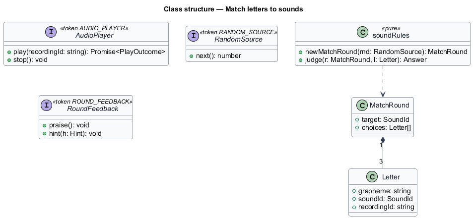
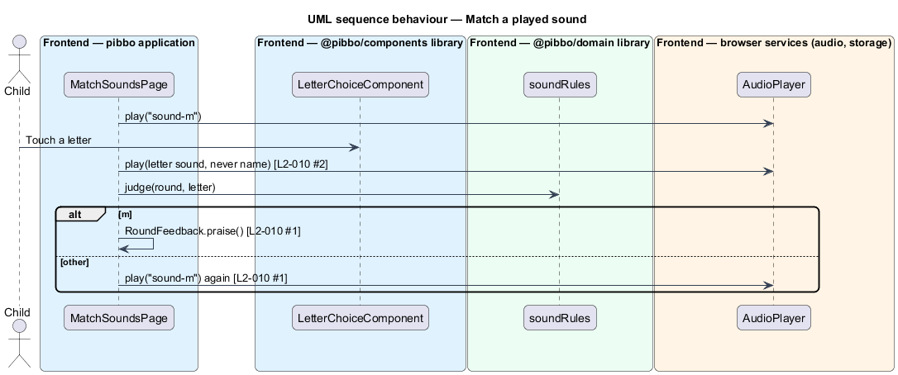

# Match letters to sounds

## Overview

Four letters are shown in one column and their four sounds in another, in a different order; each sound shows how it is written ("/m/") and a picture of a word it begins ("as in map"). The child touches a letter, which is held and makes its *sound*, never its name (m says "mmm", not "em"), then touches the sound it makes. A right partner joins the two in the same colour; a wrong one plays its sound and gives a small shake, and nothing else changes. When all four are matched, brief praise is spoken and shown and Next is offered. Every consonant recording is the sound alone, with no vowel added (ADR 0015).

- **pair** — a letter and its sound, with the picture of a word the sound begins
- **held** — the letter last touched, waiting for its sound (`aria-pressed`)
- **miss** — a sound touched that is not the held letter's: the sound plays and the card shakes

## Description

The feature is a vertical slice through the Angular workspace: the page in the `pibbo` application, presentation components in `@pibbo/components`, pure rules in `@pibbo/domain`, and the contracts and tokens in `@pibbo/api`.

- **`LetterSounds`** — route component in `pibbo` (`pb-letter-sounds`, `/read/letter-sounds`), loaded by `loadComponent` when the child chooses the activity. It holds the `LetterSoundsRound` in a signal, plays each recording through `AUDIO_PLAYER`, times the shake and the praise with the injected `CLOCK`, and hands state to the presentation component. The next round's pictures and recordings are fetched by the route-scoped `ASSET_PRELOADER` while the child plays this one.
- **`Pairs`** — presentation component in `@pibbo/components` (`pb-pairs`, the mock's `.pairs` and `.pair`). It takes the round as signal inputs and emits `letter` and `sound` with the index touched; it injects no service. A matched pair is marked by colour, by "matched" in its label and by no longer taking a touch.
- **`LetterSoundsRound`** — immutable round state in `@pibbo/domain/sounds`: `matching` or `right`, the letters, the sounds in the order shown, the held letter and the letters matched, in order.
- **Letter sounds rules** — `startLetterSoundsRound`, `holdLetter`, `matchSound`, `pairColour` and `letterSoundsAssets`, pure functions with unit tests. The sounds' order comes from the injected `RandomSource` and is never the letters' own order.
- **`AudioPlayer`** — contract in `@pibbo/api` bound to `AUDIO_PLAYER`. Playing a recording stops the one before it; a recording that cannot play resolves as `failed`, and the sound is already shown on its card ("/m/").
- **Content** — `letterSounds` in `sound-out-content.json`: the pairs (a sound key from the same sounds table Sound it out uses, the word it is "as in" and its picture), the instruction and the praise. `tools/content/check-content.mjs` fails the build when a pair names a sound that is not recorded or a picture or recording that is missing. The consonant audit (`L2-010` #4) is a content review checklist, not a test.

## Requirements

The feature realises the following level-2 (L2) requirements. Each L2 requirement refines a level-1 (L1) requirement, cited by identifier.

| L2 ID | Refines (L1) | Requirement |
|-------|--------------|-------------|
| `L2-010` | `L1-008` | Match letters to sounds |

Acceptance criteria of `L2-010` (Match letters to sounds):

1. Given the letters m, s, t, c and their sounds, when the child touches m and then the sound /m/, then /m/ is spoken, and m and /m/ are joined in the same colour, marked as matched and no longer take a touch; when all four are matched, then brief praise is spoken and shown and Next is offered.
2. Given any letter, when touched, then it is held and its sound ("mmm") is spoken, never its name ("em"); given any sound, when touched, then its recording is spoken.
3. Given t is held, when the child touches the sound /k/, then /k/ is spoken, the sound gives a small shake (none with reduced motion), t stays held, and nothing is taken away; there is no timer and no limit on tries.
4. Given every consonant recording in the content set, when audited against the content checklist, then each is the sound alone with no added vowel.

## Diagrams

### System context

The child uses Pibbo directly; a grown-up is beside or nearby and is not needed to make the feature work. No third-party system takes part.

### Containers

The feature runs in the `pibbo` single-page application. Its content, pictures and recordings are bundled and served from Pibbo's own origin; the frontend does not call the backend (ADR 0034), and nothing a child does is sent anywhere.

### Components

`LetterSounds` composes `Pairs` for presentation and calls the letter sounds rules for every decision. The page is the only part that injects tokens; the rules hold no Angular dependency.

### Class structure

`LetterSoundsRound` is the value the rules transform; `LetterSounds` holds it in a signal and passes it to `Pairs`.

### Match a played sound

Touching a letter holds it and plays its sound; touching a sound plays it and, with a letter held, matches the pair or shakes.

## Open questions

- **Diagrams.** The diagrams still carry the names drawn before journey 11 (`MatchSoundsPage`, `LetterChoiceComponent`, `soundRules`) and a content API; the text above is current, and the diagrams are redrawn when the design skill next runs over this feature.
- **Recordings.** The sound recordings are placeholder silences (ADR 0008); the consonant audit (`L2-010` #4) waits for the real recordings.
- **Which letters, and in what order.** The four pairs are the cast of the mock (m, s, t, c); which letters Letter sounds covers is not decided.
