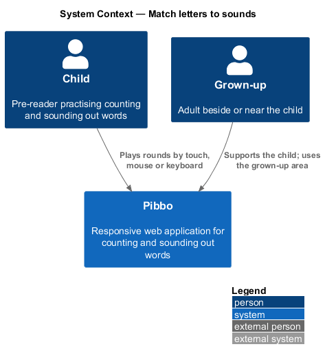
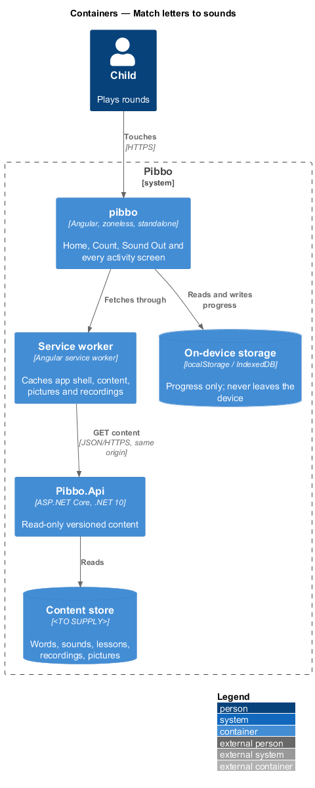
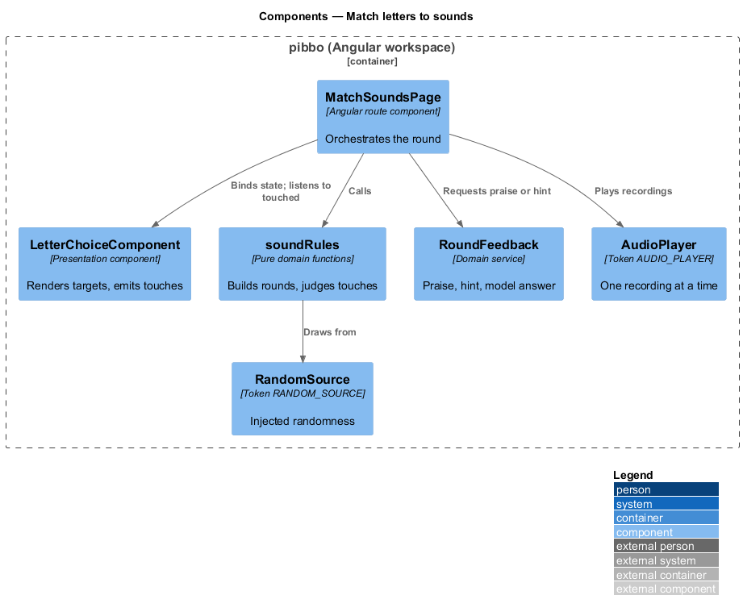

# Match letters to sounds

## Overview

A sound is played and three letters are shown; the child touches the letter that makes it. Each letter makes its *sound*, never its name: m says "mmm", not "em". Every consonant recording is the sound alone, with no vowel added.

## Description

The feature is a vertical slice through the Angular workspace: the page in the `pibbo` application, presentation components in `@pibbo/components`, pure rules in `@pibbo/domain`, and the contracts and tokens in `@pibbo/api`.

- **`MatchSoundsPage`** — route component in `pibbo`, loaded by `loadComponent` when the child chooses the activity. It is provided with its own `soundRules` state at route scope, asks the rules for each round, plays recordings through `AUDIO_PLAYER` and hands state to the presentation component.
- **`LetterChoiceComponent`** — presentation component in `@pibbo/components` (selector `pb-letterchoice`). It takes the round state as signal inputs, emits a `touched` output per target, and injects no service.
- **`MatchRound`** — immutable round state in `@pibbo/domain/sounds`; every transition returns a new value.
- **`soundRules`** — pure functions in `@pibbo/domain/sounds` that build a round from the injected `RandomSource` and decide the outcome of each touch, with unit tests.
- **`AudioPlayer`** — contract in `@pibbo/api` bound to `AUDIO_PLAYER`. Playing a recording stops the one before it; a recording that cannot play resolves as `unavailable` and the screen shows the text instead.
- **`RoundFeedback`** — shared round behaviour (`retry-and-praise`): brief praise, hints after a wrong answer, and modelling the answer after three wrong answers.
- **`Sound content data`** — the letter-to-sound table in `@pibbo/domain/sounds`; a build check proves every sound has a recording. The consonant audit (`L2-010` #3) is a content review checklist.

## Requirements

The feature realises the following level-2 (L2) requirements. Each L2 requirement refines a level-1 (L1) requirement, cited by identifier.

| L2 ID | Refines (L1) | Requirement |
|-------|--------------|-------------|
| `L2-010` | `L1-008` | Match letters to sounds |

Acceptance criteria of `L2-010` (Match letters to sounds):

1. Given the sound /m/ is played and 3 letters are shown, when the child touches m, then the same /m/ recording and praise play; when another letter is touched, then that letter's sound plays and /m/ is played again.
2. Given any letter tile, when touched, then its sound ("mmm") plays, never its name ("em").
3. Given every consonant recording in the content set, when audited against the content checklist, then each is the sound alone with no added vowel.

## Diagrams

### System context

The child uses Pibbo directly; a grown-up is beside or nearby and is not needed to make the feature work. No third-party system takes part.

### Containers

The feature runs in the `pibbo` single-page application. Content arrives from `Pibbo.Api` through the service worker cache; nothing a child does is sent back.

### Components

`MatchSoundsPage` composes `LetterChoiceComponent` for presentation and calls `soundRules` for every decision. The page is the only part that injects tokens; the rules hold no Angular dependency.

### Class structure

`MatchRound` is the value the rules transform; `MatchSoundsPage` holds it in a signal and passes it to `LetterChoiceComponent`.

### Match a played sound

Touching any letter plays its own sound; a wrong letter is followed by the target sound again.

