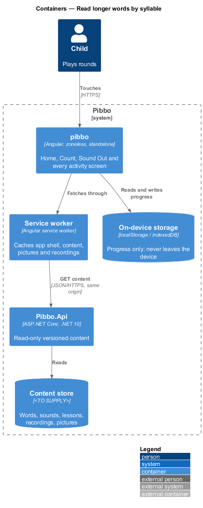
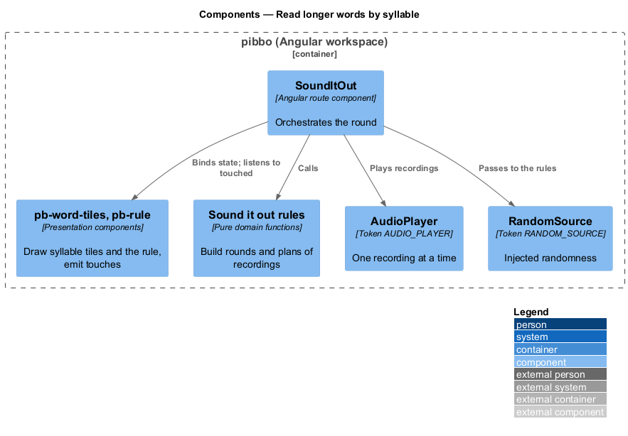
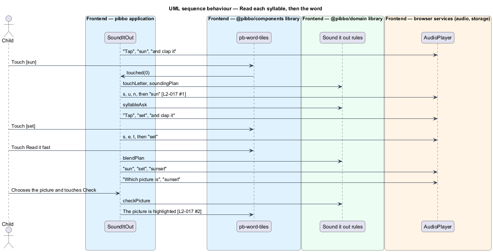

# Read longer words by syllable

## Overview

A two-syllable word ("sunset") is shown as one tile for each syllable. The child sounds out and blends each syllable, then blends the whole word. What the child sees and hears calls a syllable a "clap".

- **syllable** — one beat of a longer word, sounded out and blended on its own

## Description

The feature is a vertical slice through the Angular workspace: the page in the `pibbo` application, presentation components in `@pibbo/components`, pure rules in `@pibbo/domain`, and the contracts and tokens in `@pibbo/api`.

As built (ADR 0022), the feature lives inside Sound it out rather than in a page of its own:

- **`SoundItOut`** — the Sound it out route component in `pibbo`, loaded by `loadComponent`. For a longer word it shows and speaks which syllable to touch, plays each syllable's sounds and then the syllable through `AUDIO_PLAYER`, and runs the rest of the round as for any word.
- **`WordTiles`** — presentation component in `@pibbo/components` (selector `pb-word-tiles`). A syllable is one wide tile with its "clap 1" caption beneath, from the same inputs as a letter group.
- **`Rule`** — presentation component in `@pibbo/components` (selector `pb-rule`): the line above the tiles (`.rule`), "sun · set Read one beat at a time". `pb-silent-e` uses it too.
- **`SoundOutRound`** — immutable round state in `@pibbo/domain/sounds`, with one `heard` entry for each tile: a longer word's syllables, otherwise its sounds.
- **`shownSounds`, `soundingPlan`, `blendPlan`, `syllableAsk`** — pure functions in `@pibbo/domain/sounds`: the tiles to show; what a touch plays (a syllable's sounds then the syllable, all lighting its tile); what blending plays (the syllables then the word); and the instruction naming the next syllable, as text and as recordings. Unit tested.
- **`Syllable`** — contract in `@pibbo/api`: a `Sound` (the syllable on its tile, its caption, its recording) with the sounds that spell it. A longer `Word` carries `syllables`.
- **`AudioPlayer`** — contract in `@pibbo/api` bound to `AUDIO_PLAYER`. Playing a recording stops the one before it; a recording that cannot play resolves as `unavailable` and the screen shows the text instead.
- **Fit** — both syllable tiles keep one line at a 320 px wide viewport, each at least 60 × 60 px, with nothing to scroll.

## Requirements

The feature realises the following level-2 (L2) requirements. Each L2 requirement refines a level-1 (L1) requirement, cited by identifier.

| L2 ID | Refines (L1) | Requirement |
|-------|--------------|-------------|
| `L2-017` | `L1-015` | Read longer words by syllable |

Acceptance criteria of `L2-017` (Read longer words by syllable):

1. Given "sunset" shown as [sun][set] with `Tap “sun” and clap it.`, when the child touches [sun], then "sun" is sounded out and blended ("sss", "u", "nnn", "sun") with its tile lit, "clap 1" is shown beneath it, and [set] is then asked for and read likewise.
2. Given both syllables read, when the child touches blend, then "sun", "set" and "sunset" are spoken and three pictures are offered; when the child chooses the picture of "sunset" and touches Check, then that picture is highlighted; a wrong picture follows `L2-026`.
3. Given a 320 px wide viewport, when a two-syllable word is shown, then both syllable tiles fit on one line without scrolling or truncation.

## Diagrams

### System context

The child uses Pibbo directly; a grown-up is beside or nearby and is not needed to make the feature work. No third-party system takes part.

### Containers

The feature runs in the `pibbo` single-page application. Content arrives from `Pibbo.Api` through the service worker cache; nothing a child does is sent back.

### Components

`SoundItOut` composes `pb-word-tiles` and `pb-rule` for presentation and calls the Sound it out rules for every decision. The page is the only part that injects tokens; the rules hold no Angular dependency.

### Class structure

`SoundOutRound` is the value the rules transform; `SoundItOut` holds it in a signal and passes its tiles to `pb-word-tiles`.

### Read each syllable, then the word

A touch sounds out and blends one syllable; the final blend speaks the syllables and the word, and the word's picture is highlighted once it is chosen and checked.

## Open questions

- Which longer words and syllables Sound Out teaches, in what order, and their real recordings (ADR 0022).
- Whether a letter inside a syllable tile should light as its sound plays; the mock lights only the tile.

