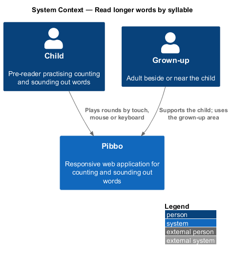
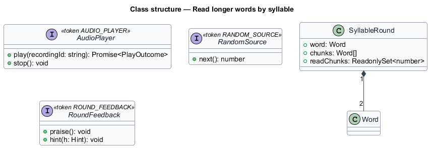

# Read longer words by syllable

## Overview

A two-syllable word ("sunset") is shown as two *chunks*. The child sounds out each chunk, then blends the whole word.

- **chunk** — one syllable of a longer word, sounded out and blended on its own

## Description

The feature is a vertical slice through the Angular workspace: the page in the `pibbo` application, presentation components in `@pibbo/components`, pure rules in `@pibbo/domain`, and the contracts and tokens in `@pibbo/api`.

- **`SyllablePage`** — route component in `pibbo`, loaded by `loadComponent` when the child chooses the activity. It is provided with its own `blendRules` state at route scope, asks the rules for each round, plays recordings through `AUDIO_PLAYER` and hands state to the presentation component.
- **`ChunkedWordComponent`** — presentation component in `@pibbo/components` (selector `pb-chunkedword`). It takes the round state as signal inputs, emits a `touched` output per target, and injects no service.
- **`SyllableRound`** — immutable round state in `@pibbo/domain/sounds`; every transition returns a new value.
- **`blendRules`** — pure functions in `@pibbo/domain/sounds` that build a round from the injected `RandomSource` and decide the outcome of each touch, with unit tests.
- **`AudioPlayer`** — contract in `@pibbo/api` bound to `AUDIO_PLAYER`. Playing a recording stops the one before it; a recording that cannot play resolves as `unavailable` and the screen shows the text instead.
- **`RoundFeedback`** — shared round behaviour (`retry-and-praise`): brief praise, hints after a wrong answer, and modelling the answer after three wrong answers.
- **`Fit`** — both chunks fit one line at a 320 px viewport; the tile size scales down within the 60 × 60 px minimum.

## Requirements

The feature realises the following level-2 (L2) requirements. Each L2 requirement refines a level-1 (L1) requirement, cited by identifier.

| L2 ID | Refines (L1) | Requirement |
|-------|--------------|-------------|
| `L2-017` | `L1-015` | Read longer words by syllable |

Acceptance criteria of `L2-017` (Read longer words by syllable):

1. Given "sunset" shown as [sun][set], when the child touches [sun], then "sun" is sounded out and blended; then [set] likewise.
2. Given both syllables read, when the child touches blend, then "sunset" is spoken and its picture is highlighted.
3. Given a 320 px wide viewport, when a two-syllable word is shown, then both chunks fit on one line without scrolling or truncation.

## Diagrams

### System context

The child uses Pibbo directly; a grown-up is beside or nearby and is not needed to make the feature work. No third-party system takes part.

### Containers

The feature runs in the `pibbo` single-page application. Content arrives from `Pibbo.Api` through the service worker cache; nothing a child does is sent back.

### Components

`SyllablePage` composes `ChunkedWordComponent` for presentation and calls `blendRules` for every decision. The page is the only part that injects tokens; the rules hold no Angular dependency.

### Class structure

`SyllableRound` is the value the rules transform; `SyllablePage` holds it in a signal and passes it to `ChunkedWordComponent`.

### Read each chunk, then the word

Each chunk is a small sound-out round; the final blend speaks the whole word and highlights its picture.

