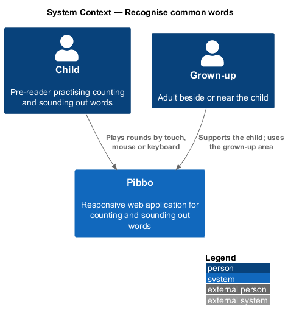
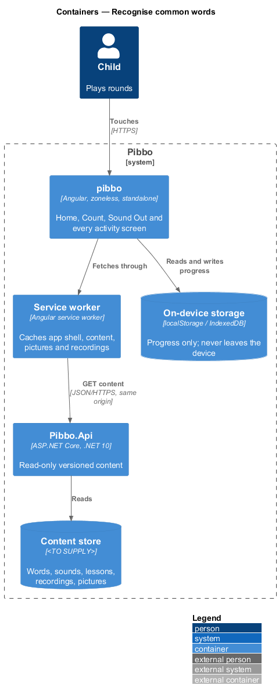
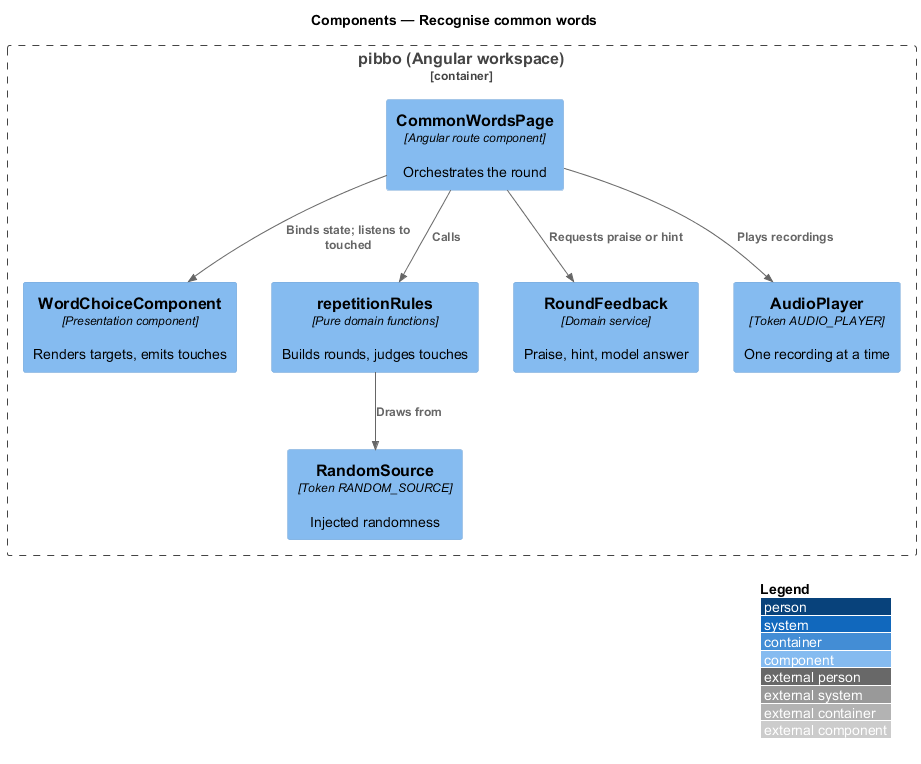
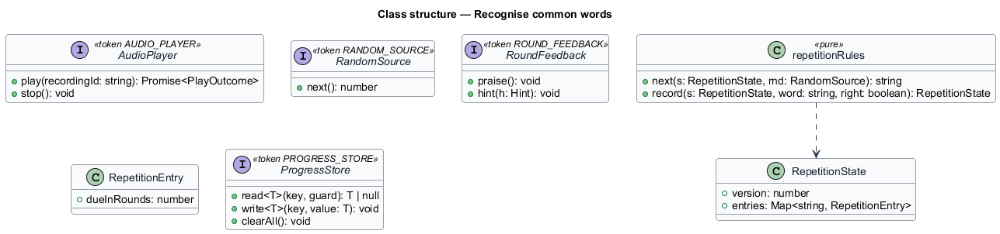
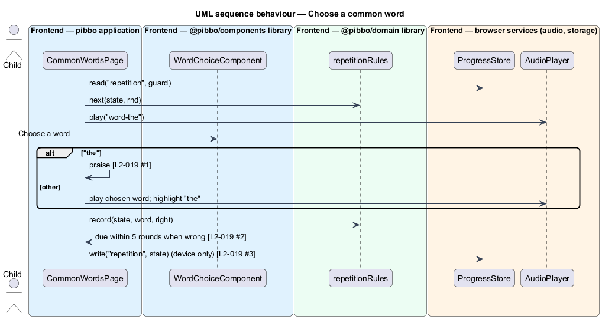

# Recognise common words

## Overview

Common words ("the", "is", "a") are high-frequency words a child finds by sight. In *Spot the word* the child hears a common word, sees it shown large, and touches every one of it in a short *story* (ADR 0022). A word missed in a round comes back in a later round while the activity is open.

- **story** — a few short sentences, every word of which is a touch target
- **due** — the common words missed in this play, asked again before any other; held at route scope and never stored

## Description

The feature is a vertical slice through the Angular workspace: the page in the `pibbo` application, presentation components in `@pibbo/components`, pure rules in `@pibbo/domain`, and the contracts and tokens in `@pibbo/api`.

- **`SpotTheWordPage`** — route component in `pibbo` (`/read/sight-words`), loaded by `loadComponent` when the child chooses the activity. It holds the round and the due words in signals at route scope, provides `ASSET_PRELOADER`, plays recordings through `AUDIO_PLAYER`, times the miss and praise through `CLOCK`, and hands state to the presentation component.
- **`SpotTheWord`** — presentation component in `@pibbo/components` (selector `pb-spot`). It takes the common word, the story, which words are found, the missed word and whether the round is done as signal inputs, emits a `word` output with the touched index, and injects no service. It keeps the mock's `.spot`, `.spot__find`, `.target-word`, `.found`, `.story` and `.story__word` classes.
- **`SpotRound`** — immutable round state in `@pibbo/domain/sounds` (`finding`, `right`); every transition returns a new value.
- **Spot rules** — pure functions in `@pibbo/domain/sounds`: `startSpotRound`, `touchStoryWord`, `endMiss`, `nextSpotWord` (from the injected `RandomSource` and the due words) and `spotAssets`, with unit tests.
- **`AudioPlayer`** — contract in `@pibbo/api` bound to `AUDIO_PLAYER`. Playing a recording stops the one before it; a recording that cannot play never blocks the round, because everything spoken is shown.
- **Content** — `common-words-content.json` in `@pibbo/domain/sounds`: the story's words as shown, the common words with their recordings, and the lines spoken around them, checked before every build by `tools/content/check-content.mjs`.

## Requirements

The feature realises the following level-2 (L2) requirements. Each L2 requirement refines a level-1 (L1) requirement, cited by identifier.

| L2 ID | Refines (L1) | Requirement |
|-------|--------------|-------------|
| `L2-019` | `L1-017` | Recognise common words. Common words are found by sight in a short story; a common word missed in a round comes back in a later round while the activity is open. |

Acceptance criteria of `L2-019` (Recognise common words):

1. Given a round asks for "the", when it is shown, then "Find every “the” in the story." is spoken and shown, "the" is shown large, one empty dot stands for each "the" in the story, and every word of the story is a touch target of at least 60 × 60 px with nothing scrolling.
2. Given the round, when the child touches a "the" (or "The"), then "the" is spoken, that word stays highlighted and takes no further touch, and one more dot is filled.
3. Given the round, when the child touches another word, then it greys for 0.4 s with no sound, and nothing found is lost.
4. Given every "the" is found, then "You found “the” 5 times!" is spoken and shown with Next, briefly, and the story takes no further touch; after 5 rounds Next returns to Home with Read chosen.
5. Given a common word missed in a round, when the next 5 rounds are chosen, then that word is asked in at least one of them.
6. Given what was missed, when the child leaves the activity, then it is forgotten: nothing is stored on the device or sent anywhere. Whether Pibbo remembers practice is not decided (`AGENTS.md`).

## Diagrams

### System context

The child uses Pibbo directly; a grown-up is beside or nearby and is not needed to make the feature work. No third-party system takes part.

### Containers

The feature runs in the `pibbo` single-page application. Its content is bundled; nothing a child does is stored or sent.

### Components

`SpotTheWordPage` composes `SpotTheWord` for presentation and calls the spot rules for every decision. The page is the only part that injects tokens; the rules hold no Angular dependency.

### Class structure

`SpotRound` is the value the rules transform; `SpotTheWordPage` holds it in a signal and passes it to `SpotTheWord`.

### Find a common word

A found word is spoken and stays found; a miss greys the word with no sound and makes the common word due within the next 5 rounds.

## Open questions

- Whether Pibbo remembers what a child has practised across visits, and so whether repetition outlives the activity (`AGENTS.md`, ADR 0022).
- Which common words and stories Pibbo covers, and in what order.
- The PNG renderings of the class, component and sequence diagrams predate journey 19; their `.puml` sources describe the feature as built and are re-rendered when PlantUML is to hand.
